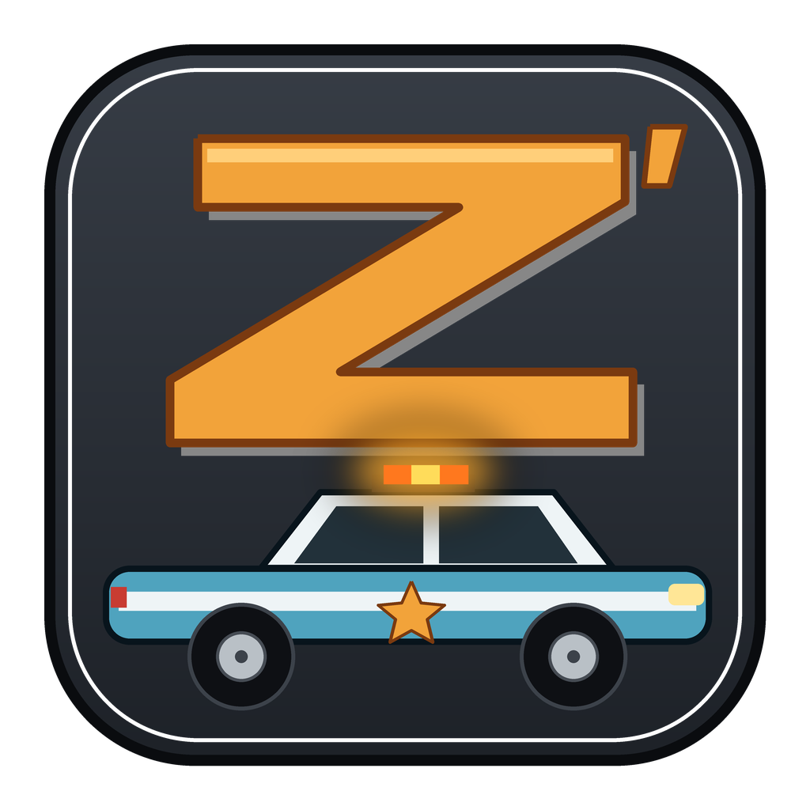
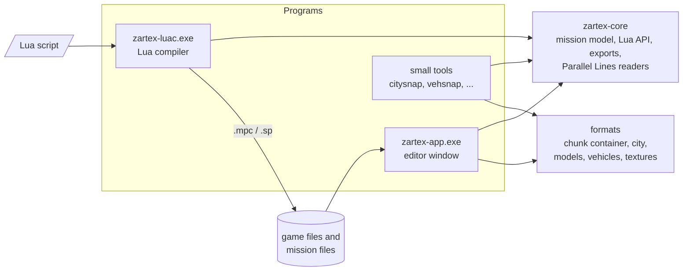

<p align="center">
  
</p>

<h1 align="center">Zartex'27</h1>

<p align="center">
  A mission editor and Lua compiler for Driv3r and Driver: Parallel Lines, written in Rust.
</p>

<p align="center">
  <a href="LICENSE"></a>
  
  
  <a href="https://github.com/lmonteirotech/zartex27/actions/workflows/ci.yml"></a>
  
  
</p>

---

## What it is

Zartex'27 reads, edits and builds the mission files of **Driv3r** (`.mpc`) and **Driver: Parallel Lines** (`.sp`). You can change a mission with a graphical editor, or write it as a Lua script, and see the city in 3D with the mission's actors, objects and cutscene cameras.

It is a Rust rewrite of the earlier tools **Zartex** and **Zartex 2**. Part of its core is a conversion of their logic, made with the help of a language model and checked by a person (see [Where the code comes from](#where-the-code-comes-from)). Everything else, the interface, the 3D views, the Parallel Lines city and the exports, is new work.

> Nothing from the games is included. Zartex'27 reads the files of your own installation.

## Features

**Editing**
- Logic graph of the mission: nodes, wires, wire types, colours.
- Inspector for nodes, actors and objects: edit properties, positions, camera aim and shot timing; delete actors and nodes (references are fixed up).
- "Add actor or node" dialog that creates anything the Lua API can create, with editable arguments.
- Mission overview: city, time of day, mood (weather, sky, music, light), traffic.
- `.bak` backup of the original on the first save.

**Lua**
- The Lua mission API of Zartex 2: **134 functions** and **84 constants**, Lua 5.2.
- `zartex-luac`: a command-line compiler for Lua scripts (Driv3r `.mpc`, Parallel Lines `.sp`).
- **Add to mission**: run a script on an open mission (`MISSION.GetActor(i)` and `GetNode(i)` reach what exists).
- **Export mission as Lua** in two forms: *readable* (API calls, with names taken from the notes) and *raw* (every field, exact).

**3D view**
- The textured city around the mission, with actors, objects and cameras; drag to move, Shift-drag for height, drag a camera's dot to aim it.
- Cutscene cameras: a timeline of the shots, play and scrub, a live preview with the mission's sky and light.
- Minimap with the mission's elements and the camera path.
- Optional 3D boxes for the selected vehicle or character.
- Graphics-card renderer (Vulkan) with an automatic fallback to the processor, and a switch to turn it off.

**Parallel Lines**
- Models and textures of the city files, one package at a time.
- The New York map: terrain tiles, about 140,000 props, a top-down minimap. Interiors are placed but not verified; the road data is not decoded yet.

**Interface**
- Windows 11 look, light and dark themes, accent colour (or the Windows accent colour).

## Supported systems

| System | Status |
|---|---|
| Windows 10, 64-bit (x64) | Supported |
| Windows 11, 64-bit (x64) | Supported |
| Anything else (Linux, macOS, 32-bit, ARM) | **Not supported at the moment** |

## Download and run

Download the zip of the latest release, unzip it, and run `zartex-app.exe`. It opens the window directly (no console). Set the game folders in **File > Settings** the first time.

## Build from source

You need the stable Rust toolchain for `x86_64-pc-windows-msvc` and the Visual Studio build tools.

```
cargo build --release
cargo test --release
```

The programs are in `target/release`. The tests that need a game installation are skipped unless you set `DRIV3R_DIR` (the first game) or `PL_DIR` (Parallel Lines).

## Command line

```
zartex-luac.exe script.lua -o mission.mpc          # compile for Driv3r
zartex-luac.exe script.lua -o mission.sp -dpl      # compile for Parallel Lines
zartex-app.exe mission.mpc --view3d                # open a mission in the 3D view
```

Every argument of both programs is listed in chapter 14 of the manual.

## Documentation

| Document | Where |
|---|---|
| **User manual** (PDF): every feature, every Lua function and constant, every command-line argument, and a complete tutorial for a first mission | [`docs/Zartex27_Manual.pdf`](docs/Zartex27_Manual.pdf) |
| Manual source: the text (`manual.md`) and the images, editable | [`docs/manual-source`](docs/manual-source/) |
| **Code structure**: what each source file does, what it calls and what calls it | [PDF](docs/architecture/Zartex27_Code_Structure.pdf) · [Markdown](docs/architecture/architecture.md) |
| Tutorial script | [`docs/tutorial_mission.lua`](docs/tutorial_mission.lua) |
| How to contribute | [`CONTRIBUTING.md`](CONTRIBUTING.md) |
| Changes | [`CHANGELOG.md`](CHANGELOG.md) |

## Code structure



- **`zartex-core`**: the library. It reads and writes the mission files, holds the mission model, runs the Lua mission API, compiles scripts, writes the two Lua exports and reads the Parallel Lines city files.
- **`zartex-app`**: the editor window (egui), the two 3D renderers (software and Vulkan), the city and world loading, the minimap, the cutscene preview, and the small command-line tools.
- **`crates/formats`**: readers for the game containers, models and city data.

The detailed documentation, with one entry for every source file, is in [`docs/architecture`](docs/architecture/architecture.md) (also as a [PDF](docs/architecture/Zartex27_Code_Structure.pdf)).

## Where the code comes from

- Part of **`zartex-core`** is a **conversion, made with the assistance of a language model and checked by a person, of logic that already existed in Zartex and Zartex 2**. That logic is not original to this repository. Each of those files says so in its header and lists what was adjusted, added or corrected here.
- **`crates/formats`** was brought into this repository from an in-development Rust game-engine reconstruction project ("game engine Rust Rework research").
- Everything else, the editor, the 3D views, the GPU renderer, the map loading, the cutscene preview, the Lua exports and the Parallel Lines city, is new work of this repository, and carries no such notice.

## Contributing

Contributions are welcome, tools and AI assistants included, as long as the person who sends the change **knows exactly what every change does**, and the review of the result is made by a human. Read [`CONTRIBUTING.md`](CONTRIBUTING.md).

## Credits and thanks

- **Fireboyd78, Mark Ludwig and CarLuver69** (the same person): **Zartex**, **DSCript** and the **Driver Tools**, the foundation of everything here.
- **BuilderDemo7**: **Zartex 2**, the Lua mission API and the support for Driver: Parallel Lines, and the only contributor listed in its repository.
- **LMonteiroSt**: Zartex'27.
- The whole **Driver Madness forum community**, and everyone who for years researched, documented and shared the formats, the tools and the knowledge about these games. This project stands on that work. Thank you.
- The authors of the open-source libraries used: egui, wgpu, mlua, glam, sysinfo and the others listed in the `Cargo.toml` files.

Driv3r and Driver: Parallel Lines belong to their owners. This project is not affiliated with them.

## License

Zartex'27 is free software, released under the **GNU General Public License, version 3 or (at your option) any later version**: you can use it, study it, change it and share it, **as long as you keep it open under the same license**. It cannot be closed, and its work cannot be taken private. The license also covers the code of the earlier tools, which came without a license of their own.

**The software and the source code are provided without any warranty.**

See [`LICENSE`](LICENSE).
