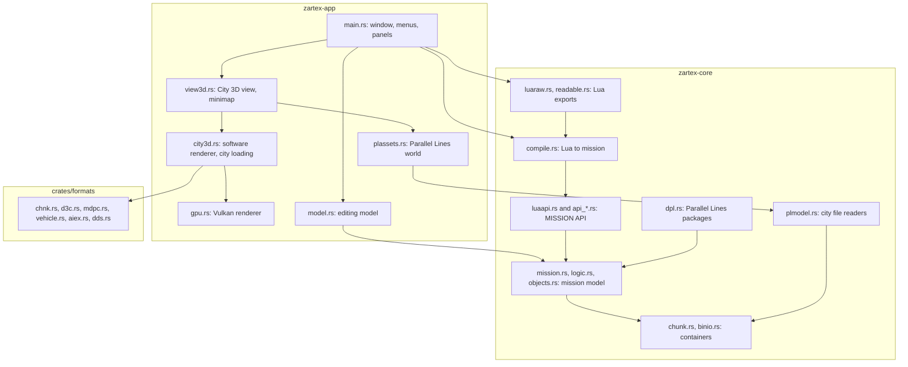

# Zartex'27: code structure

This document explains how the code of Zartex'27 is built. It is meant for people who want to read or change it, and it aims at **total transparency**: for every source file it says what the file is for, what it contains, which other files it calls, which files call it, and how data flows through it. It is not only a diagram; the diagram of the whole is in the [README](../../README.md), and this document is the detailed documentation that the README points to.

## How to read it

- Part 1 describes **`zartex-core`**, the library: containers, mission model, the Lua mission API, the exports and the Parallel Lines readers.
- Part 2 describes **`zartex-app`**, the editor window, the renderers and the small command-line tools.
- Part 3 describes **`crates/formats`** (readers for game containers and models) and the build and release files.
- "Calls" and "Called by" were computed from the `use` statements of the code and checked in the source.

## What the compiled software is

| Program | Built from | What it does |
|---|---|---|
| `zartex-app.exe` | `zartex-app/src/main.rs` and its modules | The editor: a Windows GUI program (no console window). Opens missions, edits them, runs Lua, shows the 3D views. |
| `zartex-luac.exe` | `zartex-core/src/bin/zartex-luac.rs` | Command-line compiler: Lua script in, `.mpc` or `.sp` mission file out. |
| `citysnap`, `vehsnap`, `charsnap`, `plansnap`, `d4cdump`, `mdxnprobe`, `edittest`, `camtest` | `zartex-app/src/bin/*.rs` | Small tools and checks used in development. Several include modules of the editor with `#[path]`. |

## How the crates link



## Where the code comes from

- Files marked **converted** are a conversion, made with the assistance of a language model and checked by a person, of logic that already existed in the earlier tools Zartex and Zartex 2. Their headers say so and list what this repository adjusted, added or corrected.
- Files marked **brought from the game engine Rust Rework research** came from an in-development Rust project.
- Files marked **new work** carry no such notice: the interface, the 3D views, the graphics-card renderer, the map loading, the cutscene preview, the Lua exports and the Parallel Lines city are new work of this repository.

---

# Part 1. zartex-core


## What the core does

1. `zartex-core` reads and writes Driver mission files, which are CHNK containers, into a typed model (`chunk.rs`, `mission.rs`, `logic.rs`, `objects.rs`).
2. The model (`ExportedMission`) holds actors, nodes, wire collections, mission objects, strings and sound banks.
3. A Lua mission script calls `MISSION.*` functions. These are registered in the Lua state by the `api_*.rs` files and fill a `ScriptState` (`script.rs`) in memory.
4. `compile.rs` runs the script (mlua, Lua 5.2), copies the `ScriptState` into the embedded `assets/template.mpc`, and returns the bytes of a `.mpc` mission.
5. Parallel Lines packages (`.sp`) take a second path: `api_dpl.rs` runs the script with a `PACKAGE` object and `dpl.rs` builds the package.
6. Two exports go from a mission back to Lua: `luaraw.rs` (`export_lua`) writes every item as raw `MISSION.Raw*` calls, and `readable.rs` (`export_readable`) writes API calls where a creator rebuilds the item exactly, and raw calls elsewhere.
7. `binio.rs` (byte cursor) and `chunk.rs` (container) are the bottom layer used by all of the above.
8. `plmodel.rs` is a separate set of readers for Parallel Lines model packages (MDXN), textures (PCMP, DDS), city tiles, props, interiors and roads. The application uses it to show the city.
9. `luaapi.rs` holds the argument conversion rules and the userdata types (Actor, Node, wire collection, summary) that scripts see.
10. `bin/zartex-luac.rs` is the command-line front end: it calls `compile::compile_file` or `api_dpl::compile_dpl_file`.

## Files

Order: crate root, containers and model, Lua API, compile and DPL driver, exports, Parallel Lines readers, binary. Paths are relative to `zartex-core/`. Line counts are from `deps.json`.

### `src/lib.rs` (24 lines)
**Purpose.** Crate root. Declares every module of the crate as `pub mod`.
**Origin.** New work of this repository.
**Main contents.** A module doc comment (Rust port of the DSCript chunk container, the mission model and the Lua mission API) and the list of 22 `pub mod` lines.
**Calls.** None.
**Called by.** `zartex-app` and the tests and binary of this crate use the modules through the crate name `zartex_core`.
**Data flow.** None. It only exposes the modules.

### `src/chunk.rs` (361 lines)
**Purpose.** Reads and writes the CHNK container: a tree of packages (with children) and buffers (raw bytes). It keeps the layout rules of the original so that a file saved without changes is byte-identical. The header says it is a port of DSCript.Spooling.
**Origin.** Converted from the logic of the earlier tools Zartex / Zartex 2, with the assistance of a language model and checked by a person (the file header says so). Changes made in this repository are not itemised for this file.
**Main contents.**
- `CHNK_MAGIC`, `CHUNK_VERSION` (3), `PADDING`, `align()`: format constants and alignment.
- `ChunkError`: error type (thiserror).
- `Common`, `Buffer`, `Package`, `Node` (enum: buffer or package): tree nodes with a context tag, a description, a dirty flag. `Package::push`, `remove`, `are_changes_pending`, `commit_changes`, `size`.
- `ChunkFile`: the whole file. `from_bytes`, `load`, `to_bytes` (lays out the tree), `save`.
- private `read_chunk` (parses recursively), `write_chunk`, `rd_i32`, `wr_i32`.
**Calls.** `thiserror` (external). No internal modules.
**Called by.** `binio.rs` (for `ChunkError`), `dpl.rs`, `mission.rs`, `plmodel.rs` (reads a package's chunk tree), and the tests `diff_tool.rs`, `golden.rs`, `transplant.rs`, `tree_diff.rs`.
**Data flow.** In: file bytes (`from_bytes`) or a path (`load`). The tree is parsed into `Node`s. Callers look up a node by its context tag and change its buffer data (`Buffer::set_data`), which marks it dirty. Out: `to_bytes` recomputes sizes and offsets for dirty parts and writes the whole file.

### `src/binio.rs` (156 lines)
**Purpose.** Little-endian reader and writer over byte slices, with the same behaviour as the .NET stream readers used by the original tools.
**Origin.** Converted from the logic of the earlier tools Zartex / Zartex 2, with the assistance of a language model and checked by a person (the file header says so). Changes made in this repository are not itemised for this file.
**Main contents.**
- `ModelError` (thiserror), `Res<T>`, `invalid()`.
- `Vec2`, `Vec3`, `Vec4` (f32 vectors).
- `Reader<'a>`: `bytes`, `u8`, `i16`, `u16`, `i32`, `u32`, `u64`, `i64`, `f32`, `vec2/3/4`, `align`, `rest`. Reads fail with `ModelError` when data runs out.
- `Writer`: the matching `u8` ... `vec4` writers, `pos`, `bytes`.
**Calls.** `chunk.rs` (for `ChunkError`, through `ModelError`), `thiserror`.
**Called by.** Almost every module that reads or writes binary data: `api_dpl.rs`, `api_gen.rs`, `api_manual.rs`, `api_part_a.rs`, `api_part_b.rs`, `api_part_c.rs`, `compile.rs`, `dpl.rs`, `logic.rs`, `luaapi.rs`, `luaraw.rs`, `mission.rs`, `objects.rs`, `readable.rs`, `script.rs`. In the app: `camera.rs`, `model.rs`, `view3d.rs`.
**Data flow.** In: a byte slice (`Reader::new`) or nothing (`Writer::new`). Each typed read advances the position. Out: `Writer::bytes` / `Writer` contents, which the callers hand to a buffer or a package.

### `src/logic.rs` (497 lines)
**Purpose.** The logic part of a mission: string table, sound banks, counters, wire collections, actor sets, node property definitions and the actor and node definitions. Each type has `load` and `save` with the byte layout of the original.
**Origin.** Converted from the logic of the earlier tools Zartex / Zartex 2, with the assistance of a language model and checked by a person (the file header says so). Changes made in this repository are not itemised for this file.
**Main contents.**
- `StringCollection` (`load`, `save`, `append_string`, `find_id`): string table; a string is referred to by index.
- `IntTable` (`load`, `save`, `append_unique`): integer list, used for sound banks and counters.
- `WireNode`, `WireCollection`, `WireCollections` (`load`, `save`): wires from one node to others, by type.
- `ActorSetTable`: actor sets.
- `PropValue` (enum, including `Raw` bytes and `Int`) and `Property` (`load`, `write_to`, `size`): a typed property of a node.
- `NodeDef` (`new`): one actor or node definition (type id, string id, object id, colour, flags, properties).
- `LogicCollection` (`new`, `load`, `save`): a list of `NodeDef` (used for actors and for nodes).
**Calls.** `binio.rs` (reader and writer).
**Called by.** `api_dpl.rs`, `api_fix.rs`, `api_gen.rs`, `api_manual.rs`, `api_part_a.rs`, `api_part_b.rs`, `api_part_c.rs`, `compile.rs`, `luaapi.rs`, `luaraw.rs`, `mission.rs`, `readable.rs`, `script.rs`; in the tests `lua_export.rs`, `part_b.rs`, `readable.rs`; in the app `camera.rs`, `creator_tools.rs`, `main.rs`, `model.rs`, `propedit.rs`, `bin/edittest.rs`.
**Data flow.** In: the bytes of the definitions, strings, wires and properties, from a `Chunk` buffer (via `mission.rs`), or from the Lua script state. Out: `save()` returns bytes for the same buffers. Lua API code edits the `Vec`s directly (for example `st.logic.actors.definitions`).

### `src/objects.rs` (325 lines)
**Purpose.** Mission objects: the placed items (vehicles, characters, volumes, areas, paths, icons, cameras, props, switches, collectables, animated props, markers) with their binary records.
**Origin.** Converted from the logic of the earlier tools Zartex / Zartex 2, with the assistance of a language model and checked by a person (the file header says so). Changes made in this repository are not itemised for this file.
**Main contents.**
- `MissionObject` (enum, 12 variants, one per type id 1 to 12): fields for each type, for example `Vehicle { creation_data, position, uid }`, `Camera { right, up, forward, position, reserved }`, `Marker { v1, position }`.
- `MissionObject::type_id`, `blank` (default for a type), `load` and `save` (private, one record), `save_creation_data`, `has_creation_data`, `alignment`.
- `ExportedMissionObjects` (`load`, `save`): the list of objects.
**Calls.** `binio.rs`.
**Called by.** `api_dpl.rs`, `api_manual.rs`, `api_part_a.rs`, `api_part_b.rs`, `api_part_c.rs`, `dpl.rs`, `luaraw.rs`, `mission.rs`, `readable.rs`, `script.rs`; tests `lua_export.rs`, `part_a.rs`, `part_b.rs`, `readable.rs`; app `camera.rs`, `main.rs`, `model.rs`, `view3d.rs`, `bin/camtest.rs`, `bin/citysnap.rs`.
**Data flow.** In: the bytes of the object buffer (`ExportedMissionObjects::load`), or objects created by the Lua API. Out: `save` gives the bytes, including creation data and alignment per record type.

### `src/mission.rs` (402 lines)
**Purpose.** The mission file as a whole: the exported mission (`EM__` package), the mission summary (`EMMS` buffer), and the file wrapper that loads and saves them through the chunk tree.
**Origin.** Converted from the logic of the earlier tools Zartex / Zartex 2, with the assistance of a language model and checked by a person (the file header says so). Changes made in this repository are not itemised for this file.
**Main contents.**
- `ctx(tag)`: turns a four-letter tag into the i32 context used by the chunk tree.
- `MissionSummary` (`load(d, dpl)`, `save`, `city_by_name`): start position, city type, mission id and related fields.
- `MissionInstanceData` (`load`, `save`), `LogicData` (`load`, `save`): the mission's logic buffers, including strings, sound banks, actors, nodes and wires.
- `ExportedMission` (`load`, `save`): the object list plus `LogicData`. Fields used by other modules: `logic`, `objects`.
- `MissionFile` (`from_chunks`, `from_bytes`, `to_bytes`): finds the `EM__` and `EMMS` nodes by a depth-first search (`find_dfs`) and keeps their paths. `to_bytes` writes the mission and summary back, then lays out the file.
- helpers `first_child`, `first_child_mut`, `buf_of`, `set_buf`, `pkg_of`, `pkg_of_mut`, `node_at`.
**Calls.** `binio.rs`, `chunk.rs` (tree and file), `logic.rs`, `objects.rs`.
**Called by.** `api_part_b.rs`, `compile.rs`, `dpl.rs`, `luaapi.rs`, `luaraw.rs`, `readable.rs`, `script.rs`; tests `lua_export.rs`, `model.rs`, `part_b.rs`, `readable.rs`, `snippet.rs`; app `creator_tools.rs`, `model.rs`, `bin/citysnap.rs`.
**Data flow.** In: file bytes (`MissionFile::from_bytes`), parsed into the chunk tree, then `ExportedMission::load` and `MissionSummary::load`. Out: `MissionFile::to_bytes` saves the model back into the tree and writes the chunk file.

### `src/dpl.rs` (345 lines)
**Purpose.** The Parallel Lines package (`.sp`): several missions in one file, with a spool lookup table. The package is built from nothing, not from a template.
**Origin.** Converted from the logic of the earlier tools Zartex / Zartex 2, with the assistance of a language model and checked by a person (the file header says so). Adjusted, added or corrected in this repository: reads the high 16 bits of the SSLP count field (kept in count_hi) and writes them back, so that the game's own packages open; skips the trailing BINF buffer of the game's own packages: a top-level child after the init container that is not a package is ignored.
**Main contents.**
- `ALIGN_MISSIONS`, `ALIGN_ROOT`: alignment constants.
- `SpoolSystemLookup` (`load`, `save`): the lookup table.
- `DplMission` (`new`, `summary_bytes`, `build_exported_mission`, `load_exported_mission`): one mission, from a script state or from an existing package.
- `DplPackage` (`add_mission`, `build_chunks`, `to_bytes`, `from_bytes`): the package; `build_chunks` builds the chunk tree.
**Calls.** `binio.rs`, `chunk.rs` (`ChunkFile`, `Package`, `Node`), `mission.rs` (`ExportedMission`, `MissionSummary`), `objects.rs`.
**Called by.** `api_dpl.rs` (builds the package from the script), `tests/dpl.rs`; app `model.rs`.
**Data flow.** In: `DplMission::new` values (name, id, position, flags), and an `ExportedMission` from the script. Out: `DplPackage::to_bytes` gives the `.sp` bytes. `from_bytes` reads them back.

### `src/script.rs` (242 lines)
**Purpose.** The runtime state of a Lua mission script: everything the API changes while the script runs. The Lua glue holds only indexes into it.
**Origin.** Converted from the logic of the earlier tools Zartex / Zartex 2, with the assistance of a language model and checked by a person (the file header says so). Adjusted, added or corrected in this repository: the X87 trait (xsin, xcos) reproduces the results of the 32-bit original, which used x87 fsin and fcos.
**Main contents.**
- `ScriptSummary` (start position, city type, mood id, locale id).
- `ScriptState` (fields: `objects`, `logic` (a `LogicData`), `wires`, `summary`, `spool_vehicles`, `working_dir`, `actor_setup`, `source_path`, `instances`). `new(working_dir)`.
- `ScriptState::string_id`, `note_id`, `prop`, `new_wire_collection`, `create_node`, `create_actor`, `add_wire`, `level_name`.
- `node_color`, `cast_byte`, `cast_int`, `cast_long`: C# casts for colours and numbers.
- `forward_from_radians`: angle to a forward vector.
- `X87` trait with `xsin` and `xcos`: sine and cosine computed as the 32-bit .NET process did with the x87 `fsin` and `fcos` (the header says so).
**Calls.** `binio.rs`, `logic.rs`, `mission.rs`, `objects.rs`.
**Called by.** `api_dpl.rs`, `api_fix.rs`, `api_gen.rs`, `api_manual.rs`, `api_part_a.rs`, `api_part_b.rs`, `api_part_c.rs`, `compile.rs`, `luaapi.rs`, `luaraw.rs`; tests `part_a.rs`, `part_b.rs`, `part_c.rs`.
**Data flow.** In: calls from the Lua API (`create_node`, `create_actor`, `string_id`, ...). Out: the state is read by `compile.rs` (into the template) and by `api_dpl.rs` (into a DPL package).

### `src/nodenames.rs` (236 lines)
**Purpose.** Name tables for node and actor type ids, used to write comments and to choose raw calls.
**Origin.** Converted from the logic of the earlier tools Zartex / Zartex 2, with the assistance of a language model and checked by a person (the file header says so). Adjusted, added or corrected in this repository: generated by tools_gen_api.py from NodeTypes.cs, then reviewed.
**Main contents.** `LOGIC_NODE_TYPES`, `LOGIC_NODE_TYPES_DPL`, `ACTOR_NODE_TYPES` (`(id, name)` tables); `lookup(table, id)`.
**Calls.** None.
**Called by.** `luaraw.rs` (comments in the exported script), `readable.rs` (names of raw items); app `creator_tools.rs`, `model.rs`.
**Data flow.** In: a type id. Out: a name string, or `None`.

### `src/creators.rs` (118 lines)
**Purpose.** Table of every API function that creates an actor or a logic node: name, whether it makes a node, and its parameters with types and defaults.
**Origin.** New work of this repository.
**Main contents.** `Param` (ty, name, default), `Creator` (name, makes_node, params), `CREATORS` (the table).
**Calls.** None.
**Called by.** `readable.rs` (learns each creator by trial); app `creators.rs`.
**Data flow.** Static data. `readable.rs` runs each creator in a sandbox to see which argument sets which field.

### `src/luaapi.rs` (628 lines)
**Purpose.** The Lua glue shared by all API files: argument conversion with the rules measured against MoonSharp (the Lua engine of the original tool), and the userdata types scripts see.
**Origin.** Converted from the logic of the earlier tools Zartex / Zartex 2, with the assistance of a language model and checked by a person (the file header says so). Adjusted, added or corrected in this repository: added a camelCase and a snake_case alias for every function and member of a mission table (`add_aliases`); added the MISSION.missionSummary userdata (SummaryH) with the members X, Y, MoodId, MissionId, LocaleId, MissionLocaleId, CityType and Level.
**Main contents.**
- `State` (`Rc<RefCell<ScriptState>>`), `rt_err`, `canon` (maps camelCase and snake_case to PascalCase), `add_aliases` (adds camelCase and snake_case names for every function of a table).
- `Args`: positional arguments with typed getters `int`, `uint`, `byte`, `short`, `long`, `float`, `double`, `boolean`, `string`, `actor`, `node`, `table`. Missing arguments take the default; `nil` becomes `None`; numbers are truncated.
- `dotnet_number_to_string`.
- Userdata: `ActorH` (index of an actor), `NodeH` (index of a node and its wire collection), `WiresH` (wire collection), `SummaryH` (summary). Their methods are in `add_methods` implementations; `prop_methods` gives the property setters of a node.
- `ret_actor`, `ret_node`: make the userdata to return to Lua.
**Calls.** `binio.rs`, `logic.rs`, `mission.rs`, `script.rs`; `mlua`.
**Called by.** Every `api_*.rs` file, `api_dpl.rs`, `compile.rs`, `luaraw.rs`, `readable.rs`; tests `part_a.rs`, `part_b.rs`, `part_c.rs`.
**Data flow.** In: Lua values (`MultiValue`). Out: typed Rust values for the creator functions, and Lua userdata returned to the script.

### `src/api_consts.rs` (190 lines)
**Purpose.** Registers the global constants of the mission script (for example the collectable kinds `COLLECTABLE_PISTOL`).
**Origin.** Converted from the logic of the earlier tools Zartex / Zartex 2, with the assistance of a language model and checked by a person (the file header says so). Adjusted, added or corrected in this repository: generated by tools_gen_api.py from the C# LuaMissionScript source and Collectable.cs, then reviewed.
**Main contents.** `register_constants(lua)`: sets each constant as a global.
**Calls.** `mlua`.
**Called by.** `api_dpl.rs` (`setup_dpl`), `compile.rs` (`setup_driv3r`).
**Data flow.** None at run time beyond setting globals.

### `src/api_gen.rs` (1820 lines)
**Purpose.** Generated part of the Lua API: the logic creators and the control functions (LogicStart, TruckDeliveryControl, ActorCreation, CounterWatch, FadeScreen, DPL-only functions and many more). The file is marked "do not edit" and says to fix the generator or port by hand.
**Origin.** Converted from the logic of the earlier tools Zartex / Zartex 2, with the assistance of a language model and checked by a person (the file header says so). Adjusted, added or corrected in this repository: generated by tools_gen_api.py from the C# LuaMissionScript source, then reviewed.
**Main contents.**
- `nre()`: the "Object reference not set" error.
- About 73 `pub fn` implementations, each taking `&mut ScriptState` and typed arguments, returning the new node (`(usize, usize)`). Each one checks argument types first, then calls `ScriptState::create_node`.
- `dpl_*` functions (for example `dpl_logic_start`, `dpl_marker_control`, `dpl_wanderer`): Parallel Lines variants.
- `register_generated(lua, t, st, dpl)`: adds the functions to the `MISSION` table; the `dpl` flag switches to the DPL variants.
**Calls.** `binio.rs`, `logic.rs`, `luaapi.rs`, `script.rs`; `mlua`.
**Called by.** `api_dpl.rs` (`mission_table`), `api_part_c.rs` (`actor_creation`, `countdown_intro`), `compile.rs` (`setup_driv3r`).
**Data flow.** In: Lua arguments through `Args`. Out: a node (and actor where needed) in `ScriptState`. `register_generated` is the entry point for the Lua table.

### `src/api_manual.rs` (131 lines)
**Purpose.** Hand-ported part of the Lua API, for the functions the generator cannot translate safely, and the registration of all API files.
**Origin.** Converted from the logic of the earlier tools Zartex / Zartex 2, with the assistance of a language model and checked by a person (the file header says so). Changes made in this repository are not itemised for this file.
**Main contents.**
- `nre()`, `reg(lua, t, st, name, f)`: registers one function with the state; a helper used by all API files.
- `create_character(...)`: the CreateCharacter creator (mission scripts only).
- `register_manual(lua, t, st, dpl)`: registers `CreateCharacter` (not in DPL), then calls `api_fix::register`, `api_part_a::register`, `api_part_b::register`, `api_part_c::register`.
**Calls.** `api_fix.rs`, `api_part_a.rs`, `api_part_b.rs`, `api_part_c.rs`, `binio.rs`, `logic.rs`, `luaapi.rs`, `objects.rs`, `script.rs`.
**Called by.** `api_dpl.rs` (`mission_table`), `api_fix.rs`, `api_part_a.rs`, `api_part_b.rs`, `api_part_c.rs`, `compile.rs` (`setup_driv3r`).
**Data flow.** In: the Lua table and the state. Out: functions registered on the table.

### `src/api_fix.rs` (73 lines)
**Purpose.** Methods that the generator translates wrongly. They are written by hand: the original builds a property list and then, if a name is given, replaces it, so the strings of both lists end up in the string table.
**Origin.** Converted from the logic of the earlier tools Zartex / Zartex 2, with the assistance of a language model and checked by a person (the file header says so). Adjusted, added or corrected in this repository: replaces the whole property list when a name is given, for CounterControl and CounterWatch, where the generated methods keep the first list.
**Main contents.** `counter_node` (builds a counter node), `register(lua, t, st, dpl)`.
**Calls.** `api_manual.rs` (`reg`), `logic.rs`, `luaapi.rs`, `script.rs`.
**Called by.** `api_manual.rs` (`register_manual`).
**Data flow.** In: Lua arguments. Out: a counter node in `ScriptState`.

### `src/api_part_a.rs` (1121 lines)
**Purpose.** Actor creators of the mission script: AI paths, test volumes, markers, areas, switches, AI targets, special effects, objective icons, vehicles, collectables, characters in vehicles, and cameras.
**Origin.** Converted from the logic of the earlier tools Zartex / Zartex 2, with the assistance of a language model and checked by a person (the file header says so). Changes made in this repository are not itemised for this file.
**Main contents.**
- Helpers: `color`, `lua_number`, `actor_or_neg`, `v3`.
- `create_ai_path`, `test_volume`, `marker`, `create_area`, `get_animated_object_at`, `create_switch`, `ai_target`, `special_effect`, `create_objective_icon`, `create_objective_icon_attached_to`, `create_vehicle`, `create_collectable`, `create_character_in_vehicle`, `create_camera`, `create_camera_looking_at_position`. Each creates the string, the actor definition, the object and returns the handle.
- `attached_icon_is_overload1`: chooses between the two overloads of CreateObjectiveIconAttachedTo by the argument types.
- `register(lua, t, st, dpl)`: registers them.
**Calls.** `api_manual.rs` (`reg`, `nre`), `binio.rs`, `logic.rs`, `luaapi.rs`, `objects.rs`, `script.rs`.
**Called by.** `api_manual.rs` (`register_manual`).
**Data flow.** In: Lua arguments. Out: actor definitions and mission objects in `ScriptState`.

### `src/api_part_b.rs` (610 lines)
**Purpose.** Other LuaMissionScript methods: `toflag`, actor settings and setups, wire collections, sound banks, actor lookup by id, UID and position setters, `FindPlayerActor`, `GetLogicStart`, `GetNodeById`, `ImportMissionScriptFromFile`, and the overloaded `SetChaseVehicle`, `SetCharacterForceGetOutVehicleTo`, `SetCharacterPositionTo`.
**Origin.** Converted from the logic of the earlier tools Zartex / Zartex 2, with the assistance of a language model and checked by a person (the file header says so). Changes made in this repository are not itemised for this file.
**Main contents.** `ActorSettingH`, `ActorSetupH` (userdata for actor settings), `is_ud`, `toflag`, `check_id`, `get_actor_by_id`, `get_node_by_id`, `find_player_actor`, `write_creation_data`, `create_actor_setting`, `import_file` (reads another script file), the overloads, and `register(lua, t, st, dpl)`. `register` adds the methods by hand because `reg()` would drop a leading table argument.
**Calls.** `api_manual.rs`, `binio.rs`, `logic.rs`, `luaapi.rs`, `mission.rs` (import), `objects.rs`, `script.rs`.
**Called by.** `api_manual.rs` (`register_manual`); test `tests/part_b.rs`.
**Data flow.** In: Lua arguments and userdata. Out: updates to actors, nodes, wires and objects in `ScriptState`.

### `src/api_part_c.rs` (752 lines)
**Purpose.** Character methods (name control, health, felony, weapons, animations, vehicle exit, drive and chase AI), fades, bomb car, point checks, audio, and clocks. All of them create logic nodes, or an actor and a node.
**Origin.** Converted from the logic of the earlier tools Zartex / Zartex 2, with the assistance of a language model and checked by a person (the file header says so). Changes made in this repository are not itemised for this file.
**Main contents.** About 37 functions such as `character_name_control`, `set_character_health_to`, `give_character_weapon`, `character_drive_to`, `character_chase_actor`, `bomb_car`, `play_audio`, `show_clock`, `start_clock`; helpers `reg_node`, `note_arg`, `reg_amount`, `reg_flags`; `register`. `register` returns at once when `dpl` is true (these methods are for mission scripts only).
**Calls.** `api_gen.rs` (`actor_creation`, `countdown_intro`), `api_manual.rs` (`nre`, `reg`), `binio.rs`, `logic.rs`, `luaapi.rs`, `objects.rs`, `script.rs`.
**Called by.** `api_manual.rs` (`register_manual`); test `tests/part_c.rs`.
**Data flow.** In: Lua arguments. Out: nodes (and actors) in `ScriptState`.

### `src/api_dpl.rs` (488 lines)
**Purpose.** The Parallel Lines driver. It sets up a Lua state with the `PACKAGE` and `INITMISSION` globals, runs the script, and turns the created missions into a `.sp` package.
**Origin.** Converted from the logic of the earlier tools Zartex / Zartex 2, with the assistance of a language model and checked by a person (the file header says so). Changes made in this repository are not itemised for this file.
**Main contents.**
- `MissionEntry` (state, name, id, position, flags, `define_root`) and `PackageEnv` (`init`, `created`, `added`).
- `register_dpl_methods`: DPL-only methods (for example `CountActor`, `DensityControl`).
- `dpl_create_character`, `dpl_create_vehicle`, `dpl_create_mission_actor`, `asset_densities`, `density_node`, `orientation`, `matrix`, `mission_table`, `new_entry`.
- `setup_dpl(lua, env)`: creates `INITMISSION` and `PACKAGE` (`CreateMission`, `AddMission`).
- `run_dpl_script(path)`: runs a script file and returns the `PackageEnv`.
- `compile_dpl_file(path)`: runs the script, converts the environment with `PackageEnv::to_package`, and returns the `.sp` bytes.
- `entry_to_mission`: converts an entry into a `DplMission`.
**Calls.** `api_consts.rs`, `api_gen.rs`, `api_manual.rs`, `binio.rs`, `compile.rs` (`new_lua`, `CompileError`), `dpl.rs`, `logic.rs`, `luaapi.rs`, `objects.rs`, `script.rs`.
**Called by.** `zartex-app/src/main.rs`, `zartex-core/src/bin/zartex-luac.rs`, tests `coverage_parity.rs`, `diff_tool.rs`, `lua_parity.rs`.
**Data flow.** In: a `.lua` file (BOM removed). Each `PACKAGE.CreateMission` call creates a `MissionEntry` with its own `ScriptState`; `AddMission` records the sub-mission id. Out: `PackageEnv::to_package` gives a `DplPackage`, whose `to_bytes` is the `.sp` file.

### `src/compile.rs` (181 lines)
**Purpose.** The mission script pipeline: runs a Driver Lua script, applies the result to the template, and returns the `.mpc` bytes. Also runs a snippet on an existing mission.
**Origin.** Converted from the logic of the earlier tools Zartex / Zartex 2, with the assistance of a language model and checked by a person (the file header says so). Adjusted, added or corrected in this repository: added seed_state, install_getters and apply_snippet: the "Add to mission" mode, which runs a script on an already open mission; setup_driv3r registers the raw calls of luaraw.rs in the MISSION table.
**Main contents.**
- `TEMPLATE_MPC`: the embedded `assets/template.mpc`.
- `CompileError` (`Lua(String)`, `Model(ModelError)`) with `Display`, and `From` conversions.
- `new_lua()`: Lua 5.2 with the table, string, math, bit and coroutine libraries only (the header says io, os and debug are not exposed).
- `setup_driv3r(lua, st)`: builds the `MISSION` table: `register_generated`, `register_manual`, `register_raw`, `add_aliases`, `missionSummary`; then `register_constants`.
- `run_driv3r_script(path)`: runs the file and returns the `ScriptState`.
- `compile_to_mpc(script)`: loads the template (`MissionFile::from_bytes`), replaces the actor and node definitions, wires, objects, strings, sound banks and summary fields, and returns `to_bytes`.
- `compile_file(path)`: the two steps above.
- `seed_state(mission, summary)`: a `ScriptState` that starts from an existing mission.
- `install_getters(lua, st)`: adds `MISSION.GetActor` and `MISSION.GetNode`.
- `apply_snippet(mission, summary, src)`: runs a snippet on a mission, and writes back the result.
**Calls.** `api_consts.rs`, `api_gen.rs`, `api_manual.rs`, `binio.rs`, `logic.rs`, `luaapi.rs`, `luaraw.rs`, `mission.rs`, `script.rs`.
**Called by.** `api_dpl.rs` (`new_lua`, `setup_dpl` helpers), `readable.rs` (`install_getters`, `new_lua`, `seed_state`, `setup_driv3r`), `bin/zartex-luac.rs` (`compile_file`), `zartex-app/src/main.rs` (`compile_file`, `apply_snippet`), `zartex-app/src/creator_tools.rs` (`apply_snippet`); tests `coverage_parity.rs`, `diff_tool.rs`, `lua_export.rs`, `lua_parity.rs`, `part_a.rs`, `part_b.rs`, `part_c.rs`, `readable.rs`, `snippet.rs`.
**Data flow.** In: a `.lua` path, or an `ExportedMission` for snippets. The script fills a `ScriptState`. Out: `Vec<u8>` for a `.mpc` (`compile_file`), or an updated `ExportedMission` (`apply_snippet`).

### `src/luaraw.rs` (345 lines)
**Purpose.** Export of a mission to Lua without loss. Each object, actor and node is written as one raw `MISSION.Raw*` call, and wires as `N[i].wireCollection.Add(...)`. `register_raw` provides these calls, so the script compiles back to the same mission.
**Origin.** New work of this repository.
**Main contents.**
- `export_lua(mission, summary, title, game_dpl)`: writes the script text (summary, sound banks, objects, actors, nodes, wires).
- `prop_lua`, `object_lua`: one property or object as Lua text.
- Formatting helpers `ff` (float), `lstr` (string), `bytes`, `v3`, `v4`.
- `register_raw(lua, mission, st)`: adds `RawSummary`, `RawSoundBanks`, `RawObject`, `RawActor`, `RawNode` and related functions.
- `parse_prop`, `parse_object`: read the arguments of the raw calls back into the model. `Cur` is a small reader for the raw byte arguments.
**Calls.** `binio.rs`, `logic.rs`, `luaapi.rs`, `mission.rs`, `nodenames.rs`, `objects.rs`, `script.rs`; `mlua`.
**Called by.** `compile.rs` (`setup_driv3r`), `readable.rs` (`export_lua`, `ff`, `lstr`, `object_lua`, `prop_lua` for raw items), `zartex-app/src/main.rs` (`export_lua`); test `tests/lua_export.rs`.
**Data flow.** Export: `ExportedMission` in, script text out. Register: the raw calls put values into a `ScriptState`; `compile.rs` then writes it to a mission.

### `src/readable.rs` (1013 lines)
**Purpose.** Export of a mission as readable API calls (`MISSION.CreateCharacter(...)`, `MISSION.ActorCreation(...)`, `node.wireCollection.Add(...)`). The exporter learns from the creators which argument sets which field, and writes an item as an API call only if the call rebuilds it exactly. Anything else is written with the raw calls.
**Origin.** New work of this repository.
**Main contents.**
- `Stats`: counts of actors and nodes, how many came out readable, how many were normalized, approximated or written raw (`raw_kinds`).
- `Sandbox`: a Lua state with the mission loaded (`new` uses `seed_state`, `setup_driv3r`, `install_getters`); each trial runs one creator call and rolls the state back.
- `learn(sb, creator)`: finds which argument of a creator sets which field, by changing one argument at a time.
- `plan_item`, `plan_pass`: decides, for each actor and node, whether a creator rebuilds it exactly.
- `resolve`, `RDef`, `RVal`, `RProp`: definitions with string ids replaced by their text, so two definitions can be compared.
- `relaxed`, `loose_obj_eq`, `fmt_f32`, `fmt_angle`: comparisons that ignore the fields the API cannot set.
- `export_readable(mission, summary, title, game_dpl) -> (String, Stats)`: the entry point. If the sandbox cannot be made, it returns `export_lua`'s output.
**Calls.** `binio.rs`, `compile.rs` (`install_getters`, `new_lua`, `seed_state`, `setup_driv3r`), `creators.rs`, `logic.rs`, `luaapi.rs` (`State`), `luaraw.rs` (`export_lua`, `ff`, `lstr`, `object_lua`, `prop_lua`), `mission.rs`, `nodenames.rs`, `objects.rs`; `mlua`.
**Called by.** `zartex-app/src/main.rs` (`export_readable`); test `tests/readable.rs`.
**Data flow.** In: `ExportedMission`, optional `MissionSummary`, title. The sandbox runs `CREATORS` calls, the items are planned, and the script is written. Out: script text and `Stats`.

### `src/plmodel.rs` (1160 lines)
**Purpose.** Readers for Parallel Lines model packages (MDXN version 1), the PCMP material and texture block inside them, the city tiles, props, interiors and roads. Positions are model-local and Z-up as stored, with no axis swap.
**Origin.** New work of this repository.
**Main contents.**
- Data types: `PlPackage` (models and materials), `PlModel`, `PlSubMesh` (vertices, indices, `has_material`), `PlMaterial`, `PlSubstance`, `PlTexture` (with DDS bytes), `TexFormat`, `VbDecl`, `PackageRef`, `TilePlacement`, `PropPlacement`.
- `parse_package(chunk_data)`: parses one MDXN package: its sub-models, index runs, vertices, materials and textures.
- `decode_rgba(texture)`: decodes mip 0 of a DDS texture to RGBA8 (DXT and RGB565 blocks, `decode_block`, `dxt5_alpha_table`).
- `find_packages(path)`: walks the `.d4c` chunk file and returns the MDXN data of every GEGR and GESR package (reads the whole file).
- `index_packages(path)`, `load_package(path, ref)`: the same, but read only the chunk tables first, then one package on demand.
- `read_tiles(path)`: terrain tiles of the city from the GEBI record of the global package.
- `read_super_ids(path)`: super region id of each GESR.
- `read_props(path)`: props of every region (GEIR, GEBI v10 records).
- `index_interiors(path)`, `read_interior_props(path)`, `read_entrances` (private): interior packages and the props they place.
- `read_roads(path)`: road polylines from the global AIEX chunk. The header marks it EXPERIMENTAL and says it does not line up with the streets.
- `dds_total_size`, `dds_dims`, `rd_at`, `chunk_entries`, `record_index`, `to_off`, `to_count`: helpers.
**Calls.** `chunk.rs` (`ChunkFile`, `Node`). `std` only otherwise.
**Called by.** `zartex-app/src/plassets.rs`.
**Data flow.** In: a `.d4c` or city file path. Out: packages, textures (RGBA bytes on request), and placement lists for the viewer. Test helpers in the `tests` module (`write_png`, `write_obj`, `crc32`) write PNG and OBJ files; they are used only by the test module.

### `src/bin/zartex-luac.rs` (39 lines)
**Purpose.** Command-line compiler for Driver and Driver: Parallel Lines Lua scripts. It replaces the original LuaC compiler.
**Origin.** Converted from the logic of the earlier tools Zartex / Zartex 2, with the assistance of a language model and checked by a person (the file header says so). Changes made in this repository are not itemised for this file.
**Main contents.** `main()`: reads the arguments `<script.lua> [-o out] [-dpl]` (`-driver4` is also accepted for DPL), prints LuaC-style messages, calls the compiler, writes the output (default `mission.mpc`, or `mission.sp` with DPL), and exits with status 1 on error.
**Calls.** `zartex_core::api_dpl::compile_dpl_file`, `zartex_core::compile::compile_file`.
**Called by.** Run from the command line. Nothing in the repository calls it.
**Data flow.** In: a script path and options. Out: the `.mpc` or `.sp` file, and console messages.

## Test files (`tests/`)

- `coverage_parity.rs`: runs a Lua script for each API method and overload (from `oracle/cov`) and checks that the Rust compiler fails when the original failed and produces identical bytes when it succeeded.
- `diff_tool.rs`: ignored debug test; compares the buffers of a script's output with a golden file (environment variables `ZARTEX_DIFF`, `ZARTEX_GOLDEN`).
- `dpl.rs`: rebuilds a golden `.sp` package from the model and compares the bytes; checks the default extras of CreateMission.
- `golden.rs`: identity round trip of every golden file and of the template through `ChunkFile`.
- `lua_export.rs`: mission to `export_lua` to mission; the rebuilt actors, nodes, properties, wires, objects and sound banks must match, for the samples and for installed missions.
- `lua_parity.rs`: compiles the sample scripts and the DPL scripts and compares the bytes with the golden `.mpc` and `.sp` files.
- `model.rs`: parses the golden `.mpc` files into the model and saves them again; the bytes must match.
- `part_a.rs`: runs every part-a creator from Lua and checks the definitions created.
- `part_b.rs`: smoke tests of the part-b methods (for example `toflag`, actor setup, actor lookup, chase vehicle overloads, importing a script file).
- `part_c.rs`: runs every ported part-c method once and checks the nodes it creates.
- `readable.rs`: mission to `export_readable` to mission; the rebuilt definitions must match, and the test reports how many items came out as readable calls.
- `snippet.rs`: `apply_snippet` appends and wires new nodes on the `survival` golden mission, and fails for a missing node.
- `transplant.rs`: replaces buffers of the template with golden buffers, marks them dirty, saves, and compares with the golden file (tests the container's dirty and layout logic).
- `tree_diff.rs`: ignored debug helper that prints the chunk tree of golden files.

## How this part fits together

The core has four layers. `chunk.rs` and `binio.rs` read and write the CHNK container and the little-endian fields. `mission.rs`, `logic.rs`, `objects.rs` and `dpl.rs` turn these into the typed mission model, and `script.rs` holds the state a running script changes. The Lua API is spread over `luaapi.rs` (argument rules and userdata), `api_gen.rs` (generated creators), the hand-ported `api_manual.rs`, `api_fix.rs`, `api_part_a.rs`, `api_part_b.rs` and `api_part_c.rs`, and the constants in `api_consts.rs`. `compile.rs` (Driver missions) and `api_dpl.rs` (Parallel Lines packages) run a script and produce the output file. The two exports, `luaraw.rs` and `readable.rs`, go the other way, from a mission to a script; `readable.rs` uses the `creators.rs` table and runs the creators in a sandbox that `compile.rs` sets up. `plmodel.rs` is independent of the mission model: it reads the Parallel Lines model and city files through `chunk.rs` for the application. `zartex-luac.rs` only calls the two compile entry points.

## Unclear from the code

- The origin of `chunk.rs`, `binio.rs` and `plmodel.rs` is not stated in their headers (see each entry).
- `mission.rs` does not state its origin in its header.
- The `CONTRIBUTING.md` says every file header states its origin. Most headers in this crate do not, so the origin labels above are based on the header wording where it exists.
- `creators.rs` names `tools/tools_gen_creators.py` in its header; the repository has `tools/tools_tools/tools_gen_creators.py`. Not checked further.


---

# Part 2. zartex-app


Repository root: `F:\Games\Independent\DRIV3R Tools\Zartex27`. Crate path: `zartex-app/`. Line counts are those of `wc -l`.

## What the app does

1. `zartex-app.exe` is the editor window, titled "Zartex'27", built with eframe/egui; it has no system title bar (`with_decorations(false)`) and starts at 1320 x 820 (minimum 900 x 600).
2. The window has a toolbar (Open, Save as, Fit graph, Logic graph / City 3D switch, Compile Lua, mission picker), a left panel (Missions, Objects, Assets tabs and a Driv3r / Parallel Lines switch), a centre panel (logic graph or City 3D), a right inspector, a bottom panel (Console, Cameras, Lua script, Warnings) and a status bar.
3. The menus are File, View, Lua and Help. File holds New Driv3r mission, Open, Save, Save as, Settings and Exit.
4. Opening a `.mpc` (Driv3r) or `.sp` (Parallel Lines) file builds a `Project` (`model.rs`). A `.mpc` gives one view; a `.sp` gives an Init view and one view per sub-mission.
5. The editing model: the UI queues `Edit` values in `App.pending` during a frame; `apply_pending` applies them to the in-memory copy and sets the dirty flag. Save writes the edited mission back in the file's own format. The first save in place keeps a `.bak` copy of the original.
6. Lua: the Lua tab text is compiled by `zartex-core` (`compile::compile_file`, or `api_dpl::compile_dpl_file` for scripts that use PACKAGE or INITMISSION) into a new `Project`. "Add to mission" runs a snippet on the open Driv3r mission with `compile::apply_snippet`. Export writes the mission as Lua with `readable::export_readable` or `luaraw::export_lua`.
7. Two 3D renderers: the software renderer is `city3d::render_vp`, a z-buffered textured triangle rasteriser on the CPU. The graphics-card renderer is `gpu.rs`, which uses wgpu restricted to Vulkan. It is probed once at start and used unless the user turns it off; when it returns no frame, the CPU renderer runs instead.
8. Driv3r city: `CityStore::open` reads the city's `.d3c`, `SuperRegions.pcs` and `Interiors.pcs` from the game folder in a background thread. `CityStore::region` then builds the geometry near the camera target (radius 650 with the graphics card, 260 with the CPU).
9. Parallel Lines world: `PlWorld::open` reads the `*_pc.d4c` city file in a background thread (through `zartex-core::plmodel`) and gives terrain tiles, props, ground heights and road polylines. Parallel Lines missions use this world instead of the Driv3r city.
10. Minimap: a 270 px square at the top right of the 3D view. Its plan image is built once per city in a thread (`CityStore::plan` or `PlWorld::plan`). It shows building footprints, roads, mission objects and the visible area. A click or drag moves the 3D view, a right-drag pans the minimap and scroll zooms it.
11. Cutscene preview: `camera::shots` orders the `CameraSelect` nodes into a shot list with durations and blends; `camera::pose_at` gives the camera at a time t. The Cameras tab plays this, and a 384 x 216 preview in the corner of the 3D view draws it, with the mood's sky dome and lighting when the mission has them.
12. Other crates: `zartex-core` provides the mission model, logic and object types, compile and export, and the Lua API names; `formats` (`chnk`, `d3c`, `dds`, `mdpc`, `aiex`, `vehicle`) reads the game's files. Settings are stored in `%APPDATA%\ZartexM\settings.txt`.

## How the crate is organised

- `src/main.rs`: the application (`App`) and all its panels, menus and windows.
- `src/model.rs`: the view model (`Project`, `MissionView`), the edit types and their application, and the logic graph layout.
- `src/view3d.rs`: the City 3D tab (`CityView`): camera control, picking, dragging, camera preview and minimap.
- `src/city3d.rs`, `src/gpu.rs`: the two renderers and the Driv3r city loader.
- `src/plassets.rs`: the Parallel Lines city world and the asset lists for Parallel Lines.
- `src/camera.rs`: the cutscene camera sequence.
- Panels and small widgets: `overview.rs`, `propedit.rs`, `modelbox.rs`, `mood.rs`, `missions.rs`, `assets.rs`, `creator_tools.rs`.
- Data and configuration: `settings.rs`, `theme.rs`, `about.rs`, `skin_names.rs`, `creators.rs`, `vehicle3d.rs`, `character3d.rs`.
- `src/bin/*.rs`: eight developer tools (see the last section).
- `build.rs` and `assets/`: build-time values and the program icon.

---

## Source files

### `zartex-app/src/main.rs` (2408 lines)
**Purpose.** The application: the window, its panels and menus, the frame loop, file open and save, Lua compile and run, and the Add, Settings and About windows. It is the crate root, so it declares all the other modules.
**Origin.** New work of this repository.
**Main contents.**
- `enum Sel`, `Bottom`, `LeftTab`, `Asset`, `Center`, `Level`: the selection, bottom tab, left tab, chosen asset, centre view and log severity.
- `struct App`: every piece of UI and project state (see the table below).
- `SAMPLE_LUA`: the script used by the Lua tab and by New Driv3r mission.
- `App::new`: start-up, including settings, fonts, GPU hook, folder scan and command-line and `ZM_*` environment options.
- `App::rescan`, `App::pick_path`: read the game folders and the mood list; choose a game folder.
- `App::export_lua`, `App::run_snippet`, `App::add_snippet`: Lua export and running Lua on the open mission.
- `App::open_path`, `App::compile_lua`, `App::save_as`, `App::save_in_place`: open and save.
- `App::apply_theme`, `App::apply_pending`, `App::log`, `App::get_layout`: theme, edit queue, console, graph layout cache.
- `impl eframe::App::ui`: the frame loop.
- `top_bar`, `status_bar`, `bottom_panel`, `left_panel`, `right_panel`, `city_tab`, `title_bar`, `cameras_panel`, `pl_assets_tab`, `assets_tab`, `pl_preview`, `asset_preview`, `missions_tab`, `add_window`, `about_window`, `settings_window`, `graph`: the panels and windows.
- `menu_item`, `tab_button`, `flat_buttons`, `kv`, `counts`, `main`, `app_icon`: helpers and entry point.

Parts of `main.rs` (line numbers are those of the file):

| Part (lines) | What it does | Main functions |
|---|---|---|
| Crate header and modules (1-26) | Hides the console window in release builds on Windows. Declares the 20 modules and imports `model::*` and `settings::{Game, Scan, Settings}`. | (none) |
| Small enums (28-73) | `Sel`: nothing, a logic node, an actor or an object. `Bottom`: Console, Lua, Warnings, Cameras. `LeftTab`: Objects, Missions, Assets. `Asset`: sky, mood, vehicle, skin, Parallel Lines texture or model. `Center`: Graph or City. `Level`: Info, Ok, Err. | (types) |
| `App` struct (75-138) | Holds the open project, the selection, the graph pan and zoom, the log, the Lua text, the settings and scans, the pending edits, the cutscene clock, the theme state, the asset choice, the caches, the 3D views and the screenshot automation fields. | `App` |
| `SAMPLE_LUA` (140) | The sample script for a new Driv3r mission. | (constant) |
| Start-up (142-300) | Loads settings, installs fonts, installs the GPU hook and applies the GPU setting, rescans the game folders, opens the window's arguments and reads the `ZM_*` variables. | `App::new` |
| Game folders (302-349) | Lists skies (`Skies`), moods (`Moods\moodNN.txt`) and Parallel Lines landmarks; scans both game folders; asks the user for a folder. | `rescan`, `pick_path` |
| Lua export and snippets (351-416) | Writes the open Driv3r mission as readable or raw Lua into the Lua tab or a file. Runs a Lua snippet on the open mission. | `export_lua`, `add_snippet`, `run_snippet` |
| Theme (418-434) | Picks light or dark (follows the system when asked) and the accent; the Windows accent is read every 20 s. | `apply_theme` |
| Edit queue (436-451) | Applies the queued edits to the project; clears the selection after a delete. | `apply_pending` |
| Console (453-455) | Appends a message. | `log` |
| Open (457-489) | `.lua` files are read and compiled; `.mpc` and `.sp` files are opened with `Project::open_bytes`. Sets the game kind and resets the views. | `open_path` |
| Compile Lua (491-524) | Compiles the Lua tab text. Text with PACKAGE or INITMISSION goes to `api_dpl`; other text goes to `compile::compile_file`. Writes a temporary file when the text differs from the file on disk. | `compile_lua` |
| Save (526-551, 1419-1452) | Save as: asks for a path and writes the mission bytes. Save: keeps one `.bak` copy and writes in place. Both refuse the game's own Parallel Lines packages. | `save_as`, `save_in_place` |
| Graph layout cache (553-569) | Returns the node positions of the logic graph, cached by file and mission index. | `get_layout`, `counts` |
| Frame loop (571-629) | Opens a dropped file; runs the screenshot automation; advances the cutscene clock while playing; applies theme and edits; draws the panels in order and the centre panel; draws the floating windows. | `impl eframe::App for App` (`ui`) |
| Toolbar (632-700) | Open, Save as, Fit graph, the two view buttons, Compile Lua, the mission picker and the city name. | `top_bar` |
| Status bar (702-723) | Game name, counts of actors, nodes, objects and strings, and the saved or unsaved state. | `status_bar` |
| Bottom panel (725-807) | Console, Lua editor with Run, Open script and Add to mission, the Cameras tab, and the Warnings list. | `bottom_panel` |
| Left panel (809-907) | Game switch and the Missions, Objects and Assets tabs. The Objects tab lists actors, logic nodes, objects, strings and sound banks with a search box. | `left_panel` |
| Inspector (909-1144) | Overview when nothing is selected. For a node: id, type, note, flags, wires out (remove, retype, add), properties, delete. For an actor: id, type, object, 3D model box, position, properties, delete. For an object: position, model box, camera aim, and a raw dump. | `right_panel` |
| City tab (1146-1242) | Passes the mission to `CityView::ui`. Driv3r uses the game folder, the start point and the camera overlays; Parallel Lines shows actors on its world. Turns the view's events into `Edit` values. | `city_tab` |
| Icon and title bar (1244-1417) | Loads the icon texture. Draws the title bar with the File, View, Lua and Help menus, the file name with an unsaved mark, drag to move, double-click to maximise, and the minimise, maximise and close buttons. | `icon_id`, `title_bar` |
| Cameras tab (1454-1554) | Play, pause and stop; a timeline of the shots; per-shot duration, blend time and zoom edits; the list of animations. | `cameras_panel` |
| Start point (1556-1564) | The player start (summary position with the first character's height). | `start_point` |
| Parallel Lines assets (1566-1636) | Chooses a city file, a package, then lists its textures and models. | `pl_assets_tab` |
| Driv3r assets (1638-1702) | Lists skies, moods, the city's vehicles and the mission's characters, with a search box. | `assets_tab` |
| Asset preview (1704-1811) | Shows the chosen asset in the inspector. Buttons create a vehicle or a character at the player start (runs `MISSION.CreateVehicle` or `MISSION.CreateCharacter`), or set a mood on the mission. | `pl_preview`, `asset_preview` |
| Missions tab (1813-1885) | Driv3r: missions grouped by city and mode from `missions::TABLE`, with an "Other" group. Parallel Lines: the `*_missions.sp` packages. | `missions_tab` |
| Add to mission window (1887-1956) | Lists the creators from `creators::CREATORS`, fills their default arguments, and runs the call on the open mission. | `add_window` |
| About window (1958-2106) | Three tabs: build and computer (version, build line, renderer, system information), credits, licence. | `about_window` |
| Settings window (2108-2227) | Game folders with checks, theme and accent, the Vulkan switch, and a recheck. | `settings_window` |
| Logic graph (2229-2338) | Draws nodes and wires with pan, zoom and a grid; colours wires by type; selects a node on click. | `graph` |
| Helpers (2341-2390) | Menu entries with an accent underline; flat tab buttons; flat toolbar button style; a label and value row (used by `overview.rs` and `propedit.rs`). | `menu_item`, `tab_button`, `flat_buttons`, `kv` |
| Entry points (2392-2408) | `main` sets the window options and starts eframe. `app_icon` builds the window icon from `assets/icon.png`. | `main`, `app_icon` |

**Calls.**
- `zartex-core`: `api_dpl::compile_dpl_file`, `compile::compile_file`, `compile::apply_snippet`, `luaraw::export_lua`, `readable::export_readable`, `logic`, `objects`.
- Own modules: all 20 declared modules (`about`, `assets`, `plassets`, `camera`, `creator_tools`, `gpu`, `creators`, `character3d`, `city3d`, `missions`, `model`, `propedit`, `modelbox`, `vehicle3d`, `mood`, `overview`, `settings`, `skin_names`, `theme`, `view3d`).
- External crates: `eframe` (window and widgets), `rfd` (file dialogs), `image` (screenshot and icon), `glam` (positions).
- Environment variables read: `ZM_SELECT_OBJECT`, `ZM_SELECT_ACTOR`, `ZM_APPEARANCE`, `ZM_ABOUT`, `ZM_SETTINGS`, `ZM_ASSET`, `ZM_EXPORT`, `ZM_SHOT_WAIT_MS`. (`ZM_FORCE_NO_VULKAN`, `ZM_CITY_DIST` and `ZM_CITY_TARGET` are read in `gpu.rs` and `view3d.rs`.)
- Command-line options: `--screenshot <png>`, `--view3d`, `--game <folder>`, `--select-node <n>`, `--bottom <lua|warnings|cameras>`, `--time <s>`, `--mission <n>`, `--maximized`, and a file path to open.

**Called by.** Nothing in the crate calls `main.rs`. Cargo starts it.

**Data flow.** In: the file or Lua text the user opens, the settings file, the game folders, command-line options and widget events. Inside: `Project` is changed only through `apply_pending` and `save_*`; the views (`city`, `pl`, `sky_box`, `model_box`) are fed from `Project` each frame. Out: written mission files, `.lua` files, screenshots (when asked) and `settings.txt`.

### `zartex-app/src/model.rs` (612 lines)
**Purpose.** The view model. It turns a mission from `.mpc`, `.sp` or compiled Lua into a flat structure the UI can read, and it holds the edit types and the rules that apply them. It also has the helper functions for labels, wires, the graph layout, warnings, object positions and deleting nodes and actors.
**Origin.** New work of this repository.
**Main contents.**
- `enum GameKind`: Driv3r or Parallel Lines.
- `struct MissionView`: title, mission data (`ExportedMission`), summary (`MissionSummary`), kind.
- `enum Source`: the container that is saved (`MissionFile` or `DplPackage`).
- `struct Project`: path, source, views, current view, dirty flag.
- `Project::open_bytes`: reads `.sp` (Init plus sub-missions) or `.mpc`.
- `Project::from_compiled_mpc`, `from_compiled_sp`: build a project from compiled output, marked dirty.
- `Project::view`: the current view.
- `string_of`, `node_type_name`, `actor_type_name`, `node_label`, `actor_label`, `object_label`: display names.
- `wire_index`, `edges`, `Edge`: the wire collection of a node and the list of wires between nodes.
- `layout`: left-to-right layout of the logic graph (breadth-first depth from the LogicStart nodes).
- `prop_value_text`: text of a property value.
- `warnings`: nodes with no incoming wire (except LogicStart).
- `enum Owner`, `PropEdit`, `SummaryEdit`, `Edit`: the edits the UI can ask for.
- `object_position`, `set_object_position`: read and move an object's anchor (paths move as a whole).
- `Project::apply`: applies one `Edit`; sets dirty when it changed something.
- `Project::sync_to_source`: writes the edited views back into the container before saving.
- `actor_position`, `actors_as_objects`: actor positions; Parallel Lines actors shown as map objects.
- `delete_node`, `delete_actor`: remove and renumber; references to a deleted actor become -1; an object that clearly belonged to the actor is removed too.

**Calls.**
- `zartex-core`: `dpl::DplPackage`, `logic` (`LogicCollection`, `NodeDef`, `PropValue`, `Property`), `mission` (`ExportedMission`, `MissionFile`, `MissionSummary`), `nodenames` (type name tables), `objects::MissionObject`, `binio` (vector type).
- `crate::camera`: `set_camera_forward`, `set_float_prop` (for the camera and cutscene edits).

**Called by.**
- `main.rs`: opening, saving, labels, layout, edges, warnings, the edit queue and the delete rules.
- `camera.rs`: the types `MissionView` and `edges`, through `use crate::model::*`.
- `overview.rs`, `propedit.rs`: the view type and the edit types.
- `creator_tools.rs` (tests) and the bin tools `camtest.rs` and `edittest.rs`, which include this file with `#[path]`.

**Data flow.** In: bytes of a mission file or compiled Lua output (through `zartex-core`). Inside: the containers are split into views; UI edits are applied to the view's `ExportedMission` or summary; wires and positions are read from there. Out: a `Project` with edited views, and on save, the bytes written by `sync_to_source` and the container's own `to_bytes`.

### `zartex-app/src/view3d.rs` (858 lines)
**Purpose.** The "City 3D" view: it shows the city geometry around the mission, the mission's objects, actors and cameras, the cutscene camera preview and the minimap. It handles mouse picking, dragging objects, moving the start point and aiming cameras.
**Origin.** New work of this repository.
**Main contents.**
- `enum CityEvent`: `Click`, `AimCamera`, `MoveObject`, `MoveStart`: what the view reports back to `main.rs`.
- `enum Target`: what the mouse can drag (an object, a camera's aim handle, the start point).
- `struct CamExtras`: the per-frame overlays (camera preview, path markers, sky, labels, roads, lighting, minimap switch).
- `struct CityView`: all the state of the view (camera, loaded store and scene, plan, minimap, preview texture, loading channels).
- `object_pos`, `style`: map position and colour and label of an object.
- `CityView::recenter`, `new`, `ensure_store`: reset the view; create the view; start loading the city in a thread.
- `CityView::ui`: the main function. Starts the Parallel Lines or Driv3r loading; reloads the geometry when the camera leaves the loaded area (more than 45% of the radius); renders the 3D frame (scale 1.5 with the graphics card, 0.8 with the CPU); draws objects and the camera path; handles picking and dragging; draws the camera preview; draws the minimap.
- `CityView::minimap`: the 270 px minimap (plan image, mission markers, view area; scroll zoom, click or drag to move the view, right-drag to pan).
- `ground_hit`: the point on the ground under the mouse.

**Calls.**
- `crate::camera`: `Pose` (camera preview).
- `crate::city3d`: `Camera`, `CityStore`, `Scene`, `city_dir`, `load_sky`, `render_lit`, `render_vp`, `Plan`.
- `crate::plassets`: `PlWorld`, `city_files` (Parallel Lines).
- `crate::gpu`: `enabled()` (chooses the view radius and the render scale).
- `crate::theme`: colours and fonts.
- `zartex-core::objects::MissionObject`, `binio` (positions).

**Called by.** `main.rs` only (`city_tab` and the `CityView` field of `App`). The unit test in this file is the only other user.

**Data flow.** In: the mission's objects and start point, the game folder, the city index, the camera pose and the lighting. Inside: a background thread opens the city store (Driv3r) or the Parallel Lines world; geometry near the target is built with `CityStore::region` or `PlWorld::scene`; a frame is rendered with the GPU or the CPU renderer. Out: an event (click, moved object, moved start, aimed camera) that `main.rs` turns into an `Edit`, and the picture.

### `zartex-app/src/city3d.rs` (773 lines)
**Purpose.** Driv3r city geometry and the software renderer. It reads the city files through `formats`, builds the triangles near a point, renders them with a z-buffer and texture sampling, renders skies, and makes the minimap plan image. It also holds the hook through which the GPU renderer takes over.
**Origin.** New work of this repository.
**Main contents.**
- `city_dir(city_type)`: city id (1 to 6) to the game's city folder name.
- `struct Tex`, `Lighting`, `Scene`: texture, mission lighting and fog (from `mood.rs`), and triangle lists in world space with water level.
- `set_gpu_hook`, `GpuHook`: registers the GPU renderer; `render_vp` calls it first.
- `struct CityStore`: keeps the city files in memory. `CityStore::open` reads them; `region` builds the scene near a centre; `plan` builds the minimap image.
- `decode_bc1_block`, `decode_level`, `make_tex`, `rgb565`: texture decoding to RGBA.
- `texture_for`: uploads a model's texture once and caches it by package and handle.
- `struct Camera`, `Camera::orbit`, `eye`, `view_proj`; `project`, `project4`: the orbit camera and projection.
- `render`, `render_lit`, `render_vp`: the frame entry points; `render_vp` takes an arbitrary view-projection and a sky.
- `draw_tris`: the triangle rasteriser (near-plane clipping, depth test, texture sampling, fog, unlit mode for skies).
- `load_sky`: loads a sky dome from `Skies`.
- `Plan`, `hull`, `fill_convex`, `line`: the minimap image (building footprints as convex hulls, roads from `aiex`).

**Calls.**
- `formats`: `chnk::Chunk`, `d3c::{City, Scope}`, `dds::{self, Format}`, `mdpc::{self, Package}`, `aiex::load` (roads in the plan).
- `eframe::egui::ColorImage`, `glam` (`Mat4`, `Quat`, `Vec3`).
- `crate::gpu` through the hook (set at start-up).

**Called by.**
- `view3d.rs`: the Driv3r view, minimap and preview.
- `gpu.rs`: `Lighting`, `Scene` (and the hook type).
- `mood.rs`: `Lighting` (type of the lighting from a mood).
- `vehicle3d.rs`, `character3d.rs`, `modelbox.rs`: `Scene`, `texture_for`, `Camera`, `render`.
- `plassets.rs`: `Scene`, `Tex`, `Plan`, `Camera`, `render`.
- `main.rs`: `Lighting` in the City tab and the sky.
- Bin tools `charsnap.rs`, `citysnap.rs`, `plansnap.rs`, `vehsnap.rs` (through `#[path]`).

**Data flow.** In: the city's `.d3c`, `SuperRegions.pcs` and `Interiors.pcs` (bytes read once). Inside: `region` parses the files, selects instances within the radius, decodes textures and builds triangles; `render_vp` either sends the scene to the GPU hook or rasterises it on the CPU. Out: a `ColorImage` for the 3D view, the camera preview or a model box; and a `Plan` image for the minimap.

### `zartex-app/src/gpu.rs` (591 lines)
**Purpose.** The graphics-card renderer. It probes for a Vulkan device once, builds the render pipelines, uploads scenes into GPU buffers (with a cache of 8 scenes), draws them into an offscreen texture, reads the pixels back and returns a `ColorImage`. It produces what the CPU renderer produces.
**Origin.** New work of this repository.
**Main contents.**
- `enum Support`: `Available(name)` or `Unavailable(reason)`.
- `struct Gpu`, `GpuScene`, `Target`: the device, pipelines, sampler, scene cache and the render target with its readback buffer.
- `GPU` (OnceLock) and `ENABLED` (AtomicBool): the probe result and the user's switch.
- `support()`: probes once (Vulkan only; a software Vulkan device counts as unavailable; `ZM_FORCE_NO_VULKAN` forces "unavailable").
- `apply_preference(user_off)`: enabled only when a device exists and the user has not switched it off.
- `enabled()`: current state.
- `install_hook()`: registers `render_vp` with `city3d`.
- `init()`: creates the instance, adapter, device, shader module, bind-group layouts, the three pipelines and the sampler.
- `pack()`: shelf-packs the textures of a scene into one 4096 px atlas.
- `Gpu::upload`, `Gpu::target`, `Gpu::globals`, `Gpu::render`: scene upload with cache, render target sizing, the uniform block, and the draw with readback.
- `render_vp`: the public entry; returns `None` when disabled, so the CPU path runs.
- `SHADER`: the WGSL source (`vs`/`fs` for the scene, `vs_water`/`fs_water` for the sea, `vs_bg`/`fs_bg` for the sky gradient background).

**Calls.**
- `crate::city3d`: `Lighting`, `Scene`, `Tex` (and the hook registration).
- External: `wgpu` 30.0.1 (Vulkan backend only), `pollster` (blocks on the async adapter and device calls), `bytemuck` (buffer contents), `eframe::egui::ColorImage`, `glam`.

**Called by.**
- `main.rs`: `install_hook`, `apply_preference`, `support`, `enabled` (start-up, settings window, About window).
- `view3d.rs`: `enabled()` (view radius and render scale).
- Bin `citysnap.rs` (through `#[path]`).

**Data flow.** In: a `Scene`, a view-projection matrix, the eye, the size, an optional sky scene and an optional lighting. Inside: textures are packed into an atlas; the scene's vertex buffer is cached by key; the frame is drawn at the requested size; the pixels are copied back. Out: `Some(ColorImage)`, or `None` when acceleration is off or the frame could not be drawn (then `city3d` uses the CPU).

### `zartex-app/src/camera.rs` (235 lines)
**Purpose.** The cutscene camera. It works out the order of the camera shots from the `CameraSelect` logic nodes, the camera pose of each shot, and the pose at a given time with blending. It also has the helpers that aim a camera and read a camera's heading and tilt.
**Origin.** New work of this repository.
**Main contents.**
- `struct Pose`: position, forward, up vectors and vertical field of view (degrees).
- `struct Shot`: node, actor, duration, blend time, zoom, start time, pose and the camera object index.
- `prop_float`, `prop_int`: read a numeric property by name from a node or actor.
- `camera_pose`: pose of a Camera actor, from its Camera object (Driv3r) or its Matrix property (Parallel Lines).
- `shots`: the shot list; follows the `CameraSelect` chain (starting from nodes with no predecessor) and adds durations.
- `total_time`: sum of shot durations.
- `pose_at`: the pose at time t; blends from the previous shot with smoothstep and slerp.
- `yaw_pitch`, `dir_from_yaw_pitch`: heading and tilt from a forward vector and back.
- `set_camera_forward`: aims a Camera object; no roll.
- `set_float_prop`: sets a float property on a node or an actor (duration, blend time, zoom).
- `animations`: animation actors and the nodes that play them.
- Unit tests `aim_round_trips_and_stays_orthonormal`, `blend_moves_between_shots`.

**Calls.**
- `crate::model::*`: `MissionView`, `node_type_name`, `edges`.
- `zartex-core`: `logic::{PropValue, Property}`, `objects::MissionObject`, `binio::Vec3`.
- External: `glam` (quaternions, vectors).

**Called by.**
- `main.rs`: `shots`, `total_time`, `pose_at`, `animations`, `yaw_pitch`, `dir_from_yaw_pitch` (cutscenes tab and the camera inspector).
- `model.rs`: `set_camera_forward`, `set_float_prop` (in `Project::apply`).
- `view3d.rs`: `Pose` (the preview).
- Bin tools `camtest.rs` and `edittest.rs` (through `#[path]`).

**Data flow.** In: a `MissionView` (the logic nodes, actors and objects). Inside: nodes are ordered, each shot's pose is read from its camera; `pose_at` interpolates between shots. Out: shots for the timeline and the path, a `Pose` for the preview, and edits to aim or timing that `Project::apply` writes back.

### `zartex-app/src/plassets.rs` (323 lines)
**Purpose.** Parallel Lines assets. `PlStore` reads the models and textures of a city file one package at a time, for the asset lists and previews. `PlWorld` builds the Parallel Lines city around a point: terrain tiles, props, ground heights, roads and the minimap plan.
**Origin.** New work of this repository.
**Main contents.**
- `struct PlStore`: the package index of the open city file and the packages already loaded.
- `city_files`: the `*_pc.d4c` files in the game's `Cities` folder.
- `PlStore::open`, `package`, `texture_image`, `model_scene`: index the file, load a package, convert a texture to an image, build a model scene.
- `struct PlWorld`: the tiles, props, prop grid, ground map and road polylines of one city, plus the loaded packages.
- `PlWorld::open`: reads the index and the global package (slow; run in a thread).
- `PlWorld::plan`: the minimap plan: one 1024 px render of the scene from straight above, over 5800 units around a fixed centre.
- `PlWorld::ground_height`, `ground_at`: height at a point, from the lowest upward-facing tile surface per 8 m cell.
- `PlWorld::scene`: builds the triangles within a radius of a centre, with props if asked.
- `make_tex`: converts a Parallel Lines texture.

**Calls.**
- `zartex-core::plmodel`: `index_packages`, `load_package`, `PackageRef`, `PlPackage`, `PlTexture`, `TilePlacement`, `PropPlacement`.
- `crate::city3d`: `Scene`, `Tex`, `Plan`, `Camera`, `render`.
- `crate::vehicle3d::VehicleModel` (the model result type).
- External: `eframe` (`ColorImage`), `glam`.

**Called by.**
- `main.rs`: `PlStore` (Parallel Lines assets tab and preview) and the `city_files` list.
- `view3d.rs`: `PlWorld` and `city_files` (the Parallel Lines city).

**Data flow.** In: a `.d4c` city file and its packages (bytes read through `zartex-core`). Inside: the index gives package references; packages are loaded on demand and cached; `PlWorld::scene` picks the tiles and props near the centre and builds triangles, textures come from the package. Out: textures as images, models as `VehicleModel`, and scenes and plans for the 3D view and the minimap.

### `zartex-app/src/settings.rs` (183 lines)
**Purpose.** The user's configuration and the scan of the two game folders. It reads and writes `%APPDATA%\ZartexM\settings.txt`, checks each game folder for the expected files, and reads the Parallel Lines landmark list.
**Origin.** New work of this repository.
**Main contents.**
- `enum Game`: Driv3r or ParallelLines.
- `struct Settings`: the two folders, the GPU switch, the appearance, the accent colour and the Windows-accent switch.
- `struct Scan`: whether the folder is usable, a message, the mission files and the city count.
- `config_path`: the settings file location.
- `Settings::load`, `save`: read and write the key=value text file (keys `driv3r`, `parallel_lines`, `gpu_off`, `appearance`, `accent`, `accent_windows`).
- `Settings::path`: the folder for a game.
- `list_dir`: lists files by extension and name suffix.
- `scan`: Driv3r needs `Missions\*.mpc` (not templates); Parallel Lines needs `*_missions.sp`.
- `pl_landmarks`: reads `Cities\levels.txt` for named points.
- `Default for Settings`.

**Calls.** `crate::theme::Appearance` (the appearance value and its parser). Standard library only otherwise.

**Called by.** `main.rs` only: `App::new` (load), `save`, `scan`, `pl_landmarks`, the `Game` and `Scan` types, and the settings window.

**Data flow.** In: the settings file and the game folders. Out: a `Settings` value kept by `App`, the `Scan` results shown in the left panel and settings window, and the landmark list for the Parallel Lines view. Writing happens when a setting changes.

### `zartex-app/src/theme.rs` (275 lines)
**Purpose.** The look of the app: a Windows 11 style palette in light and dark, with an accent colour, the fonts, and the Windows accent colour read from the registry.
**Origin.** New work of this repository.
**Main contents.**
- `enum Appearance`: System, Light, Dark, with `key` and `parse`.
- `struct Palette`, `palette(dark, accent)`: the colours of one theme.
- `PAL` (RwLock): the current palette, read through the colour functions.
- Colour functions: `accent`, `accent_soft`, `window_bg`, `card_bg`, `card_stroke`, `text`, `text_dim`, `canvas_bg`, `grid`, `bar_bg`, `hover_bg`, `node_body`, `node_border`, `overlay`, `seg`, `seg_blend`, `is_dark`.
- `install_fonts`: loads Segoe UI, Segoe UI Bold and Consolas from `C:\Windows\Fonts` when present.
- `apply`: sets the egui visuals for the palette.
- `windows_accent`: reads `HKCU\...\DWM\AccentColor` with `reg query` (Windows only; `None` elsewhere).
- `card`: the frame style for cards.
- `node_color`: a colour for a logic node's header, from its label and type.

**Calls.** `eframe::egui` (colours, visuals, fonts). Starts `reg` on Windows.

**Called by.** `main.rs`, `modelbox.rs`, `overview.rs`, `propedit.rs`, `settings.rs` (the `Appearance` type), `view3d.rs`.

**Data flow.** In: the appearance setting, the system theme and the accent. Inside: `apply` stores a palette and sets the egui visuals. Out: colours and frames for every widget.

### `zartex-app/src/about.rs` (57 lines)
**Purpose.** Facts for the About window: name, version, build date and target, the documentation and licence links, the author link, and a read of the computer's system information (run in a thread).
**Origin.** New work of this repository.
**Main contents.**
- Constants: `NAME`, `VERSION` (from Cargo), `BUILD_DATE` and `BUILD_TARGET` (from `build.rs`), `DOCS_URL` (`None` for now, so the menu item is disabled), `AUTHOR_URL`, `LICENSE_URL`.
- `struct SysInfo`: OS, processor, memory and graphics card names.
- `gather`: reads the system information with `sysinfo`; graphics names come from `gpu_names`.
- `gpu_names`: on Windows, runs PowerShell `Get-CimInstance Win32_VideoController`; empty elsewhere (two cfg versions).
- `build_line`: text for the build line.

**Calls.** `sysinfo` (`System`), the environment values set by `build.rs` (`env!`), and `std::process::Command` (PowerShell on Windows).

**Called by.** `main.rs`: `about_window`, `title_bar` (Help menu), `about::SysInfo` in `App`, and `about::gather` in a thread.

**Data flow.** In: none (build values and the machine). Out: text and links for the About window and the system information rows.

### `zartex-app/src/assets.rs` (49 lines)
**Purpose.** Lists what the game offers for building missions: sky files, the vehicle ids of a city, and the character skins a mission uses.
**Origin.** New work of this repository.
**Main contents.**
- `skies`: `Skies\*.d3s` file names.
- `vehicle_ids`: vehicle ids of a city from its `.vvs` package and `.vvv` extras.
- `mission_skins`: skin hashes listed in the mission's `.dam` (`UPXD` table).
- `skin_name`: the name of a skin hash from `skin_names::SKINS` without its `SKIN_` prefix, or the hash in hex when it is not in the table.

**Calls.** `crate::skin_names::SKINS`; `crate::vehicle3d::city_name`; `crate::character3d::skins`; `formats::chnk::Chunk`, `formats::{mdpc, vehicle}`.

**Called by.** `main.rs`: `rescan` (skies) and `assets_tab` (vehicles, skins, names).

**Data flow.** In: the game folder, the city type or the mission stem. Out: name lists and ids for the Assets tab.

### `zartex-app/src/vehicle3d.rs` (132 lines)
**Purpose.** Loads a Driv3r vehicle model (one vehicle id of a city) into a scene for the model box and the asset preview.
**Origin.** New work of this repository.
**Main contents.**
- `struct VehicleModel`: the scene, the centre, the radius and the part count.
- `city_name`: city id to the folder name used in `Vehicles`.
- `load`: reads the city's `.vvs` (packages and hierarchies) and `.vvv` (extra vehicles) and the shared car material file, then builds the part triangles with textures.

**Calls.** `crate::city3d` (`Scene`, `texture_for`); `formats::chnk::Chunk`, `formats::{mdpc, vehicle}`; `glam`.

**Called by.** `assets.rs` (`city_name`), `character3d.rs` (the model type), `modelbox.rs` (`load`, the type), `plassets.rs` (the type), and bin tools `charsnap.rs` and `vehsnap.rs`.

**Data flow.** In: game folder, city id, vehicle id. Out: a `VehicleModel` for the model box.

### `zartex-app/src/character3d.rs` (101 lines)
**Purpose.** Loads a character model from a Driv3r mission file (`Missions\missionNN.dam`) for the model box, in bind pose.
**Origin.** New work of this repository.
**Main contents.**
- `u32_at`: reads a little-endian value.
- `skins`: skin hashes of the `UPXD` table; entry k is drawn by the k-th distinct model.
- `model_groups`: groups of model indices that share one model uid.
- `load`: finds the skin's model in the `MDPC` package and builds its triangles.

**Calls.** `crate::city3d` (`Scene`, `texture_for`); `crate::vehicle3d::VehicleModel`; `formats::chnk::Chunk`, `formats::mdpc`; `glam`.

**Called by.** `assets.rs` (`skins`), `modelbox.rs` (`load`), bin tool `charsnap.rs`.

**Data flow.** In: the `.dam` file, the mission stem and the skin hash. Out: a `VehicleModel` (scene, centre, radius).

### `zartex-app/src/modelbox.rs` (170 lines)
**Purpose.** The optional 3D box in the inspector: a small view that shows a vehicle, a character, a custom model (Parallel Lines), or the sky dome of a mood, with mouse orbit.
**Origin.** New work of this repository.
**Main contents.**
- `struct ModelBox`: the loaded model for a key, its camera, texture and last size.
- `ModelBox::vehicle`, `character`, `custom`: load (once per key) and show a model.
- `reset_camera`, `show`: fit the camera to the model; draw the render and let a drag orbit the camera (yaw changes with horizontal drag).
- `struct SkyBox`, `SkyBox::show`: the sky dome of a mood, shown the same way.

**Calls.** `crate::city3d` (`Camera`, `Scene`, `render`); `crate::vehicle3d` (`load`, `VehicleModel`); `crate::character3d` (`load`); `crate::theme`; `eframe::egui`.

**Called by.** `main.rs`: the inspector (vehicle and character models), the asset preview (vehicles, characters, sky, Parallel Lines models).

**Data flow.** In: game folder and a model key. Out: a rendered texture drawn in the inspector.

### `zartex-app/src/mood.rs` (55 lines)
**Purpose.** Reads a mood file (`Moods\moodNN.txt`): the time of day, weather, sky, music, and the lighting and fog values.
**Origin.** New work of this repository.
**Main contents.**
- `struct Mood`: the key and value pairs of the file (keys in upper case).
- `Mood::load`: reads the file; skips `#` and `//` lines.
- `Mood::get`, `rgb`, `num`: read a text, a colour triple or a number.
- `Mood::lighting`: builds a `city3d::Lighting` (ambient, directional light, fog) when the file has the needed keys.

**Calls.** `crate::city3d::Lighting`; `glam::Vec3`.

**Called by.** `main.rs` (the mood cache, the mood list, the asset preview and the lighting for the 3D view) and `overview.rs` (the mood summary).

**Data flow.** In: a mood text file. Out: values for the overview, the sky name, and the lighting used by the 3D view.

### `zartex-app/src/overview.rs` (219 lines)
**Purpose.** The "Mission overview" shown in the inspector when nothing is selected: where and when the mission starts, the weather, the music, the traffic density, and the mood. Values can be edited.
**Origin.** New work of this repository.
**Main contents.**
- `show`: draws the overview from the summary and the mood; pushes `Edit::Summary` values.
- `heading`, `row`, `swatch`: layout helpers.
- `nice`, `file_name`, `city_name`: text helpers and the city names (city id 1 to 6).

**Calls.** `crate::kv` (in `main.rs`), `crate::model::*` (`MissionView`, `Edit`, `SummaryEdit`), `crate::mood::Mood`, `crate::theme`, `eframe::egui`.

**Called by.** `main.rs` (`right_panel`, when nothing is selected).

**Data flow.** In: the mission summary, the mood and the list of moods. Out: `Edit::Summary` values added to the pending edits.

### `zartex-app/src/propedit.rs` (128 lines)
**Purpose.** The editable property list for a logic node or an actor in the inspector: one row per property, with an editor for its type (number, text, boolean, vector, actor reference).
**Origin.** New work of this repository.
**Main contents.**
- `show`: one row per property, skipping the first `skip` ones (the wire property); pushes `Edit::Prop`.
- `row`, `text_row`: layout; `text_row` is a text field whose new value is returned when it loses focus and differs from the current text.

**Calls.** `crate::kv`, `crate::model::*` (`MissionView`, `Owner`, `Edit`, `PropEdit`, `actor_label`, `string_of`), `crate::theme`, `zartex-core::logic::{PropValue, Property}`.

**Called by.** `main.rs` (node and actor inspectors).

**Data flow.** In: the property list of the selected node or actor. Out: `Edit::Prop` values added to the pending edits.

### `zartex-app/src/creator_tools.rs` (95 lines)
**Purpose.** Default arguments for the Add to mission dialog. For each creator parameter that is an actor, it picks an existing actor of the matching kind, so the generated call is valid. It also has two tests: every creator runs with its defaults, and deleting does not leave broken references.
**Origin.** New work of this repository.
**Main contents.**
- `default_args`: builds the argument text; actor parameters become `MISSION.GetActor(n)` chosen by the parameter name.
- Tests: `creators_run_with_their_default_arguments`, `deleting_keeps_references_valid`.

**Calls.** `crate::creators::Creator`; `crate::model::*`; `zartex-core::compile::apply_snippet`, `logic`, `mission::MissionFile`, `nodenames`.

**Called by.** `main.rs` (`add_window`, when a creator is picked).

**Data flow.** In: the chosen creator and the mission's actors (index and type name). Out: the argument text that the dialog shows.

### `zartex-app/src/creators.rs` (2 lines)
**Purpose.** Re-exports the creator table of `zartex-core`, so the app uses it through its own module path.
**Origin.** New work of this repository.
**Main contents.** `pub use zartex_core::creators::*;` (the table `CREATORS` and the `Creator` type).

**Calls.** `zartex-core::creators`.

**Called by.** `main.rs` (`add_window`), `creator_tools.rs` (`Creator`).

**Data flow.** None of its own; it passes the `zartex-core` table through.

### `zartex-app/src/missions.rs` (94 lines)
**Purpose.** The catalogue of Driv3r missions per city (names, modes, mission ids and their sub-missions), as listed by the original Zartex, and the file-name rule for missions.
**Origin.** New work of this repository.
**Main contents.**
- `enum City`: Miami, Nice, Istanbul; `City::ALL`, `City::name`.
- `struct Descriptor`: city, mode, name, mission ids (first is the mission, the rest are sub-missions).
- `TABLE`: the list of descriptors.
- `stem(id)`: the file stem `missionNN` for an id.
- `city_of_file(stem)`: the city of a mission file; no caller in the app.

**Calls.** None outside the standard library.

**Called by.** `main.rs` (`missions_tab`: `City`, `TABLE`, `stem`).

**Data flow.** In: mission ids and file names. Out: the grouped list in the Missions tab.

### `zartex-app/src/skin_names.rs` (45 lines)
**Purpose.** A table that maps skin hashes to their Lua constant names (`SKIN_TANNER` and so on), so that the Assets tab can show names.
**Origin.** New work of this repository.
**Main contents.** `SKINS`: 41 pairs of name and hash.

**Calls.** None.

**Called by.** `assets.rs` (`skin_name`), `main.rs` (`assets::skin_name`).

**Data flow.** In: none. Out: the name of a skin hash, used in the list and in the Create action text.

### `zartex-app/build.rs` (24 lines)
**Purpose.** Build script: writes the build date and the target into the compiled program (for the About window) and embeds the program icon into the Windows executable.
**Origin.** New work of this repository.
**Main contents.** `main`: computes today's UTC date from the system clock (days since 1970, civil calendar) and prints `cargo:rustc-env=BUILD_DATE=...`; prints `BUILD_TARGET` from `TARGET`; on Windows, `winresource` sets `assets/icon.ico` and warns (does not fail) if that fails.

**Calls.** `winresource` (build dependency).

**Called by.** Cargo (not a source file). Its values are read in `about.rs` with `env!`.

**Data flow.** In: the clock, the `TARGET` variable, `assets/icon.ico`. Out: environment values for `about.rs`, and an icon resource in the `.exe`.

### `zartex-app/src/bin/camtest.rs` (47 lines)
**Purpose.** Developer check of the camera matrix: for cameras that have `pLookAt` set, it prints which reading of the stored right, up and forward vectors points at the target actor, over every `.mpc` in a game folder.
**Origin.** New work of this repository.
**Main contents.** `main`: reads the `Missions` folder argument, opens each mission, compares the camera vectors with the target position.

**Calls.** This file includes `../model.rs` and `../camera.rs` with `#[path]`, and `zartex_core::objects`; `glam`.

**Called by.** Nothing (run by hand: `camtest <game folder>`).

**Data flow.** In: a game folder. Out: printed rows.

### `zartex-app/src/bin/charsnap.rs` (21 lines)
**Purpose.** Renders one character model to a PNG: `charsnap <game root> <mission stem> <skin hash> <out.png>`.
**Origin.** New work of this repository.
**Main contents.** `main`: loads the character with `character3d::load`, orbits a camera, renders 480 x 640 with `city3d::render`, and saves the PNG.

**Calls.** `#[path]` includes of `city3d.rs`, `vehicle3d.rs`, `character3d.rs`; `image`.

**Called by.** Nothing (run by hand).

**Data flow.** In: game folder, mission stem, skin hash. Out: a PNG file.

### `zartex-app/src/bin/citysnap.rs` (61 lines)
**Purpose.** Renders the Driv3r city around a mission's player start to a PNG, for checks without the window. Options: radius, yaw, pitch, distance.
**Origin.** New work of this repository.
**Main contents.** `main`: reads the `.mpc`, finds the first character, loads the city store around it, renders with `city3d` (with `gpu` included, so the hook can be set).

**Calls.** `#[path]` includes of `city3d.rs` and `gpu.rs`; `zartex-core::mission::MissionFile`, `objects::MissionObject`; `image`; `glam`.

**Called by.** Nothing (run by hand).

**Data flow.** In: game root, a `.mpc`, output path and view options. Out: a PNG.

### `zartex-app/src/bin/d4cdump.rs` (35 lines)
**Purpose.** Prints the structure of a Parallel Lines city file: for each tag path up to a depth, the count, total size and version.
**Origin.** New work of this repository.
**Main contents.** `walk` (recursive over child chunks, collects counts and sizes); `main` (reads the file and prints a sorted table).

**Calls.** `formats::chnk::Chunk`.

**Called by.** Nothing (run by hand).

**Data flow.** In: a `.d4c` file and a depth. Out: printed statistics.

### `zartex-app/src/bin/edittest.rs` (60 lines)
**Purpose.** Checks that edits survive a save and a reload, and that the real Parallel Lines packages open. Given a mission file and the word `edit`, it applies sample edits (object and start moves, a float and a text property, a summary change, a wire), saves, reloads and prints the results. Without `edit`, it checks that an unedited mission saves to identical bytes and parses to identical content.
**Origin.** New work of this repository.
**Main contents.** `main`: `Project::open_bytes`, then `Project::apply` with several `Edit` values.

**Calls.** `#[path]` includes of `model.rs` and `camera.rs`; `zartex-core::logic`.

**Called by.** Nothing (run by hand).

**Data flow.** In: a mission file (and optionally the word `edit`). Out: printed results of the checks.

### `zartex-app/src/bin/mdxnprobe.rs` (61 lines)
**Purpose.** Prints the header of the first MDXN model packages of a Parallel Lines city file: the fields, the offsets of their tables, and the vertex declarations.
**Origin.** New work of this repository.
**Main contents.** `u32_at`; `main` (finds `GESR` and `GEGR` entries, reads `MDXN` headers, prints the offsets and spans); `vdecls` (vertex declarations).

**Calls.** `formats::chnk::Chunk`.

**Called by.** Nothing (run by hand).

**Data flow.** In: a `.d4c` file. Out: printed header information.

### `zartex-app/src/bin/plansnap.rs` (13 lines)
**Purpose.** Builds the minimap plan of a Driv3r city and writes it as a PNG: `plansnap <game root> <city type> <out.png>`.
**Origin.** New work of this repository.
**Main contents.** `main`: `CityStore::open`, then `plan()`, then saves the image.

**Calls.** `#[path]` include of `city3d.rs`; `image`.

**Called by.** Nothing (run by hand).

**Data flow.** In: game root and city type. Out: a PNG.

### `zartex-app/src/bin/vehsnap.rs` (20 lines)
**Purpose.** Renders one Driv3r vehicle to a PNG: `vehsnap <game root> <city type> <vehicle id> <out.png> [yaw] [pitch]`.
**Origin.** New work of this repository.
**Main contents.** `main`: `vehicle3d::load`, orbit camera, `city3d::render` at 640 x 400, PNG.

**Calls.** `#[path]` includes of `city3d.rs` and `vehicle3d.rs`; `image`.

**Called by.** Nothing (run by hand).

**Data flow.** In: game root, city type, vehicle id, view options. Out: a PNG.

---

## Assets folder

- `zartex-app/assets/icon.ico` (about 56 KB): the Windows icon embedded in the `.exe` by `build.rs` (`winresource`).
- `zartex-app/assets/icon.png` (about 143 KB): the program icon. `main.rs` loads it with `include_bytes!` for the title bar and About texture (`icon_id`, 128 px) and for the window icon (`app_icon`, 256 px).

## Crate dependencies (`zartex-app/Cargo.toml`)

- Runtime: `eframe` 0.37.0, `rfd` 0.17.2, `image` 0.25.10 (PNG only), `zartex-core` (path), `glam` 0.30, `wgpu` 30.0.1, `pollster` 1.0.1, `sysinfo` 0.33 (system feature only), `bytemuck` 1.25.2, `formats` (path).
- Build: `winresource` 0.1.

## Notes for the reader

- `deps.json` lists `model` and `settings` as external crates for `main.rs`, and `model` for the bin tools. They are the crate's own modules (`mod model;`, `mod settings;`).
- The bin tools include source files with `#[path = "../x.rs"]`, so they compile copies of those files into their own crate. Each tool declares the modules those files need (for example `camtest` declares `model` and `camera`).
- `main.rs` defines `kv`, used by `overview.rs` and `propedit.rs` through `crate::kv`.
- `missions::city_of_file` has no caller in the app.

## How this part fits together

`main.rs` owns the application state and draws the panels. The state is the `Project` from `model.rs`, which holds the views of a mission built with `zartex-core`. The panels queue `Edit` values; `Project::apply` writes them to the views, and `sync_to_source` writes the views back before a save. The 3D views are in `view3d.rs`, which uses `city3d.rs` for the Driv3r city (and the software renderer), `plassets.rs` for the Parallel Lines city, and `gpu.rs` for the graphics-card renderer that `city3d` calls first through its hook. `camera.rs` turns the `CameraSelect` nodes into the shot list used by the Cameras tab and the preview. The small panels (`overview`, `propedit`, `modelbox`, `mood`) read the same `Project` and `theme` values. Game files are read through the `formats` crate, and the mission model, Lua compile and export come from `zartex-core`.


---

# Part 3. crates/formats, build and release files


This part covers the crate `crates/formats` (every source file), then the build and release files of the repository. Paths are relative to the repository root `F:\Games\Independent\DRIV3R Tools\Zartex27`.

Line counts are the number of lines in each file (`wc -l`).

## Part 1. The crate `crates/formats`

The crate reads the binary data files of the games. It does not write them. Nothing from the game is bundled in the crate: every reader works on bytes that the caller reads from the user's own installation (stated in the crate header in `lib.rs`).

The crate has no external dependencies (its `Cargo.toml` has an empty `[dependencies]` section). Its only internal dependency is between its own modules.

### Module map

| File | Lines | Reads | Used by (outside the crate) |
|---|---|---|---|
| `lib.rs` | 10 | nothing (declares the modules) | the crate is used by path as `formats::...` |
| `bytes.rs` | 32 | any byte slice | none directly |
| `chnk.rs` | 162 | the `CHNK` container | `assets.rs`, `character3d.rs`, `city3d.rs`, `vehicle3d.rs`, and the binaries `d4cdump.rs`, `mdxnprobe.rs` |
| `mdpc.rs` | 368 | `MDPC` model packages | `assets.rs`, `character3d.rs`, `city3d.rs`, `vehicle3d.rs` |
| `vehicle.rs` | 225 | `AWHF` / `UPVH` vehicle hierarchies | `assets.rs`, `vehicle3d.rs` |
| `d3c.rs` | 183 | the city container (`.d3c`) | `city3d.rs` |
| `aiex.rs` | 500 | the road network inside a `.d3c` (`AIEX`) | `city3d.rs` |
| `dds.rs` | 68 | `DDS` texture headers and data | `city3d.rs` |

The files outside the crate are in `zartex-app`, which declares the dependency `formats = { path = "../crates/formats" }`. The other crate of the workspace, `zartex-core`, does not use `formats` (no `formats` reference in its sources or its `Cargo.toml`). The names of the callers above are given only so that the call links are visible; their own code is not described here.

### Dependency order between the modules

```
lib.rs  declares: aiex, bytes, chnk, d3c, dds, mdpc, vehicle

bytes.rs  <--  chnk.rs
bytes.rs  <--  vehicle.rs
chnk.rs   <--  d3c.rs, aiex.rs, mdpc.rs, vehicle.rs
mdpc.rs   <--  vehicle.rs
dds.rs    (no internal dependency)
```

---

### `crates/formats/src/lib.rs` (10 lines)

**Purpose.** The crate root. It declares the seven reader modules and gives the crate description: readers for the chunk container, the model packages, the city, the vehicle hierarchies, the road network and the textures.

**Origin.** Brought from the game engine Rust Rework research (the file header says so). Differences: the module list is trimmed: the original index had more modules, which were not needed here.

**Main contents.** Seven `pub mod` declarations: `aiex`, `bytes`, `chnk`, `d3c`, `dds`, `mdpc`, `vehicle`. No types or functions.

**Calls.** None.

**Called by.** Every file of the workspace that uses the crate imports one of these modules by path (for example `formats::chnk::Chunk`, `formats::d3c::City`).

**Data flow.** None. It only exposes the modules.

---

### `crates/formats/src/bytes.rs` (32 lines)

**Purpose.** Little-endian reads at a byte offset, shared by the other readers. Each read returns `None` when the slice is too short.

**Origin.** Brought from the game engine Rust Rework research (the file header says so). Differences: not itemised for this file.

**Main contents.**
- `u16_le(b, o) -> Option<u16>`: a `u16` at offset `o`.
- `u32_le(b, o) -> Option<u32>`: a `u32` at offset `o`.
- `f32_le(b, o) -> Option<f32>`: an `f32` at offset `o`, made from the bits of the `u32` there.
- A unit test `reads_and_bounds`.

**Calls.** None (internal). Standard library only.

**Called by.**
- `chnk.rs`: `u32_at` calls `bytes::u32_le`.
- `vehicle.rs`: `rd32` calls `bytes::u32_le`; `rd16` calls `bytes::u16_le`.
- `f32_le` has no caller in the code I read, apart from the unit test. Not clear from the code whether it is intended for later use.

**Data flow.** In: a byte slice and an offset. Out: the value read, or `None` if `offset + size` is past the end of the slice. No state is kept.

---

### `crates/formats/src/chnk.rs` (162 lines)

**Purpose.** Reader for the `CHNK` container, the outer format that the game's data files use. It parses the 16-byte header and the table of entries, and gives access to each entry's payload. Nested containers are read with the same type.

**Origin.** Brought from the game engine Rust Rework research (the file header says so). Differences: not itemised for this file.

**Main contents.**
- `MAGIC` (`b"CHNK"`) and `MAX_ENTRIES` (100000): the limits checked on parse.
- `Error` enum: `Truncated`, `BadMagic`, `TooManyEntries(u32)`, `OutOfRange { off, size }`, with a `Display` implementation.
- `Entry<'a>`: `ctx` (a 4-byte context value), `version`, `align_log2`, `data` (a slice of the file), `desc` (an optional text after the payload).
  - `tag()`: the context as a four-character string. Bytes outside printable ASCII are shown as `?`.
  - `is_chnk()`: true when the payload starts with `CHNK`.
  - `children()`: parses the payload as a nested `Chunk`.
- `Chunk<'a>`: `version` (the low 31 bits of the version word), `compressed` (bit 31 of the version word), `entries`.
  - `Chunk::parse(buf)`: reads the header (count at byte 8, version at byte 12), then the entries (16 bytes each, starting at byte 16). Each entry gives the context, the payload offset and size, the version, the description length and the alignment.
  - `find(tag)`: iterator over the entries with the given tag.
  - `count_entries()`: all entries, including those of nested containers.
  - `count_chunks()`: all containers, including nested ones (this one counts).
- Unit tests `parses_entry_and_desc` and `rejects_garbage`.

Notes from the code:
- The `compressed` flag is reported but the crate does not decompress anything.
- The header's size field is not checked.

**Calls.**
- `bytes.rs`: `bytes::u32_le` for all header and entry reads.
- Standard library only otherwise.

**Called by.**
- Inside the crate: `d3c.rs` (uses `Chunk` and `children`/`find`/`tag`), `aiex.rs` (`load` reads `GESR`, `GERD` and `AIEX` through `Chunk`), `mdpc.rs` (`load_packages` walks the tree through `children`/`is_chnk`), `vehicle.rs` (`load_hierarchies` walks the tree).
- Outside the crate: `zartex-app/src/assets.rs`, `zartex-app/src/character3d.rs`, `zartex-app/src/city3d.rs`, `zartex-app/src/vehicle3d.rs` call `Chunk::parse` on the file bytes. The binaries `zartex-app/src/bin/d4cdump.rs` and `zartex-app/src/bin/mdxnprobe.rs` also parse and walk `Chunk` values.

**Data flow.** In: the whole file as a byte slice. `Chunk::parse` checks the magic and the entry count, then builds one `Entry` per table row. Each `Entry.data` borrows the input slice (no copy). Out: a `Chunk` whose entries point into the input. An entry whose range is outside the buffer makes the whole parse fail with `OutOfRange`.

---

### `crates/formats/src/mdpc.rs` (368 lines)

**Purpose.** Reader for the `MDPC` version 6 model package. A package holds the models (bounding box, vertex buffer reference, seven LOD levels), the LOD instances (sub-model ranges and placement matrices), the sub-models (primitive type, index range, material), the vertex buffer layouts, the index buffer, and the materials, substances and textures of the `PCMP` block.

**Origin.** Brought from the game engine Rust Rework research (the file header says so). Differences: not itemised for this file.

**Main contents.**
- `CTX_MDPC` (`0x4350_444D`, the bytes `MDPC` read as a little-endian context): used to find packages in a container.
- `Error` enum: `Truncated(what)`, `Version(u32)`, `Bad(what)`, with `Display`.
- `Rd<'a>`: private helper for little-endian reads that return `Error::Truncated` with a label.
- `SubModel`: `prim` (4 = triangle list, 5 = triangle strip), `base_vertex`, `start_index`, `prim_count`, `material`.
- `LodInstance`: `sub_first`, `sub_count`, `matrix` (4x4, row-vector), `use_transform`.
- `Lod`: `inst_first`, `count`, `flags`, `mask`.
- `Model`: `bbox` (8 corners), `vb_index`, `vb_type`, `lods` (7 entries).
- `VertexBuffer`: `count`, `stride`, `offset`.
- `Texture`: `data_off`, `data_size`, `width`, `height`.
- `Substance`: `bin`, `flags`, `ts` (3 bytes), `tex_flags`, `textures` (indices).
- `Material`: `substances` (indices).
- `Package<'a>`: the parsed tables above plus `uid`. Private `data` (the payload slice) and `tex_base`.
  - `Package::parse(data)`: requires version 6; reads the header fields at fixed offsets; builds vertex buffers, indices, sub-models, LOD instances and models; parses the `PCMP` block if the material offset is not zero. Fails if a LOD instance or model refers to a range outside its table.
  - `parse_pcmp`: reads textures, substances and materials, and resolves the references between them.
  - `texture_bytes(i)`: the raw DDS or BMP bytes of texture `i` (a slice of the payload).
  - `vertex(vb, i)`: position, normal and UV of one vertex (the first eight floats).
  - `vertex_floats(vb, i)`: all floats of one vertex.
  - `submodel_triangles(s, out)`: appends a plain triangle list of a sub-model to `out`. Strips (type 5) are expanded with alternating winding; degenerate triangles are dropped. Lists (type 4) are copied. Other types return an error.
- `load_packages(root)`: all packages in a container, in file order (searching nested containers).
- `collect`: the recursive walk used by `load_packages`.

**Calls.**
- `chnk.rs`: `Chunk` type, `is_chnk`, `children` (in `collect`).
- Standard library only otherwise.

**Called by.**
- `vehicle.rs`: `wheel_radius` takes a `mdpc::Package` and reads the bounding box of a model.
- `zartex-app/src/assets.rs`: refers to `mdpc::load_packages` (a placeholder line; the models are loaded on demand elsewhere, per the comment in that file).
- `zartex-app/src/character3d.rs`: `load_packages`.
- `zartex-app/src/city3d.rs`: `load_packages` (with `Package`); `texture_bytes`; `vertex`; `submodel_triangles`.
- `zartex-app/src/vehicle3d.rs`: `load_packages`; `vertex`; `submodel_triangles`.

**Data flow.** In: the payload slice of an `MDPC` entry (from `Chunk`). `Package::parse` reads the fixed header, then the tables at the offsets stored in the header. All offsets inside a package are relative to the start of its payload. Out: a `Package` with owned tables. Vertex data and texture data are not copied: `vertex` and `texture_bytes` read them from the borrowed payload when called.

---

### `crates/formats/src/vehicle.rs` (225 lines)

**Purpose.** Reader for the vehicle hierarchy `UPVH` (signature `AWHF`, type 6 for vehicles). It gives the part tree of a vehicle and the tables that place each part's model: moving parts, damage zones, marker points, placement matrices, and the half extents of the collision primitives.

**Origin.** Brought from the game engine Rust Rework research (the file header says so). Differences: not itemised for this file.

**Main contents.**
- `CTX_UPVH` (`0x4856_5055`, the bytes `UPVH`): the context used to find hierarchies.
- `HIERARCHY_TYPE_VEHICLE` (6): checked on parse. The header says the value is the hierarchy type, not a version.
- `Part`: `ptype` (1 generic, 2 wheel, 3 marker, 4 root, 8/9 damage variants), `slot` (0x1B..0x1E = wheels FL, FR, RL, RR), `n_sub` (size of the subtree in pre-order), `model_id` (0xFF = no model), `offset_id`, `axis_id`, `damaging_id`, `position_id`, `physics_id` (all -1 = none), `flags`.
- `Hierarchy`: `uid`, `parts`, `moving` (8 floats each), `instances` (4x4 matrices), `damaging` (20 floats each), `markers` (vec4), `pdl_half0` (half extents of the first primitive of each collision model).
- `rd32`, `rd16`, `rdf`: private read helpers over `bytes.rs`.
- `Hierarchy::parse(b)`: checks the `AWHF` signature and the type, reads the counts from the header, then the tables in order (parts, moving, damaging, markers, instances, and the `PDL001.002.` block if present).
- `Hierarchy::parents()`: the parent index of every part, from the pre-order subtree sizes.
- `Hierarchy::zone_centre(id)`: the centre of a damage zone in model space (from the translation of its world-to-zone matrix).
- `Hierarchy::extra_wheel_centres()`: centres of the extra rear wheels (slots 0x2A, 0x2B).
- `Hierarchy::wheel_centres()`: the four wheel centres in the order FL, FR, RL, RR (slots 0x1B..0x1E); `None` for a missing wheel.
- `load_hierarchies(root)`: all hierarchies in a container, in file order (searching nested containers).
- `wheel_radius(h, pkg)`: the wheel radius, from the vertical extent of the front-left wheel model's bounding box. Returns `None` if the value is not between 0.05 and 2.0 m.

**Calls.**
- `bytes.rs`: `u32_le`, `u16_le`.
- `chnk.rs`: `Chunk` type and `children`/`ctx`/`is_chnk` in `walk`.
- `mdpc.rs`: `mdpc::Package` in `wheel_radius`.

**Called by.**
- `zartex-app/src/assets.rs`: `load_hierarchies`.
- `zartex-app/src/vehicle3d.rs`: `load_hierarchies`; `Hierarchy::parents()`.
- `zartex-app/src/vehicle3d.rs` also uses `formats::mdpc` together with this module.
- `wheel_radius`, `extra_wheel_centres`, `wheel_centres` and `zone_centre` have no caller in the code I searched (outside this file). Not clear from the code whether they are used elsewhere.

**Data flow.** In: the payload of a `UPVH` entry (found by `load_hierarchies`, which walks nested containers). `Hierarchy::parse` returns `None` if the signature or the type does not match, or if any read goes past the end. Out: a `Hierarchy` with owned tables. The `wheel_radius` function needs the `mdpc::Package` of the same vehicle, passed in by the caller.

---

### `crates/formats/src/d3c.rs` (183 lines)

**Purpose.** Reader for the city container (`.d3c`). It collects the building and prop instances (`GEBI` tables) from the global, region and interior parts of the file, the water tiles (`GWTR`), and the parking spaces (`ATRD` k-d trees).

**Origin.** Brought from the game engine Rust Rework research (the file header says so). Differences: not itemised for this file.

**Main contents.**
- `Scope` enum: `Global`, `Region(u32)`, `Interior`.
- `Instance`: `scope`, `pos` (3 floats), `id` (the package and model fields), `d` (3 floats), `s` (1 float), `interior` (index of the interior it belongs to, `u32::MAX` if none).
  - `package()`: bits 10..15 of `id`. `model()`: bits 0..9 of `id`.
  - `is_placeholder()`: the model field is 0x3FF.
  - `is_yaw()`: `s == 101.0`. Then `d` is a yaw form `(cos t, sin t, 0)`; otherwise `(d, s)` is a quaternion.
- `Water`: `pos`, `id`.
- `ParkingSlot`: `pos`, `kind` (the category).
- `City`: `instances`, `water`, `parking` (categories 2..8, tree 3), `parking1` (category 1, tree 1).
  - `City::parse(root)`: walks the top-level containers of the file. The first `GESR` gives the global instances and water. Each `GEIR` gives region instances (scope `Region(n)` when its description reads `Region n`, otherwise `Interior`) and parking. Each `IRCT` gives interior instances and increments the interior counter.
  - `count(pred)`: number of instances whose scope matches.
- Private helpers: `parse_gebi` (32-byte records after a 0x40-byte header; the record count must match the size exactly), `parse_gwtr` (32-byte records), `parse_atrd_parking` (16-byte records of a k-d tree; position from the first two words), `region_index`.

**Calls.**
- `chnk.rs`: `Chunk` type; `find`, `children`, `is_chnk`, `tag` and `desc` of entries.

**Called by.**
- `zartex-app/src/city3d.rs`: `City::parse`, `Scope`, `Instance` fields and methods (`package`, `is_placeholder`, `is_yaw`), and `interior`. `City::parse` is called from two places in that file.

**Data flow.** In: the root `Chunk` of the `.d3c` file. Each table is parsed only if its byte size matches its count exactly; a table with a wrong size is skipped without an error. Out: a `City` with four owned vectors. The parse cannot fail: it returns a `City` even when no table is found.

---

### `crates/formats/src/aiex.rs` (500 lines)

**Purpose.** Reader for the road network `AIEX` (version 28, according to the header comment), which lives inside the global region `GERD` of a `.d3c`. It reads the road polylines (pieces), the road segments, the lane links with their neighbours and junction nodes, the records that group the segments, and a spatial grid. It also has helpers that work on this graph: height ranges, connected components, closed circuits, lane paths.

**Origin.** Brought from the game engine Rust Rework research (the file header says so). Differences: not itemised for this file.

**Main contents.**
- `Piece`: `points` (polyline points, the start point plus one point per step).
- `Segment`: `length`, `lanes` (lane count for each side), `first_piece`, `n_pieces`, `fast` (bit 0 of the flag byte: faster road), `flags` (the whole flag byte), `word24`.
- `Link`: `seg`, `profile` (index of the lateral offset), `nodes` (junction nodes), `neighbors` (per extremity: a link and the extremity it connects to).
- `Node`: `gate` (two points), `target`, `owner`, `w2`. Methods `entry()`, `is_curve()`, `atypical()` read bits of `w2`.
- `Rec`: `seg`, `lists` (four lists of lane links: 0 and 1 are the traffic lanes of each side), `neighbors` (per extremity: a record and the extremity by which it is entered).
- `Aiex`: `segments`, `pieces`, `profile_x`, `profile_y`, `links`, `nodes`, `recs`, `link_owner` (link to record, list and index), `cell_min`, `grid_wh`, `grid1` (the spatial grid, cells of records).
- `P<'a>`: private reader for the payload (u32, i32, u16, u8, f32, and relative pointers).
- `Aiex::parse(data)`: reads the header counts and offsets (all pointers are relative), then pieces, segments, links, nodes, records (with their neighbour lists and lane lists) and the grid. It returns `None` on any short read. The version number is not checked.
- `rec_heights(rec)`: `(min, mean, max)` of the heights of the polylines of a record's segment.
- `rec_components()`: connected components of the record graph (both extremities, undirected).
- `isolated_elevated(min_y)`: components that have lanes and lie wholly above `min_y` (no ramp to the ground).
- `is_closed(comp)`: every record of the component has neighbours at both extremities.
- `disable_recs(recs)`: removes lanes and neighbours from the given records (their segments stay).
- `cell_recs(x, z)`: the records of the 240 m grid cell that contains the point.
- `lane_side(link)`: 0 or 1 for the traffic lanes, `None` otherwise.
- `segment_polyline(seg)`: the centre line of a segment (its pieces joined).
- `lane_path(link)`: the driving path of a lane, offset from the centre line by the lane's lateral position; on side 1 the path is reversed. Returns a `LanePath`.
- `LanePath`: `points`, `steps` (length of the step that starts at each point, which drives the target speed), `side`, `seg`, `fast`.
- `load(root)`: finds `GESR`, then `GERD`, then `AIEX`, and parses it. Returns `None` if one is missing.
- Unit test `an_elevated_loop_with_no_ramp_is_isolated`, with a small hand-built network.

**Calls.**
- `chnk.rs`: `Chunk` type (in `load`), `find`, `children`, `tag`, `is_chnk`.

**Called by.**
- `zartex-app/src/city3d.rs`: `aiex::load` (once, on the city's root), and `segment_polyline` on the parsed road data.
- Inside the file: `isolated_elevated` uses `rec_components` and `rec_heights`; `lane_path` uses `segment_polyline` and the owner table `link_owner`. `cell_recs`, `lane_side`, `disable_recs`, `is_closed`, `isolated_elevated` and `lane_path` have no caller outside this file in the code I searched. Not clear from the code whether they are used by anything else.

**Data flow.** In: the root `Chunk` of a `.d3c`. `load` finds the `AIEX` payload and `Aiex::parse` reads it. Out: an owned `Aiex`. Pieces are turned into points by adding each step (direction times length) to the previous point. Helpers do not change the data, except `disable_recs`, which empties the lane and neighbour lists of the given records.

---

### `crates/formats/src/dds.rs` (68 lines)

**Purpose.** Minimal reader for the `DDS` texture files the game uses: DXT1, DXT3 and DXT5 (block-compressed) and uncompressed 32-bit BGRA, with a full mip chain.

**Origin.** Brought from the game engine Rust Rework research (the file header says so). Differences: not itemised for this file.

**Main contents.**
- `Format` enum: `Bc1`, `Bc2`, `Bc3`, `Bgra8`.
  - `is_block()`: true for the three block formats.
  - `level_size(w, h)`: bytes of one mip level (8 bytes per 4x4 block for BC1; 16 for BC2 and BC3; 4 bytes per pixel for BGRA).
- `Dds<'a>`: `width`, `height`, `mips`, `format`, `data` (all mip levels, largest first, tightly packed).
- `parse(b)`: checks the `DDS ` magic and a length of at least 128 bytes; reads height, width, mip count, pixel format flags, the four-character code and the bit count; selects the format; computes the size of all mip levels and returns the slice that follows the 128-byte header. Returns `None` for any other format (for example the `DX10` code).

**Calls.** None (internal). Standard library only.

**Called by.**
- `zartex-app/src/city3d.rs`: `dds::parse`, the `Format` enum, `Format::is_block` and `Format::level_size`, to decode texture data.

**Data flow.** In: the bytes of one texture file (the texture data taken from a model package with `mdpc::Package::texture_bytes`). Out: a `Dds` borrowing the input. Nothing is decoded here: the function only finds the format and the size of each mip level. The decoding of the blocks is done by the caller.

---

## How this part fits together

`lib.rs` declares seven modules. Everything is read from one of three starting points: a `CHNK` container (`chnk.rs`, which uses `bytes.rs` for its header reads), a `.d3c` city root (`d3c.rs` and `aiex.rs`, which both walk `Chunk`), or a vehicle container (`vehicle.rs`, which walks `Chunk` and reads model packages through `mdpc.rs`). `mdpc.rs` is the model-package reader that the vehicle code and the character code share. `dds.rs` is standalone: it only reads the header of a texture file that the caller already holds. The only caller of the city readers (`d3c`, `aiex`, `dds`) is `city3d.rs` in `zartex-app`. `vehicle.rs` is used by `assets.rs` and `vehicle3d.rs`; `mdpc.rs` and `chnk.rs` are used by those two and by `character3d.rs`. The crate never writes files and never decompresses data.

---

## Part 2. Build and release files

### `Cargo.toml` (workspace root, 6 lines)

**What it is.** The workspace manifest. It has no package of its own.

**What it does.**
- `[workspace]` with `resolver = "2"` and the three members: `crates/formats`, `zartex-core` and `zartex-app`.
- `[profile.release]` with `opt-level = 3`.

**Used by.** Cargo, for every build and test of the workspace.

---

### `crates/formats/Cargo.toml` (8 lines)

**What it is.** The manifest of the `formats` crate.

**What it does.** Package `formats`, version `0.1.0`, edition 2021, license `GPL-3.0-or-later`, with a description. The `[dependencies]` section is empty: the crate uses only the standard library.

---

### `zartex-core/Cargo.toml` (8 lines)

**What it is.** The manifest of the crate `zartex-core` (only the declared fields are listed here, as requested by the brief's exclusion of its code).

**What it does.** Package `zartex-core`, version `0.1.0`, edition 2021. Dependencies: `thiserror` 1 and `mlua` 0.10 with the features `lua52` and `vendored`.

---

### `zartex-app/Cargo.toml` (19 lines)

**What it is.** The manifest of the crate `zartex-app` (declared fields only, as above).

**What it does.** Package `zartex-app`, version `0.1.0`, edition 2021. Dependencies: `eframe` 0.37.0, `rfd` 0.17.2, `image` 0.25.10 (PNG only), `zartex-core` (path `../zartex-core`), `glam` 0.30, `wgpu` 30.0.1, `pollster` 1.0.1, `sysinfo` 0.33 (system feature only), `bytemuck` 1.25.2, `formats` (path `../crates/formats`). Build dependency: `winresource` 0.1.

---

### `Cargo.lock` (about 117 KB, 454 `name =` entries)

**What it is.** The lock file written by Cargo. It records the exact version of every package that the workspace resolves.

**What it does.** Pins the versions used for builds and tests. It is generated by Cargo; nothing in the repository edits it by hand. The file was not analysed further.

---

### `.gitignore` (8 lines)

Ignores `/target` and `**/target`, `*.bak`, `Thumbs.db`, `.DS_Store`, `*.tmp`, and the Word files `docs/*.docx` and `docs/architecture/*.docx`.

---

### `target/` (folder)

The Cargo build output folder. It is ignored by `.gitignore`. Not part of the source.

---

### `CHANGELOG.md`

Release notes. It has one entry, `0.1.0 - first release`, and lists the features of that release. It states that releases are made by hand from a "Release" workflow and not by pull requests or merges. No workflow file exists in this tree (see `.github/workflows` below), so that statement cannot be checked here.

---

### `CONTRIBUTING.md`

The contributor guide. It states the rule that a contributor must understand every change, and the rule that a person must review what the code does. It gives the build and test commands `cargo build --release` and `cargo test --release`, and the environment variables for tests that need a game installation: `DRIV3R_DIR` (the folder of the first game) and `PL_DIR` (the folder of Parallel Lines). It says the tests that need no game (sample scripts, golden outputs, manual checks) always run. It refers to `docs/architecture/` and `docs/manual-source/`; neither folder is in this repository.

---

### `oracle/` (folder)

The reference outputs of the original compiler and generated test cases. They are read by the Rust tests and by the coverage tool. The original compiler itself is not in this repository.

| Entry | Content |
|---|---|
| `api_signatures.json` (46 KB) | Output of `tools_extract_api.py`: one record per public method of the three C# classes of the Zartex 2 mission script (`LuaMissionScript`, `LuaMissionScriptDPL`, `LuaMissionPackage`): class, line, return type, name, modifiers, parameters. |
| `api_methods.json` (324 KB) | Output of `tools_methods.py`: the same records plus `body` (the text of the method, comments removed) and `end` (last line). The `kind` value (node, actor, other) that `tools_methods.py` computes is not in the file, because the file is written before that value is set. Read by `tools_show_method.py`, `tools_tools/tools_gen_creators.py`, `tools_gen_api.py` and `tools_coverage.py`. |
| `cov/lua/` (836 files) | Generated Lua test scripts for the coverage tool. For each of 139 method overloads, six variants: `min`, `full`, `nilstr`, `nilact`, `edge`, `edgemin` (file name `<Method>_<line>_<variant>.lua`). Plus two package cases (`dpl_package_basic`, `dpl_package_two`). The variants differ in the arguments: all optional arguments, nil for strings or actors and nodes, edge values for numbers. |
| `cov/or/` (745 files: 607 `.mpc`, 138 `.sp`) | Output of the original compiler for each case in `cov/lua/` where it succeeded. Written by `tools_coverage.py`. Read by `zartex-core/tests/coverage_parity.rs`. |
| `cov/rs/` (745 files) | Output of `zartex-luac` for the same cases. Written by `tools_coverage.py`. Compared with `cov/or/` byte for byte. |
| `golden/` (12 scripts and `README.md`) | Compiled outputs of the original compiler for 12 sample scripts: 7 `.mpc` files (`areatest`, `checkpointRace`, `deathmatch`, `presidentsrun`, `scriptedTraffic`, `survival`, `template`) and 5 `.sp` files for Parallel Lines (`DPL_ambulance`, `DPL_ambulance_init`, `DPL_template`, `DPL_vehicle`, `DPLtest`). `README.md` says how they were made: with the original compiler's command line, and for the `.sp` files with a small program that repeats the editor's steps. |
| `scripts_fixed/` (2 files) | Patched copies of `areatest.lua` and `checkpointRace.lua`. According to `golden/README.md`, the originals were out of date (missing the `skin` argument of `CreateCharacter` and `CreateCharacterInVehicle`); `SKIN_TANNER` was added. |

The original compiler (LuaC, built from the Zartex 2 sources) is not part of this repository. `tools/tools_coverage.py` expects it in the environment variable `LUAC_ORACLE`.

Readers of this folder (tests and tools):
- `zartex-core/tests/coverage_parity.rs`: `cov/or/`, against Rust output.
- `zartex-core/tests/golden.rs`, `dpl.rs`, `model.rs`, `transplant.rs`, `readable.rs`, `lua_export.rs`: `golden/`.
- `zartex-core/tests/lua_parity.rs`: `golden/` and `scripts_fixed/`.
- `zartex-core/tests/snippet.rs`: `golden/survival.mpc`.
- `zartex-app/src/creator_tools.rs`: `golden/survival.mpc`.
- `tools/tools_coverage.py` and the tools that read `api_methods.json` (listed under `tools/`).

---

### `tools/` (folder, 6 Python files)

The generators of the Rust code and the coverage tool. They read the C# source of the earlier tool (Zartex 2) and the JSON files in `oracle/`. They are run by hand; there is no workflow that runs them.

Common points:
- `REPO` is the parent folder of `tools/` (the repository root).
- `ZARTEX2_SRC` is an environment variable with the folder of the Zartex 2 C# source. Default: `Zartex2`.
- Several paths are written relative to the current working directory, not to `REPO` (see each file). The code does not say from which directory the author ran them.

| File | Reads | Writes |
|---|---|---|
| `tools_extract_api.py` | `ZARTEX2_SRC\Zartex2\MissionScript\LuaMissionScript.cs` | `api_signatures.json` (cwd-relative; the file is expected in `oracle/`). Prints the count of methods, and overloads. Finds the public methods of the three mission-script classes by regular expression. |
| `tools_methods.py` | `oracle/api_signatures.json` (cwd-relative), the same C# file | `oracle/api_methods.json` (cwd-relative). Adds the method body (by matching braces, comments removed). Prints the count of each kind (node, actor, other) and the names of the "other" methods. The kind is not written to the file. |
| `tools_show_method.py` | `oracle/api_methods.json` (under `REPO`) | Nothing. Prints every overload of a method, given its name and optionally its class (usage in the docstring: `python tools_show_method.py Name [Class]`). |
| `tools_tools/tools_gen_creators.py` | `oracle/api_methods.json` (under `REPO`) | `..\zartex-core\src\creators.rs` (relative to the current directory). For every function that returns a node or an actor, takes the overload with the most parameters; writes a table of creators with parameter type, name and default value. The generated file's header says it was made by this script. |
| `tools_gen_api.py` | `oracle/api_methods.json` (under `REPO`). Also the C# files `LuaMissionScript.cs`, `Objects\Types\Collectable.cs` and `Logic\NodeTypes.cs` under `ZARTEX2_SRC` | `zartex-core/src/api_gen.rs` (the Rust functions for node creators and simple delegations); `tools/gen_report.txt` (what could not be translated, to be ported by hand; this file is not in the repository); `zartex-core/src/api_consts.rs` (constants, from `gen_consts`); `zartex-core/src/nodenames.rs` (node names, from `gen_nodenames`). `gen_consts()` and `gen_nodenames()` are called at module level, so they run with the script. |
| `tools_coverage.py` | `oracle/api_methods.json` (under `REPO`); the original compiler named by `LUAC_ORACLE` (default `LuaC.exe`); `target/release/zartex-luac.exe` | Deletes and recreates `oracle/cov/` (`lua/`, `or/`, `rs/`); writes one Lua script per case, compiles each with the original compiler and with `zartex-luac`; writes `coverage_mismatches.json` at the repository root; prints a summary. Cases that only one side accepts, or whose output bytes differ, are listed as mismatches. |

Notes:
- `tools_tools/tools_gen_creators.py` and `tools_gen_api.py` both write Rust files into `zartex-core/src/`. Running them replaces those files.
- Nothing in the repository runs these tools automatically.

---

### `docs/` (folder, 2 files)

- `docs/tutorial_mission.lua` (3,825 bytes): a commented Lua mission script. It is a tutorial: the player starts on foot at point A, gets into a car and drives to point B, in the city of Miami. It uses the mission API (`MISSION.*`) and the city and mood settings (`Level = "Miami_Day"`, `MoodId = 33`).
- `docs/tutorial_mission.mpc` (10,240 bytes): a binary file. Its first bytes are the `CHNK` container magic, so it is a compiled mission in the same container format that `chnk.rs` reads. The code does not say which script it was compiled from. Not clear from the code.

No file in the repository's `.rs`, `.py` or `.md` files names these two files. `CONTRIBUTING.md` refers to `docs/architecture/` and `docs/manual-source/`; neither folder is in this repository.

---

### `.github/workflows/` (folder, empty)

The folder exists and is empty: there is no workflow file in this tree. `CHANGELOG.md` says releases come from a "Release" workflow; that workflow is not in the repository, so the release process cannot be read from this tree.
