<p align="center">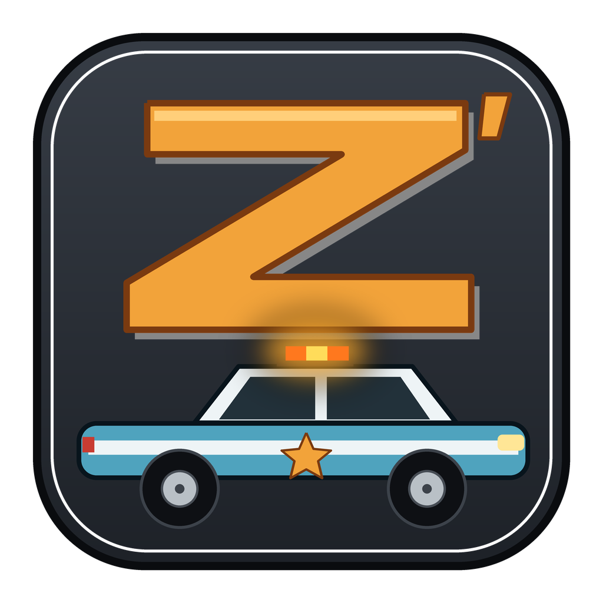</p>

**Zartex'27 User Manual**

Mission editor for Driv3r and Driver: Parallel Lines

Version 0.1.0

<!-- The table of contents is generated by the PDF export. -->

# Introduction

Zartex'27 is a mission editor for **Driv3r** and **Driver: Parallel Lines**. It is a Rust rewrite of Zartex 2. Version 0.1.0 is licensed under GPL v3 or later.

The program reads and edits missions (`.mpc` for Driv3r, `.sp` for Parallel Lines). It runs the Lua mission API (MoonSharp-compatible, Lua 5.2). It also shows the city in 3D, with the mission's actors, objects and cutscene cameras.

This manual is for a modder who knows Driv3r or Driver: Parallel Lines and has not used this tool before. Each chapter explains what a feature is for, and then how to use it.

## Main screens

- **Logic graph**: the mission's logic nodes and the wires between them (chapter 3).
- **City 3D**: the city around the mission, with its actors, objects and cameras (chapter 6).
- **Bottom tabs**: Console, Cameras, Lua script and Warnings (chapters 7 and 8).
- **Left panel**: the two games, and the tabs Missions, Objects and Assets (chapters 1 and 9).
- **Right panel**: the mission overview, or the Inspector when something is selected (chapters 4 and 5).

## Credits

- Zartex'27 development: LMonteiroSt (github.com/lmonteirotech).
- Zartex 2 (Lua mission API, Parallel Lines support): BuilderDemo7.
- Zartex, DSCript and the Driver Tools: Fireboyd78/Mark Ludwig/CarLuver69.

# 1 First start

## 1.1 Set the game folders

Zartex'27 lists missions and cities from the game folders that you set in Settings. Do this first.

1. Open **File > Settings**. The Settings window opens by itself when no game folder is set.
2. Set the root folder of **Driv3r**, of **Driver: Parallel Lines**, or of both.
3. Click **Recheck contents**. Missions and cities are listed from those folders.

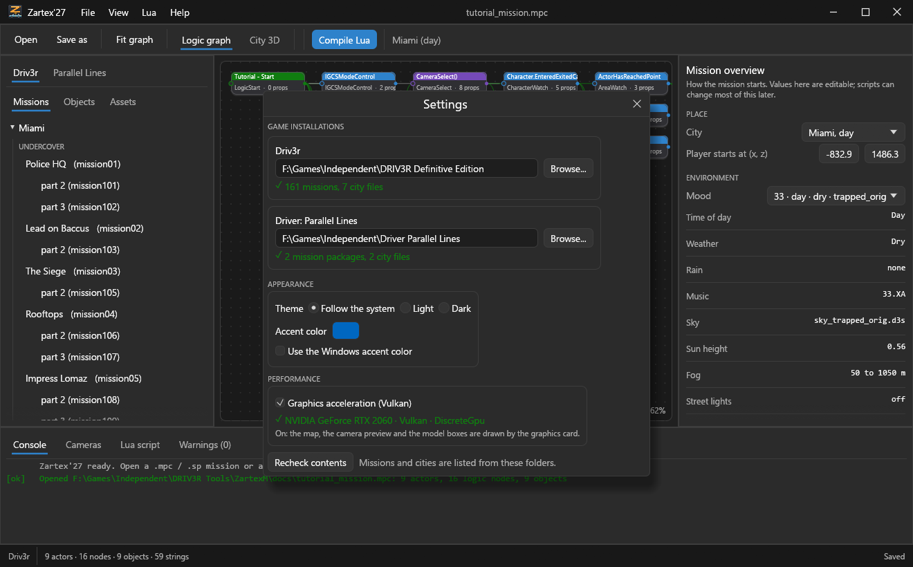

*Figure 1. The Settings window, where the game folders are set.*

## 1.2 Appearance and performance

- **APPEARANCE** sets the theme (follow the system, light or dark) and the accent colour. On Windows, you can use the Windows accent colour.
- **PERFORMANCE** sets graphics acceleration with Vulkan. It turns on by itself if the machine supports Vulkan. If the machine does not, the switch is locked off. You can turn it off yourself.

## 1.3 Open a mission

The left panel shows the two games at the top, Driv3r and Parallel Lines. Under them are the tabs **Missions**, **Objects** and **Assets**.

1. Under the game you want, open the **Missions** tab.
2. Find the mission. Missions are listed by city, with the original Zartex names.
3. Click the mission to open it.

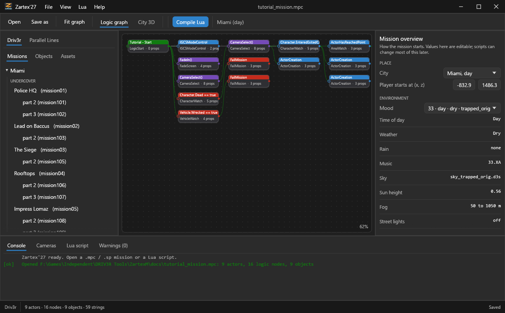

*Figure 2. The main window with a mission open in the Logic graph.*

# 2 The window

## 2.1 Parts of the window

- **Title bar** with the menus File, View, Lua and Help.
- **Toolbar** with Open, Save as, Fit graph, the Logic graph / City 3D switch and Compile Lua. For packages with several missions, the toolbar also has a mission list.
- **Screens**: the Logic graph, City 3D, the bottom tabs, the left panel and the right panel.
- **Bottom tabs**: Console (messages), Cameras (shot timeline), Lua script (editor) and Warnings.

## 2.2 Menus

Appendix B lists every menu command. In short:

- **File** creates, opens, saves and closes missions, and contains Settings.
- **View** switches between the Logic graph and City 3D, and sets the minimap and map lighting.
- **Lua** compiles scripts and exports missions as Lua.
- **Help** has the documentation link and the About window.

## 2.3 Open and save files

You can open a file in two ways: use **File > Open mission or script...** (accepts `.mpc`, `.sp` and `.lua`), or drop a `.mpc`, `.sp` or `.lua` file onto the window.

1. Make your changes.
2. Choose **File > Save** to save the file, or **File > Save as...** to save it under a new name.
The first time you save, Zartex'27 keeps a `.bak` copy of the original file.

> **Warning:** Saving the game's own Parallel Lines packages (`.sp`) is blocked, because their extra data would be lost. To build a Parallel Lines package, compile a Lua script instead (chapter 8).

## 2.4 Help

- **Help > Documentation** is disabled until a repository link exists.
- **Help > About Zartex'27** shows the build, this computer's system, processor, memory and graphics, the credits and the GPL licence.

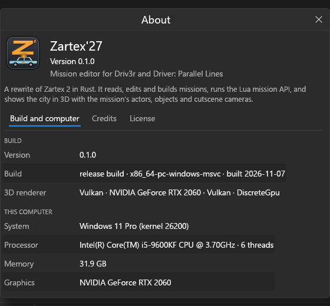

*Figure 3. The About Zartex'27 window, with the application icon.*

# 3 Logic graph

The Logic graph shows the mission's logic nodes as boxes. Wires connect the boxes. Each box has:

- a **title**: the node's note, or its type when there is no note;
- a **subtitle**: the node's type and the number of properties it has.

The colour of a box is the colour that the mission stores for that node. For example, green is used for LogicStart, red for failure and watch nodes, purple for camera and fade nodes, blue for actor-related nodes and orange for timers.

See Figure 2 for a mission in the Logic graph.

1. Use **Fit graph** to frame all the nodes on screen.
2. Click a node to select it. The right panel changes to the Inspector (chapter 5).
# 4 Mission overview

When nothing is selected, the right panel shows the **mission overview**. For Driv3r it contains:

- **City**, and the time of day.
- **Player start**, as x and z.
- **Mood**: the list of `Moods\moodNN.txt` files, with time of day, weather and sky.
- **Mood details** (read-only): time of day, weather, rain, music, sky, sun height, fog and street lights.
- **Traffic values**: parked cars, attractor parked cars, ping in and ping out radius, and density override.
- **Changed by the script**: the nodes that change the music and other settings.

The values in the overview can be edited, except the mood details.

> **Note:** For Parallel Lines, the mission's own logic nodes set the weather, time and music. The overview only says that.

# 5 Inspector and editing

The Inspector shows the details of the element you select. You can select a node, an actor or an object in these ways: in the Logic graph, in the **Objects** tab, or by clicking the object in the map.

## 5.1 What you can edit

- Properties of nodes and actors: numbers, strings, flags, actor references and positions.
- Object and player-start positions.
- Camera aim and shot timing.
- The mission summary: city, mood and traffic.

## 5.2 Wires

A wire connects a node to a target node and has a **wire type**. You can add a wire (choose the target node and the wire type), remove a wire, or change its type.

| Wire type | What it does |
|---|---|
| 1 | The normal "enable" wire. |
| 2 | Turns the target off. For example, it is used to end the in-game cutscene mode. |

## 5.3 Delete a node or an actor

Use **Delete node...** or **Delete actor...**. Zartex'27 fixes the references and numbering after the delete.

## 5.4 3D box of the selected element

The Inspector has an optional 3D box. It shows the selected vehicle (`Vehicles\*.vvs`) or character (`Missions\missionNN.dam`, in its bind pose).

## 5.5 Add an actor or a logic node

The **Objects** tab lists the actors, logic nodes, objects, strings and sound banks of the open mission. It has a search box and the button **+ Add actor or node...**.

1. Open the **Objects** tab.
2. Click **+ Add actor or node...**.
3. Fill in the arguments of the MISSION function that creates the element.
4. Create the element. The dialog can also wire the new node.
The dialog can create any actor or logic node, because it runs the node's MISSION function with arguments that you can edit.

## 5.6 Save your edits

Edits are applied to the mission. Use **Save** or **Save as** to write them to a file.

# 6 City 3D

## 6.1 The city

For Driv3r, City 3D shows the real textured city around the mission: Miami, Nice or Istanbul, by day or night depending on the mood. Interiors are included. The view loads the area around the camera. The radius is 260 m with the CPU renderer and 650 m with Vulkan. The view reloads when you move far enough.

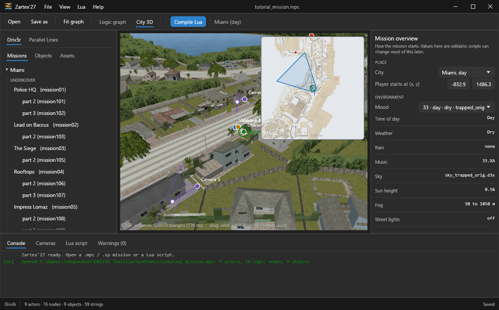

*Figure 4. City 3D view of a Driv3r mission.*

## 6.2 Mouse controls

| Mouse action | Effect |
|---|---|
| Left-drag | Orbits the view. |
| Right-drag or middle-drag | Pans the view. |
| Mouse wheel | Zooms. |
| Left-drag on a marker | Moves that actor or object. |
| Shift-drag | Changes the height of the actor or object. |
| White dot at the tip of a camera's line | Aims the camera. |

## 6.3 Markers and camera paths

Markers show the actors, objects and cameras, with labels. Turn the labels on or off with the **Labels** checkbox in the Cameras tab. The camera path of the open cutscene is drawn on the map.

## 6.4 Minimap

The minimap is a top-down plan with the mission's elements, the cutscene camera path and the area that the 3D view shows. Turn it on with **View > Minimap over the 3D view**.

- Scroll to zoom the minimap.
- Click or drag to move the 3D view to that place.
- Right-drag to pan the minimap.

## 6.5 Vulkan and lighting

- With Vulkan, the main map also draws the sea (ripples, sky reflection and sun glint). The map renders at 1.5x.
- **View > Mission lighting and fog on the map (heavier)** uses the mission's mood (day or night, colours and fog) on the main map. It is off by default. The camera preview always uses the mood.

# 7 Cameras and cutscenes

The **Cameras** tab is for Driv3r. It shows a timeline of the **shots** of the mission. A shot is one step in the chain of CameraSelect nodes, in the order they are wired. Each shot shows its duration and blend.

- **Play** and **Stop** control the timeline. You can also scrub along it.
- A corner of the 3D view shows a preview of what the camera sees.
- The checkbox **Mission sky in preview** is available. The sky and mood light are always on in the preview.

For each shot you can edit the duration, the blend in and the zoom.

> **Note:** The order and timing follow the CameraSelect chain. The timers in the game may differ.

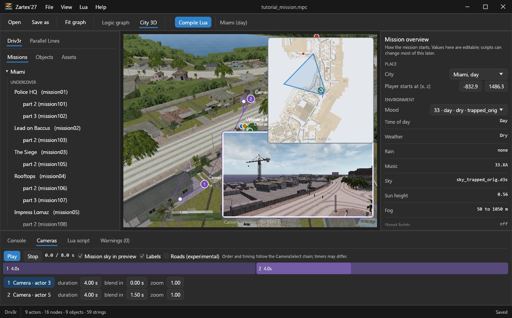

*Figure 5. Cameras tab for the tutorial mission: two shots of 4.0 s, and the second shot blends in over 1.5 s. The camera preview is in the corner of the 3D view.*

# 8 Lua: scripts, export and add to mission

## 8.1 The Lua script tab

The **Lua script** tab is an editor. It has three buttons: **Open script...**, **Add to mission** and **Run**.

- **Run** (also **Compile script** in the Lua menu) builds a new mission from the script. For Driv3r the result is a `.mpc` file. For Parallel Lines, use the command-line tool (section 8.4).
- **Add to mission** runs the Lua on the Driv3r mission that is open. What the script creates is added to the end of the mission. `MISSION.GetNode(i)` and `MISSION.GetActor(i)` give you access to the existing nodes and actors.

### Create a new mission from a script

1. Open the **Lua script** tab, or choose **File > New Driv3r mission**, which loads a small sample script.
2. Paste the script into the editor, or click **Open script...** to load it.
3. Click **Run** or use **Lua > Compile script**.
### Add a script to the open Driv3r mission

1. Open a Driv3r mission.
2. Write or open the script in the **Lua script** tab.
3. Click **Add to mission**.
## 8.2 Export a mission as Lua

There are two export forms. Use **Lua > Export mission as Lua** to write the export to the Lua tab, or **Lua > Export mission as Lua file...** to write it to a file.

The **readable** form is the default. It writes the mission as calls to the API, for example `MISSION.CreateCharacter(...)`, `MISSION.ActorCreation(...)`, `node.wireCollection.Add(other)` and `MISSION.missionSummary.Level = ...`. Variable names come from the notes. What the API cannot express exactly is written as raw calls, one item at a time. The header of the script says how many actors and nodes are plain calls.

On the 129 missions installed with Driv3r, about 90% of the nodes and 63% of the actors come out as plain calls.

> **Note:** Some actors keep their position and parameters, but not the game's internal object bytes or the exact angle. Flags, colour alpha, property type ids and name case are written by the API.

Every exported script rebuilds the same mission. This was tested.

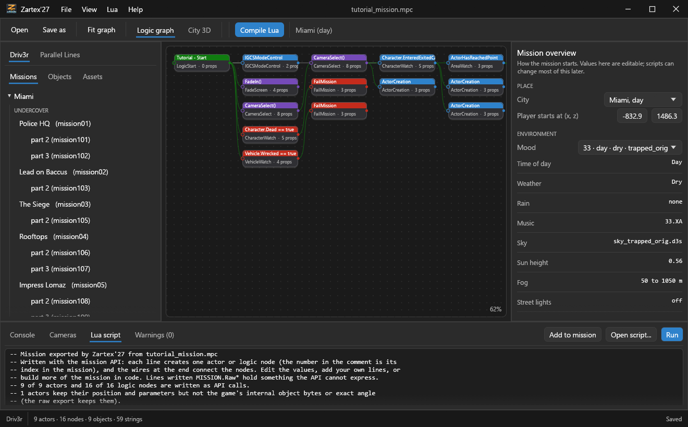

*Figure 6. The Lua script tab, with a readable export of the tutorial mission. The header reports how many items are written as API calls.*

## 8.3 Raw export

The **raw** export (**Lua > Export raw Lua** and **Lua > Export raw Lua file...**) writes `MISSION.Raw*` calls. It keeps every field exactly. It was tested on all 129 installed missions, and the result was identical.

## 8.4 Command-line tool

The command-line tool `zartex-luac` is in the repository, in the `zartex-core` project. To compile a script to a Driv3r mission, run:

```
cargo run --release --bin zartex-luac -- script.lua -o mission.mpc
```

For a Parallel Lines package, the command is:

```
zartex-luac script.lua -o mission.sp -dpl
```

# 9 Assets tab

## 9.1 Driv3r

The **Assets** tab lists the skies, the moods, the city's vehicles and the character skins of the mission. Each item has a preview and a one-click action:

- **Create this vehicle at the player start**
- **Create this character at the player start**
- **Use this mood in the open mission**

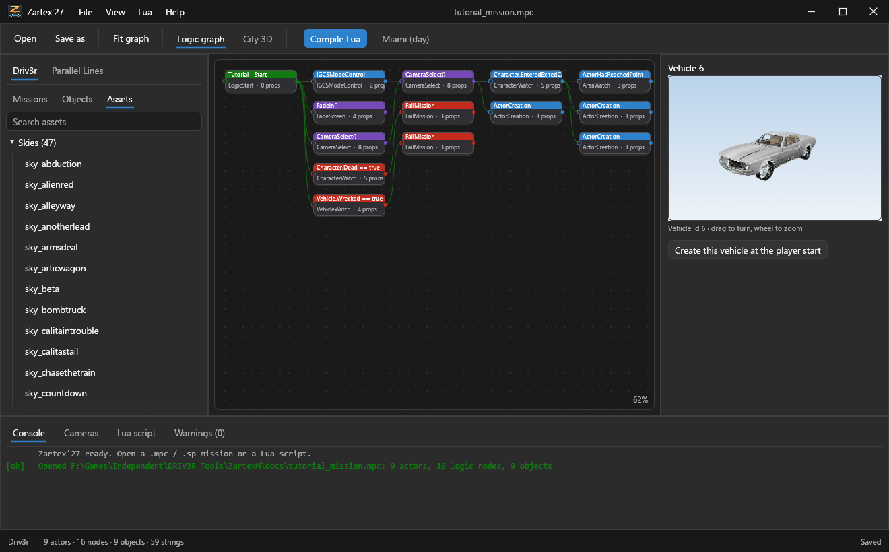

*Figure 7. Assets tab with a vehicle preview (vehicle 6).*

## 9.2 Parallel Lines

1. Choose the city file, `nyc_now_pc` or `nyc_then_pc`.
2. Choose a package: **Global** or a super region.
3. Read the lists. **Textures** shows the size and DXT format. **Models** shows the number of parts and triangles.
4. Click an item to preview it. Models are shown in a 3D box that you can turn.
# 10 Parallel Lines

## 10.1 What City 3D shows

- New York, as 147 terrain tiles with the buildings and roads of the global package.
- About 140,000 props from the regions' GEBI lists. They appear when the camera is closer than 700 m.
- The mission's actors and district markers.
- A minimap, which is a top-down render of the tiles.

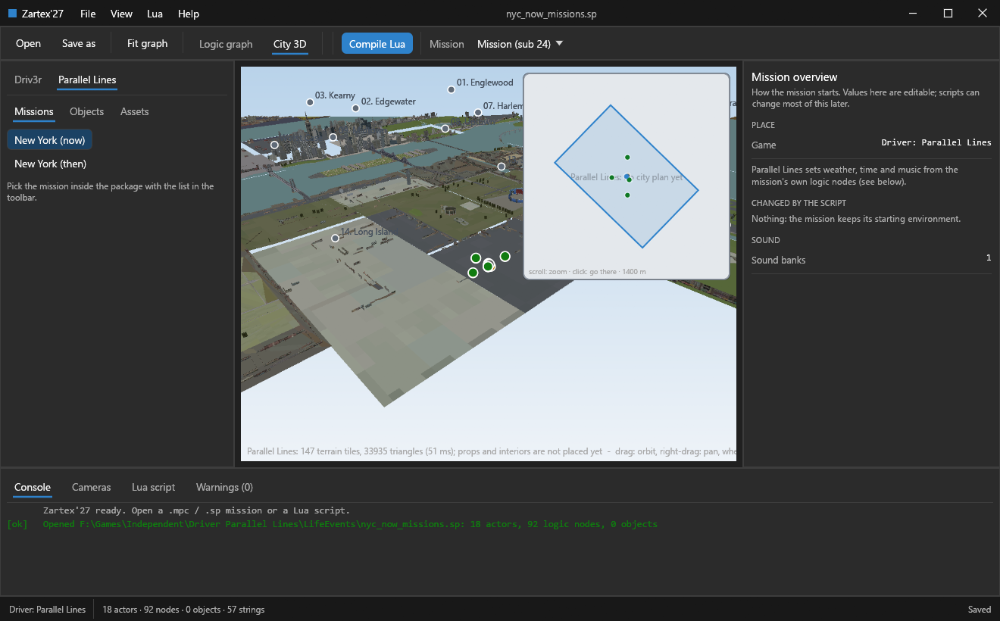

*Figure 8. Parallel Lines: the whole map in City 3D.*

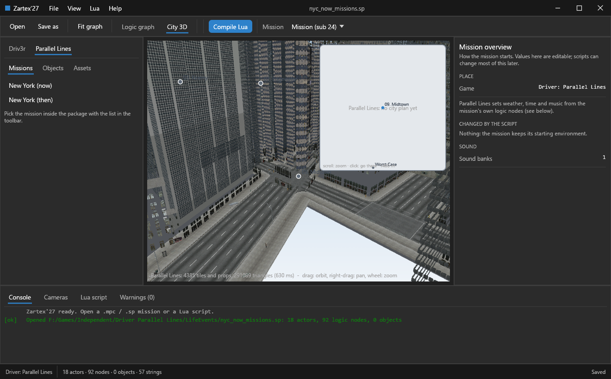

*Figure 9. Parallel Lines: a close-up of Midtown with props.*

## 10.2 Textures and models

The Assets tab shows the textures and models of the selected package. Click an item to preview it.

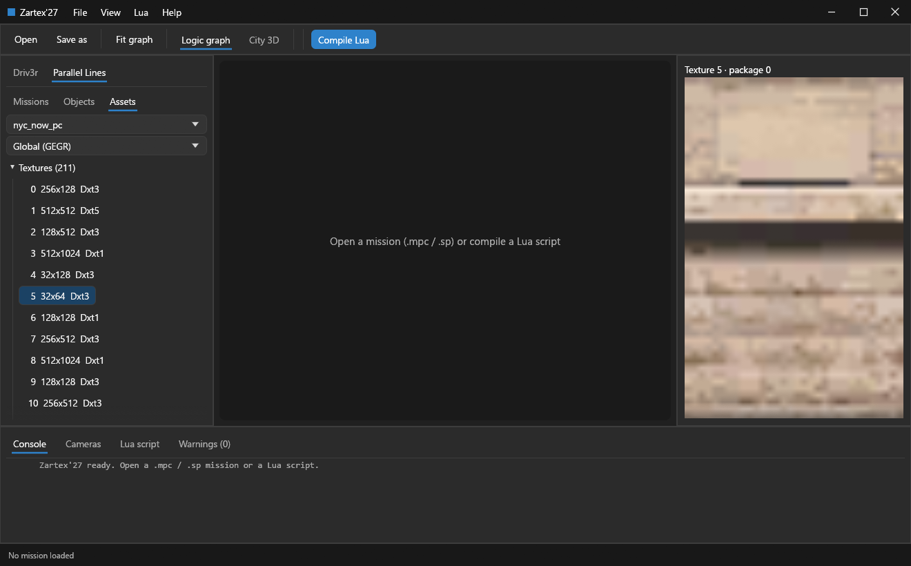

*Figure 10. Parallel Lines: the Assets tab with the texture list and a texture preview.*

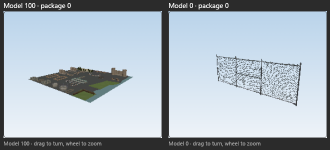

*Figure 11. Parallel Lines: model previews. Drag to turn a model, and use the wheel to zoom.*

## 10.3 Limits

> **Note:** Interiors are placed at their world position, but they sit inside buildings. **They have not been checked visually.**

> **Warning:** Road data (AIEX) is **not decoded**. The option **Roads (experimental)** (Cameras tab, off by default) draws partly understood points that do **not** line up with the streets. Do not rely on it.

- Missions of Parallel Lines can be opened and edited.
- The game's own `.sp` packages cannot be saved over (see section 2.3).
- The camera preview and some Driv3r-only features do not exist for Parallel Lines, for example the vehicle and character 3D box and the mood part of the mission overview.

# 11 Limits and honest notes

## 11.1 What has been verified

The compiler matches the original tool byte for byte on the 12 sample scripts: 7 Driv3r `.mpc` scripts and 5 Parallel Lines `.sp` scripts. It also matches on 745 of 836 generated test scripts. 91 scripts fail in both tools, and 0 differ.

Other API functions were ported from the C# source. They have smoke tests only.

## 11.2 Interface checks

> **Note:** Most interface actions were checked with screenshots and logic tests. They were **not verified with real mouse clicks**.

## 11.3 Parallel Lines

> **Warning:** Interiors are **unverified**. Roads are **not decoded**. The heights of the city props are **estimated** from the terrain.

## 11.4 Creating nodes

You can create nodes from Lua or with the **Add** dialog. There is no free-hand creation of graph nodes by drag and drop.

# 12 Tutorial: your first mission

This chapter builds a short mission in the tutorial script. The mission has these parts:

- the mission starts with two camera shots;
- the player, on foot, walks to a car and gets in;
- the player drives from point A to point B and the mission completes.

> **Warning: The tutorial has not been played in the game.** It was compiled with the tool and opened in Zartex'27, but it was not tested in Driv3r. Test it in Driv3r before you rely on it.

## 12.1 Files

- `docs/tutorial_mission.lua`: the script. The full script is in Appendix A.
- `docs/tutorial_mission.mpc`: the compiled copy of the script.

## 12.2 How to use the script

1. Open the **Lua script** tab, or choose **File > New Driv3r mission**. Paste the script into the editor, or click **Open script...** to load it.
2. Click **Compile Lua**.
3. Save the mission as `...\Missions\<name>.mpc` in the game folder. Keep a backup of any original mission first. You can also compile the script from the command line (section 8.4).
4. Open the mission in Zartex'27. Use the Logic graph, the map and the camera shots to inspect it.
## 12.3 Part 1: where and when

The first two lines of the script set the city, the time of day and the mood:

- `MISSION.missionSummary.Level = "Miami_Day"` sets the city and the time of day. Other values are `Miami_Night`, `Nice_Day`, `Nice_Night`, `Istanbul_Day` and `Istanbul_Night`.
- `MISSION.missionSummary.MoodId = 33` sets the mood. Mood 33 is the file `Moods\mood33.txt`, which sets the weather, the sky and the light.

Points A and B are two positions in metres, written as x, height and z. The comments in the script say that both are on downtown Miami streets, which a stock mission already uses. A is where the player starts. B is the destination.

To read coordinates, use the City 3D view and drag the player-start marker. The Inspector shows X, Y and Z.

## 12.4 Part 2: actors

- **The player**: `MISSION.CreateCharacter(...)` places the character 4 m from A in x, at A's height and z. The skin is `SKIN_TANNER`. The role is `1`, which makes this character the player and sets the mission's start position.
- **The car**: `MISSION.CreateVehicle(...)` places a vehicle 2 m from A in x, so the car is 6 m from the player in x. The vehicle id is `0x6` and the colour is `0`. The ids for each city are listed in the Assets tab.
- **Two cameras**: `MISSION.CreateCameraLookingAtPosition(...)` creates a fixed camera. The first two values are the camera position, and the next three are the point it looks at. The first camera is at A plus 30 m in x, 14 m higher and A plus 40 m in z. The second camera is at A minus 18 m in x, 4 m higher and A minus 22 m in z. Both cameras look at a point 1 m above A.
- **Markers**: `CreateObjectiveIconAttachedTo(Car, 0, 4, 0)` creates a marker over the car. `CreateObjectiveIcon(x, y, z, 6)` creates a marker at point B. A marker shows only when its `ActorCreation` node runs.

The script creates 9 actors in total.

## 12.5 Part 3: logic

Everything starts from `MISSION.LogicStart("Tutorial - Start")`. When a node fires, each node it is wired to is enabled. In the script, `node.wireCollection.Add(other)` creates a wire, and `Add(other, 2)` creates a wire of type 2, which turns the target off.

1. **Start the cinematic.** `ToggleIngameCutscene(true, true)` turns the in-game cutscene mode on. The HUD is hidden and the player cannot move. `FadeIn(1.0)` fades the screen in.
2. **Shot 1.** `CameraSelect(Cam1, 1, 4.0, 0, ...)` runs camera 1 for 4.0 seconds. The type `1` means the shot uses a camera actor.
3. **Shot 2.** `CameraSelect(Cam2, 1, 4.0, 1.5, ...)` runs camera 2 for 4.0 seconds. Its blend time is 1.5 seconds. Shot 1 is wired to shot 2, so shot 2 starts when shot 1's time is over.
4. **End of the shots.** When shot 2 ends, a wire of type 2 turns off the cutscene mode, and control returns to the player. The script then creates the car marker, and starts `CharacterEnterExitedVehicle(Player, Car)`, which waits for the player to enter the car.
5. **Player in the car.** The car marker is destroyed, the destination marker is created, and `ActorHasReachedPoint(Player, B, 12)` starts. This watches for the player to reach point B within a radius of 12 m.
6. **Arrived at B.** The destination marker is destroyed, and `MissionComplete(false)` completes the mission.
7. **Failures.** Two watchers run from the start. If `CharacterHasDied(Player)` fires, `FailMission(0)` runs. If `VehicleWrecked(Car)` fires, `FailMission(5, 5.0)` runs.
> **Note:** This manual does not describe the arguments of `FailMission`, `MissionComplete` or the other calls beyond the values shown above. Check them in the mission API before you change them.

## 12.6 Part 4: check the mission in Zartex'27

Open the compiled mission to check the parts of the script:

- **Logic graph** (Figure 2): the chain goes from Start to the cutscene, fade, the two shots and the failure watchers, then to CharacterWatch (enter the car), and then to AreaWatch (arrive at B).
- **Cameras tab** (Figure 5): it lists the two shots, one of 4.0 s and one of 4.0 s with a 1.5 s blend.
- **City 3D** (Figure 4): it shows the player, the car, the cameras and the camera path.
- The mission has 9 actors, 16 logic nodes and 9 objects.

## 12.7 Part 5: customise the tutorial

- Change points A and B. Use the City 3D view to read coordinates.
- Change the durations of the shots, or the blend time.
- Add more shots: add more `CreateCameraLookingAtPosition` calls and `CameraSelect` calls, and wire the shots in a chain.
- Add `DisplayMessage(id, seconds)` to show a message. The id must be a localised string id from the game's text.
- Add checkpoints, as in the stock checkpoint-race sample: a chain of `ActorHasReachedPoint` calls.
- Use the Assets tab to find other skins and vehicles.
## 12.8 Part 6: known cautions

> **Warning:** The tutorial has **not been played in the game** (see the warning at the start of this chapter).

- A mission file must be placed where the game expects its missions.
- The text ids of `DisplayMessage` come from the game's own localisation.
- The tool's camera preview follows the shot chain, but the timers may differ from the game.

# 13 Troubleshooting

This list has only the problems that are known to the project.

| Problem | What to do |
|---|---|
| "Game folder is not set" | Open **File > Settings** and set the game folder (section 1.1). |
| A Parallel Lines package cannot be saved | Compile a Lua script instead (chapter 8). The game's own `.sp` packages cannot be saved over (section 2.3). |
| The first load of the Parallel Lines city takes tens of seconds | This is expected on the first load. The first time a super region package is read, it takes longer. |
| Vulkan is not available | If the machine has no Vulkan, the CPU renderer is used. The Settings switch is locked. |
| An antivirus flags the program or a test build | Freshly built test executables can be flagged. This happened once, as a heuristic detection on a test binary. No fix is recorded. |

# 14 Command line and start-up arguments

Zartex'27 comes with two programs you can start from a command line or a shortcut: the editor `zartex-app.exe` and the script compiler `zartex-luac.exe`. This chapter lists every argument each one accepts.

## 14.1 zartex-app.exe (the editor)

The compiled editor opens the window directly. It does not open a console (prompt) window: it is built as a Windows GUI program, so nothing is printed to a terminal. Start it by double-click, from a shortcut, or from a command line, with or without arguments.

Syntax: `zartex-app.exe [mission-or-script] [options]`

| Argument | Meaning |
|---|---|
| `<path>` | A file to open at start: a Driv3r mission (`.mpc`), a Parallel Lines package (`.sp`) or a Lua script (`.lua`). Any argument that does not start with `--` is taken as the path. If several are given, each one is opened in turn and the last stays open. |
| `--view3d` | Start in the City 3D view instead of the Logic graph. |
| `--game <folder>` | Use this folder as the Driv3r game folder for this run (it also rescans the missions). It does not change the saved Settings file. |
| `--select-node <n>` | After opening the file, select logic node number n (a whole number) in the graph. The number is the node index shown in the Inspector (Node id). |
| `--mission <n>` | In a package with several missions, show mission number n of the list (counted from 0). |
| `--bottom <tab>` | Start with a bottom tab open. Values: `lua`, `warnings`, `cameras`. Any other value opens the Console. |
| `--time <seconds>` | Set the cutscene camera time (the Cameras tab scrubber) to this value, in seconds. |
| `--screenshot <file.png>` | Draw the window for a few frames, save it as a PNG to this path and exit. Useful for documentation and tests. |

### Examples

```
zartex-app.exe
zartex-app.exe "C:\Games\Driv3r\Missions\Mission11.mpc"
zartex-app.exe mission.mpc --view3d
zartex-app.exe mission.mpc --bottom cameras --view3d
zartex-app.exe mission.mpc --select-node 5
zartex-app.exe mission.mpc --view3d --screenshot out.png

```

> **Note:** Put a path that has spaces inside double quotes. Options are written with two dashes, lower case. An option that is not in this table is ignored.

### Environment variables

A few environment variables change what the editor does at start. They exist for testing and for taking screenshots; normal use does not need them. Set them before starting the program.

| Variable | Effect |
|---|---|
| `ZM_APPEARANCE` | `system`, `light` or `dark`: the theme for this run. |
| `ZM_SETTINGS` | If set (any value), open the Settings window at start. |
| `ZM_ABOUT` | If set, open the About window at start. |
| `ZM_ASSET` | Open the Assets tab on one item. `vehicle:<id>`, `mood:<id>`, `sky:<file.d3s>`, `pltex:<package>:<index>` or `plmodel:<package>:<index>` (the last two for Parallel Lines). |
| `ZM_SELECT_ACTOR`, `ZM_SELECT_OBJECT` | Select actor number n, or object number n, at start. |
| `ZM_EXPORT` | `readable` or `raw`: export the open mission to the Lua tab at start. |
| `ZM_SHOT_WAIT_MS` | With `--screenshot`: wait at least this many milliseconds before saving (for slow loads such as the Parallel Lines city). |
| `ZM_CITY_DIST`, `ZM_CITY_TARGET`, `ZM_CITY_PITCH` | Parallel Lines City 3D start camera: distance in metres, target as `x,y,z`, and pitch in radians. |
| `ZM_FORCE_NO_VULKAN` | If set, pretend the machine has no Vulkan device: the CPU renderer is used and the Settings switch is locked. |

### The Settings file

Settings are saved in `%APPDATA%\ZartexM\settings.txt`, one `key=value` per line: `driv3r` (Driv3r folder), `parallel_lines` (Parallel Lines folder), `gpu_off` (`1` when graphics acceleration is turned off), `appearance` (`system`, `light`, `dark`), `accent` (colour as six hexadecimal digits, for example `0067C0`) and `accent_windows` (`1` to use the Windows accent colour). You normally change these in File > Settings.

## 14.2 zartex-luac.exe (the script compiler)

`zartex-luac.exe` compiles a Lua mission script to a mission file without opening any window. It is a console program: run it from a command prompt or from a batch file.

Syntax: `zartex-luac.exe <script.lua> [-o <output>] [-dpl]`

| Argument | Meaning |
|---|---|
| `<script.lua>` | Required, and it must be the first argument: the Lua script to compile. |
| `-o <file>` or `-output <file>` | The file to write. If left out, `mission.mpc` is written (or `mission.sp` with `-dpl`) in the current folder. |
| `-dpl` or `-driver4` | Compile for Driver: Parallel Lines (an `.sp` package, using the Parallel Lines functions) instead of Driv3r (`.mpc`). |

With no arguments it prints the usage line `usage: zartex-luac <script.lua> [-o out.mpc|out.sp] [-dpl]` and exits with code 2.

### What it prints and its exit codes

| Output | Meaning |
|---|---|
| `1>------ Compilation started ------` | The compiler started. |
| `1> <input> -> <output>` and `========== Compilation success ==========` | The file was written. Exit code 0. |
| `!><message>` and `========== Compilation failed ==========` | The script has an error (Lua error text, with the line). Nothing is written. Exit code 1. |
| `!>Cannot write <file>: <reason>` | The output file could not be written. Exit code 1. |

### Examples

```
zartex-luac.exe tutorial_mission.lua -o tutorial.mpc
zartex-luac.exe myscript.lua
zartex-luac.exe dpl_script.lua -o nyc_now_missions.sp -dpl

```

> **Note:** The editor's Lua tab compiles the same way (the Compile Lua button). The command line is the same compiler without the window, handy for batch files.

## 14.3 Research tools

The program folder may also hold small research and test tools. They are not part of the editor and are not needed to make missions. Their usage lines are:

| Tool | Usage |
|---|---|
| `citysnap` | `citysnap <game root> <mission.mpc> <out.png> [radius] [yaw] [pitch] [dist]`: draws the city around a mission's player start to a PNG (no window). |
| `vehsnap` | `vehsnap <game root> <city_type> <vehicle id> <out.png> [yaw] [pitch]`: draws one vehicle model. |
| `charsnap` | `charsnap <game root> <mission stem> <skin hash> <out.png>`: draws one character model. |
| `plansnap` | `plansnap <game root> <city type> <out.png>`: writes the Driv3r city plan used by the minimap. |
| `d4cdump`, `mdxnprobe` | Print the structure of a Parallel Lines city file (`.d4c`) and the header of its first model packages. Experimental. |
| `edittest`, `camtest` | Checks used during development: edits survive a save and a reload; the camera matrix reading. |

# 15 Lua language reference

Tip: every function below is a heading, so use Word's Navigation pane (View > Navigation Pane) or Ctrl+F to jump to one. This chapter documents everything a Lua mission script can use: how a script is organised, the objects it works with, every function of the `MISSION` table with its arguments, and the constants (chapter 16). The tutorial in chapter 12 shows these calls in use.

## 15.1 How a script works

- A script is plain Lua 5.2 (MoonSharp-compatible). The standard libraries `table`, `string`, `math`, `bit32` and `coroutine` are available. There is no `io`, `os` or `debug`, so a script cannot read files or run programs.
- Everything about the mission goes through the global table `MISSION`. Calls that create something return a **handle** (an Actor or a Node) that you keep in a variable and pass to later calls.
- The script runs once, from top to bottom, when you compile it. The result is the mission: the actors, the logic nodes, the wires between nodes, the objects and the summary.
- Names are flexible: every function can be written in three ways, `MISSION.CreateCharacter`, `MISSION.createCharacter` and `MISSION.create_character`. They are the same function.
- Names of constants (chapter 16) are global and written in capitals, for example `SKIN_TANNER`.
- Numbers: a number you give where an integer is expected is truncated to an integer. The arguments `r`, `g`, `b` of a call set the colour the node or actor has in the editor.
- When a call is wrong (a nil actor, an actor of the wrong kind, a bad index) the script stops with an error message that names the argument. The message appears in the Console and the compile fails; nothing is written.

## 15.2 Scripts for Parallel Lines

A script for Driver: Parallel Lines is compiled with `zartex-luac.exe script.lua -o package.sp -dpl`. It does not have a `MISSION` table. It works with three global objects instead:

| Name | What it is |
|---|---|
| `INITMISSION` | The init mission of the package: the world and the actors that every mission needs (the player, vehicles, mission markers). It has the same functions as `MISSION` below (the Parallel Lines forms), including the ones only Parallel Lines has, such as `CountActor`, `CreateMissionActor`, `StartMission` and `MissionWatch`. |
| `PACKAGE` | The package itself. `PACKAGE.CreateMission(name, id, x, y, flags, defineRoot)` creates a mission and returns it; `PACKAGE.AddMission(mission, subMissionId, name)` adds it to the package as a sub-mission. |
| a mission variable | What `PACKAGE.CreateMission` returns, for example `local Mission1 = PACKAGE.CreateMission("Mission 1", 5, 0, 0, 0)`. It also has the same functions: `Mission1.LogicStart(0, "Mission 1 - Start")`. |

In the reference of section 15.6 the functions are written with the prefix `MISSION.` (the form used in scripts for the first game). **In a Parallel Lines script, write `INITMISSION.` or the mission variable instead of `MISSION.`**; the arguments are those of the entry marked "Parallel Lines" when a function has two forms (for example `LogicStart(int flags, string note)`). Every function of the reference that says "Applies to: both games" or "Parallel Lines" can be called this way.

A short example, from the stock Parallel Lines templates:

```lua
local Player = INITMISSION.CreateCharacter(95.9673, 0.096, -7.4244, 100, 29, 1.0, 0.0, nil, 0, 0, true, 65537)
INITMISSION.CountActor(Player)            -- remember to count the player and the important actors

local Mission1 = PACKAGE.CreateMission("Mission 1", 5, 0, 0, 0)
PACKAGE.AddMission(Mission1, 1)           -- the mission and its sub-mission id
local Start = Mission1.LogicStart(0, "Mission 1 - Start")
```

## 15.3 Argument types

| Type | What you write |
|---|---|
| `int`, `short`, `byte`, `uint` | A whole number. `byte` is 0 to 255, `short` is -32768 to 32767. |
| `float`, `double` | A number with decimals, for example `1.5`. Metres for positions, degrees for angles unless a call says otherwise. |
| `bool` | `true` or `false`. |
| `string` | Text in quotes. Many calls have a `note` argument: the label you see in the Logic graph. |
| `Actor` | A handle returned by a creator such as `CreateCharacter`, `CreateVehicle` or `CreateCamera`. Where the call allows it, `nil` means none. |
| `Node` | A handle returned by a function that creates a logic node. |
| `Table` | A Lua table such as `{1, 2, 3}` or `{x, y, z}`. The call says what the table must contain. |
| Arguments with `= value` | Optional. If you leave them out (only the last ones can be left out) the value shown is used. |

## 15.4 The objects a script handles

### Actor handles

Returned by every creator of an actor (a character, vehicle, camera, area, marker, objective icon and so on).

| Member | Use |
|---|---|
| `.Index` | Read: the actor's number in the mission (0 is the first). |
| `.TypeId` | Read or write: the actor type number. |
| `.Flags` | Read or write: the actor's flags. |
| `:SetColor(r, g, b [, a])` | Set the colour used for the actor in the editor. `a` is optional (255 if left out). |
| `:SetIntPropertyValue(index, value)` | Set the integer property number `index`. Works on properties of type Integer only. |
| `:SetFloatPropertyValue(index, value)` | Set the float property number `index`. |
| `:SetFloat3PropertyValue(index, x, y, z)` | Set a 3-number property (type 17). |
| `:SetFloat4PropertyValue(index, x, y, z, w)` | Not supported for the property types that exist: it raises an error. |
| `:SetTextPropertyValue(index, textIndex, value)` | Set a text-file property (its index and value). |
| `:SetAudioPropertyValue(index, bank, sample)` | Set an audio property. |
| `:SetActorPropertyValue(index, actor)` | Set an actor-reference property; `nil` means none. |
| `:GetProperyValue(index)` | Read a property: a number for float, integer or actor properties, `nil` for other types. The name is spelled exactly like this (one missing t), as in the original tool. |

The property `index` is the position of the property in the actor's property list (shown in the Inspector). Using an index of the wrong type raises an error such as `Unable to cast object to type 'FloatProperty'`.

### Node handles

Returned by every function that creates a logic node.

| Member | Use |
|---|---|
| `.wireCollection` (also `.Wires`) | The node's list of wires: the nodes it enables when it fires (see below). You can assign another node's list to it to copy the wires. |
| `.Index` | Read: the node's number in the mission. |
| `.TypeId`, `.Flags` | Read or write, as for actors. |
| `:SetWireCollection(other [, appendId])` | Replace this node's wires with a copy of `other`'s wires. With `appendId` true the node also points at the other collection. |
| `:SetColor(...)`, `:Set...PropertyValue(...)`, `:GetProperyValue(index)` | As for actors. |

### The wire list (node.wireCollection)

| Call | Use |
|---|---|
| `:Add(node [, wireType])` | Wire the node: when this node fires, `node` is enabled. `wireType` is optional and defaults to 1 (the normal enable wire). Type 2 turns the target off (the tutorial uses it to end the cutscene mode). The meaning of the other types depends on the target node. |
| `:RemoveAt(i)` | Remove the wire number i (from 0). |
| `:RemoveRange(i, count)` | Remove `count` wires starting at i. |
| `:RemoveNode(node)` | Remove the wire that points at `node`. |
| `.Index` | Read: the number of this wire collection. |

### The mission summary (MISSION.missionSummary)

| Member | Use |
|---|---|
| `.Level` | Text: `"Miami_Day"`, `"Miami_Night"`, `"Nice_Day"`, `"Nice_Night"`, `"Istanbul_Day"`, `"Istanbul_Night"`. Setting it sets the city; reading gives the name, or `"Unknown"`. |
| `.CityType` | The same as a number, 1 to 6 in the order above (0 is none). |
| `.MoodId` (also `.MissionId`) | The mood number: the file `Moods\moodNN.txt` of the game. |
| `.LocaleId` (also `.MissionLocaleId`) | The locale number. |
| `.X`, `.Y` | The player start position: X and Z in metres (the property named Y is the Z coordinate). |

Creating the player (a `CreateCharacter` with role 1) also sets the start position.

### Other members of MISSION

- `MISSION.actorSetup`: the table of actor-set data used by Parallel Lines (see `CreateActorSetting`).
- `MISSION.GetActor(i)` and `MISSION.GetNode(i)`: handles to an actor or a node that already exists. They are available only when a script is run with **Add to mission** on an open mission (not when a script is compiled on its own).

## 15.5 The raw calls (MISSION.Raw...)

The exact export (Lua menu > Export raw Lua) writes a mission with these calls. They build any actor, node or object field by field, so they can express things the normal functions cannot. You can also use them yourself.

| Call | Use |
|---|---|
| `MISSION.RawSummary(x, z, cityType, moodId)` | Set the start position, the city number and the mood number. |
| `MISSION.RawSoundBanks({n1, n2, ...})` | Set the list of sound bank numbers. |
| `MISSION.RawObject({kind, ...})` | Add an object and return its number. The table starts with the kind (`"vehicle"`, `"character"`, `"volume"`, `"area"`, `"path"`, `"icon"`, `"camera"`, `"prop"`, `"switch"`, `"collectable"`, `"anim"` or `"marker"`) followed by its fields, as the export writes them. |
| `MISSION.RawActor(type, note, object, r, g, b, a, reserved, flags, {props})` | Add an actor of the given type number. `object` is the object number it uses (or -1). `props` is a list of property entries `{type, "name", kind, values...}`. |
| `MISSION.RawNode(type, note, r, g, b, a, reserved, flags, hasWire, {props})` | Add a logic node. With `hasWire` true a wire collection is created for it. |

A property entry is `{typeNumber, "propertyName", kind, values...}`. The kinds are `"i"` (integer), `"f"` (float), `"s"` (string), `"b"` (boolean), `"tf"` (text file: text, index), `"u"` (id: high part, low part), `"au"` (audio: bank, sample), `"v4"` (four numbers), `"m"` (a 4 x 4 matrix as sixteen numbers), `"p"` (a path of 4-number points), `"uc"` (a list of character codes), `"raw"` (a list of bytes) and `"as"` (an asset list: count, assets, densities). The exported scripts show many examples.

## 15.6 Every function of MISSION

The functions are listed in alphabetical order. For each one you see: what it returns, which game it applies to, what it creates when that is known, its signature(s), the table of arguments with their defaults, and the checks the compiler makes. Arguments written with `= value` are optional. When one name appears more than once, each signature is a form (overload) of the call: use the one that fits.

> **Note:** These descriptions come from the compiler's own definitions (argument names, types, defaults and the checks it makes). A function whose meaning is not obvious from its name has no extra description here, because none exists in the original sources.

### MISSION.ActionButtonWatch

Returns a Node. Applies to: both games. Creates the logic node "ActionButtonWatch" (type 13).

```lua
MISSION.ActionButtonWatch(Actor targetSwitch, int flags = 2, string note = "", int r = 0, int g = 200, int b = 122)

```

| Argument | Type | Default |
|---|---|---|
| `targetSwitch` | `Actor` | required |
| `flags` | `int` | `2` |
| `note` | `string` | `""` |
| `r` | `int` | `0` |
| `g` | `int` | `200` |
| `b` | `int` | `122` |

### MISSION.ActorCreation

Returns a Node. Applies to: both games. Creates the logic node "ActorCreation" (type 101).

```lua
MISSION.ActorCreation(Actor actor, int activity = 1, int flags = 0, string note = "", int r = 0, int g = 200, int b = 122)

```

| Argument | Type | Default |
|---|---|---|
| `actor` | `Actor` | required |
| `activity` | `int` | `1` |
| `flags` | `int` | `0` |
| `note` | `string` | `""` |
| `r` | `int` | `0` |
| `g` | `int` | `200` |
| `b` | `int` | `122` |

Checks (error messages):

- `Bad argument #1 - Attempt to give creation to a nil value`

### MISSION.ActorHasReachedPoint

Returns a Node. Applies to: both games. Creates the actor "TestVolume" (type 4).

```lua
MISSION.ActorHasReachedPoint(Actor actor, float x, float y, float z, float radius, int flags = 1, string note = "ActorHasReachedPoint", int r = 100, int g = 128, int b = 255)

```

| Argument | Type | Default |
|---|---|---|
| `actor` | `Actor` | required |
| `x` | `float` | required |
| `y` | `float` | required |
| `z` | `float` | required |
| `radius` | `float` | required |
| `flags` | `int` | `1` |
| `note` | `string` | `"ActorHasReachedPoint"` |
| `r` | `int` | `100` |
| `g` | `int` | `128` |
| `b` | `int` | `255` |

Checks (error messages):

- `Bad argument #1 - Attempt to check point from a nil value`

### PACKAGE.AddMission

Returns nothing. Applies to: Parallel Lines packages.

```lua
PACKAGE.AddMission(LuaMissionScriptDPL mission, short subMissionId, string name = null)

```

| Argument | Type | Default |
|---|---|---|
| `mission` | `LuaMissionScriptDPL` | required |
| `subMissionId` | `short` | required |
| `name` | `string` | `null` |

### MISSION.AddSoundBankToLoadList

Returns nothing. Applies to: both games.

```lua
MISSION.AddSoundBankToLoadList(int bank)

```

| Argument | Type | Default |
|---|---|---|
| `bank` | `int` | required |

### MISSION.AITarget

Returns an Actor. Applies to: both games. Creates the actor "AITarget" (type 7).

```lua
MISSION.AITarget(Actor character, float x, float y, float z, float walkSpeed, float driveSpeed, int desiredTransport, Actor attachTo = null, int flags = 0, string note = "", int r = 128, int g = 0, int b = 255)

```

| Argument | Type | Default |
|---|---|---|
| `character` | `Actor` | required |
| `x` | `float` | required |
| `y` | `float` | required |
| `z` | `float` | required |
| `walkSpeed` | `float` | required |
| `driveSpeed` | `float` | required |
| `desiredTransport` | `int` | required |
| `attachTo` | `Actor` | `null` |
| `flags` | `int` | `0` |
| `note` | `string` | `""` |
| `r` | `int` | `128` |
| `g` | `int` | `0` |
| `b` | `int` | `255` |

Checks (error messages):

- `Inputed actor is not a Character type actor`

### MISSION.AnimationControl

Returns a Node. Applies to: both games. Creates the logic node "AnimationControl" (type 20).

```lua
MISSION.AnimationControl(Actor actor, float speed, int activity = 1, int flags = 0, string note = "", int r = 0, int g = 200, int b = 122)

```

| Argument | Type | Default |
|---|---|---|
| `actor` | `Actor` | required |
| `speed` | `float` | required |
| `activity` | `int` | `1` |
| `flags` | `int` | `0` |
| `note` | `string` | `""` |
| `r` | `int` | `0` |
| `g` | `int` | `200` |
| `b` | `int` | `122` |

### MISSION.AreaWatch

Returns a Node. Applies to: both games. Creates the logic node "AreaWatch" (type 12).

```lua
MISSION.AreaWatch(Actor actor, Actor area, int flags = 0, string note = "ActorHasReachedPoint", int r = 100, int g = 128, int b = 255)

```

| Argument | Type | Default |
|---|---|---|
| `actor` | `Actor` | required |
| `area` | `Actor` | required |
| `flags` | `int` | `0` |
| `note` | `string` | `"ActorHasReachedPoint"` |
| `r` | `int` | `100` |
| `g` | `int` | `128` |
| `b` | `int` | `255` |

Checks (error messages):

- `Bad argument #1 - Attempt to watch a nil value`
- `Bad argument #2 - The input actor is not a Area type actor`

### MISSION.AwardVehicleToPlayer

Returns a Node. Applies to: both games. Creates the logic node "AwardVehicleToPlayer" (type 140).

```lua
MISSION.AwardVehicleToPlayer(Actor character, Actor marker, int type, int tintValue, float greenRadius = 125f, float yellowRadius = 95f, float redRadius = 20f, int flags = 2, string note = "", int r = 0, int g = 200, int b = 122)

```

| Argument | Type | Default |
|---|---|---|
| `character` | `Actor` | required |
| `marker` | `Actor` | required |
| `type` | `int` | required |
| `tintValue` | `int` | required |
| `greenRadius` | `float` | `125f` |
| `yellowRadius` | `float` | `95f` |
| `redRadius` | `float` | `20f` |
| `flags` | `int` | `2` |
| `note` | `string` | `""` |
| `r` | `int` | `0` |
| `g` | `int` | `200` |
| `b` | `int` | `122` |

### MISSION.AwardWeaponToPlayer

Returns a Node. Applies to: both games. Creates the logic node "AwardWeaponToPlayer" (type 129).

```lua
MISSION.AwardWeaponToPlayer(int action, int item, int weapon, string note = "", int r = 0, int g = 200, int b = 122)

```

| Argument | Type | Default |
|---|---|---|
| `action` | `int` | required |
| `item` | `int` | required |
| `weapon` | `int` | required |
| `note` | `string` | `""` |
| `r` | `int` | `0` |
| `g` | `int` | `200` |
| `b` | `int` | `122` |

### MISSION.BombCar

Returns a Node. Applies to: both games. Creates the logic node "BombCarWatch" (type 122).

```lua
MISSION.BombCar(Actor vehicle, float minimumSpeed = 22.36f, int graceTime = 5, int bank = 45, int sample = 0, string note = "", int r = 0, int g = 200, int b = 122)

```

| Argument | Type | Default |
|---|---|---|
| `vehicle` | `Actor` | required |
| `minimumSpeed` | `float` | `22.36f` |
| `graceTime` | `int` | `5` |
| `bank` | `int` | `45` |
| `sample` | `int` | `0` |
| `note` | `string` | `""` |
| `r` | `int` | `0` |
| `g` | `int` | `200` |
| `b` | `int` | `122` |

Checks (error messages):

- `Bad argument #1 - Attempt to set bomb car to a nil value`
- `Bad argument #1 - The inputed actor is not a Vehicle type actor`

### MISSION.BombTruckControl

Returns a Node. Applies to: both games. Creates the logic node "BombTruckControl" (type 114).

```lua
MISSION.BombTruckControl(Actor vehicle, int timer, int detonationTimer, float initialVelocity, float proximity = 6.5f, float explosionImpulseScale = 0.8f, float explosionRange = 7.0f, float damageScale = 0.5f, string note = "", int r = 0, int g = 200, int b = 122)

```

| Argument | Type | Default |
|---|---|---|
| `vehicle` | `Actor` | required |
| `timer` | `int` | required |
| `detonationTimer` | `int` | required |
| `initialVelocity` | `float` | required |
| `proximity` | `float` | `6.5f` |
| `explosionImpulseScale` | `float` | `0.8f` |
| `explosionRange` | `float` | `7.0f` |
| `damageScale` | `float` | `0.5f` |
| `note` | `string` | `""` |
| `r` | `int` | `0` |
| `g` | `int` | `200` |
| `b` | `int` | `122` |

### MISSION.CameraSelect

Returns a Node. Applies to: both games. Creates the logic node "CameraSelect" (type 14).

```lua
MISSION.CameraSelect(Actor target, int cameraType, float duration = 0, float blendTime = 0, float thrillCamZoom = 1, float thrillCamSpeed = 1, float thrillCamBlur = 0, int flags = 0, string note = "CameraSelect()", int r = 128, int g = 0, int b = 255)

```

| Argument | Type | Default |
|---|---|---|
| `target` | `Actor` | required |
| `cameraType` | `int` | required |
| `duration` | `float` | `0` |
| `blendTime` | `float` | `0` |
| `thrillCamZoom` | `float` | `1` |
| `thrillCamSpeed` | `float` | `1` |
| `thrillCamBlur` | `float` | `0` |
| `flags` | `int` | `0` |
| `note` | `string` | `"CameraSelect()"` |
| `r` | `int` | `128` |
| `g` | `int` | `0` |
| `b` | `int` | `255` |

Checks (error messages):

- `Bad argument #1 - Camera target can't be a nil value`
- `Bad argument #2 - Camera type can't be a nil value`
- `Bad argument #2 - Camera type can't be a negative number`

### MISSION.CargoDoorsControl

Returns a Node. Applies to: both games. Creates the logic node "OpenCargoDoorsControl" (type 136).

```lua
MISSION.CargoDoorsControl(Actor truck, int action, int doors = 4, string note = "", int r = 100, int g = 200, int b = 122)

```

| Argument | Type | Default |
|---|---|---|
| `truck` | `Actor` | required |
| `action` | `int` | required |
| `doors` | `int` | `4` |
| `note` | `string` | `""` |
| `r` | `int` | `100` |
| `g` | `int` | `200` |
| `b` | `int` | `122` |

### MISSION.CargoVehicleWatch

Returns a Node. Applies to: both games. Creates the logic node "CargoVehicleWatch" (type 125).

```lua
MISSION.CargoVehicleWatch(Actor truck, Actor car, int wrongCarText = -1, bool sideDoorsOnly = false, int wrongCarTextId = -1, int distanceText = -1, int kilometerText = -1, int mileText = -1, string note = "", int r = 0, int g = 200, int b = 122)

```

| Argument | Type | Default |
|---|---|---|
| `truck` | `Actor` | required |
| `car` | `Actor` | required |
| `wrongCarText` | `int` | `-1` |
| `sideDoorsOnly` | `bool` | `false` |
| `wrongCarTextId` | `int` | `-1` |
| `distanceText` | `int` | `-1` |
| `kilometerText` | `int` | `-1` |
| `mileText` | `int` | `-1` |
| `note` | `string` | `""` |
| `r` | `int` | `0` |
| `g` | `int` | `200` |
| `b` | `int` | `122` |

Checks (error messages):

- `Bad Argument #1 - The truck actor type is not a Vehicle actor type`
- `Bad Argument #2 - The car actor type is not a Vehicle actor type`

### MISSION.CharacterChaseActor

Returns a Node. Applies to: both games.

```lua
MISSION.CharacterChaseActor(Actor character, Actor actor, float driveSpeed, int chaserType = 0, string note = "CharacterDriveToActor", int r = 128, int g = 0, int b = 255)

```

| Argument | Type | Default |
|---|---|---|
| `character` | `Actor` | required |
| `actor` | `Actor` | required |
| `driveSpeed` | `float` | required |
| `chaserType` | `int` | `0` |
| `note` | `string` | `"CharacterDriveToActor"` |
| `r` | `int` | `128` |
| `g` | `int` | `0` |
| `b` | `int` | `255` |

### MISSION.CharacterControl

Returns a Node. Applies to: both games. Creates the logic node "CharacterControl" (type 18).

```lua
MISSION.CharacterControl(Actor character, int property, float value, int weapon = 0, int personalityindex = -1, Actor vehicle = null, Actor target = null, string animation = "", short animAction = -1, string padFileName = "", int numPadRecordings = 0, int flags = 0, string note = "", int r = 0, int g = 200, int b = 122)

```

| Argument | Type | Default |
|---|---|---|
| `character` | `Actor` | required |
| `property` | `int` | required |
| `value` | `float` | required |
| `weapon` | `int` | `0` |
| `personalityindex` | `int` | `-1` |
| `vehicle` | `Actor` | `null` |
| `target` | `Actor` | `null` |
| `animation` | `string` | `""` |
| `animAction` | `short` | `-1` |
| `padFileName` | `string` | `""` |
| `numPadRecordings` | `int` | `0` |
| `flags` | `int` | `0` |
| `note` | `string` | `""` |
| `r` | `int` | `0` |
| `g` | `int` | `200` |
| `b` | `int` | `122` |

Checks (error messages):

- `Bad argument #1 - Attempt to control a nil value`
- `Bad argument #1 - The inputed actor is not a Character actor type`

### MISSION.CharacterDriveAroundArea

Returns a Node. Applies to: both games. Creates the actor "AITarget" (type 7).

```lua
MISSION.CharacterDriveAroundArea(Actor character, Actor area, float driveSpeed, int desiredTransport = 2, int flags = 0, string note = "CharacterDriveTo", int r = 128, int g = 0, int b = 255)

```

| Argument | Type | Default |
|---|---|---|
| `character` | `Actor` | required |
| `area` | `Actor` | required |
| `driveSpeed` | `float` | required |
| `desiredTransport` | `int` | `2` |
| `flags` | `int` | `0` |
| `note` | `string` | `"CharacterDriveTo"` |
| `r` | `int` | `128` |
| `g` | `int` | `0` |
| `b` | `int` | `255` |

Checks (error messages):

- `Bad argument #1 - The inputed actor is not a Character type actor`
- `Bad argument #1 - Actor expected got nil`
- `Bad argument #2 - The inputed actor is not a Area type actor`
- `Bad argument #2 - Actor expected got nil`
- `Bad argument #3 - Number expected got nil`

### MISSION.CharacterDriveFollowingActor

Returns a Node. Applies to: both games.

```lua
MISSION.CharacterDriveFollowingActor(Actor character, Actor actor, float driveSpeed, int desiredTransport = 2, int flags = 0, string note = "CharacterDriveFollowingActor", int r = 128, int g = 0, int b = 255)

```

| Argument | Type | Default |
|---|---|---|
| `character` | `Actor` | required |
| `actor` | `Actor` | required |
| `driveSpeed` | `float` | required |
| `desiredTransport` | `int` | `2` |
| `flags` | `int` | `0` |
| `note` | `string` | `"CharacterDriveFollowingActor"` |
| `r` | `int` | `128` |
| `g` | `int` | `0` |
| `b` | `int` | `255` |

### MISSION.CharacterDriveTo

Returns a Node. Applies to: both games. Creates the actor "AITarget" (type 7).

```lua
MISSION.CharacterDriveTo(Actor character, float x, float y, float z, float driveSpeed, int desiredTransport = 2, Actor attachTo = null, int flags = 0, string note = "CharacterDriveTo", int r = 128, int g = 0, int b = 255)

```

| Argument | Type | Default |
|---|---|---|
| `character` | `Actor` | required |
| `x` | `float` | required |
| `y` | `float` | required |
| `z` | `float` | required |
| `driveSpeed` | `float` | required |
| `desiredTransport` | `int` | `2` |
| `attachTo` | `Actor` | `null` |
| `flags` | `int` | `0` |
| `note` | `string` | `"CharacterDriveTo"` |
| `r` | `int` | `128` |
| `g` | `int` | `0` |
| `b` | `int` | `255` |

Checks (error messages):

- `Bad argument #1 - The inputed actor is not a Character type actor`
- `Bad argument #1 - Actor expected got nil`

### MISSION.CharacterEnterExitedVehicle

Returns a Node. Applies to: both games.

```lua
MISSION.CharacterEnterExitedVehicle(Actor character, Actor vehicle, int flags = 4, string note = "Character.EnteredExitedCar ...", int r = 90, int g = 20, int b = 255)

```

| Argument | Type | Default |
|---|---|---|
| `character` | `Actor` | required |
| `vehicle` | `Actor` | required |
| `flags` | `int` | `4` |
| `note` | `string` | `"Character.EnteredExitedCar ..."` |
| `r` | `int` | `90` |
| `g` | `int` | `20` |
| `b` | `int` | `255` |

### MISSION.CharacterEquipWeapon

Returns a Node. Applies to: both games.

```lua
MISSION.CharacterEquipWeapon(Actor character, int flags = 0, string note = "Character.EquipWeapon()", int r = 200, int g = 255, int b = 100)

```

| Argument | Type | Default |
|---|---|---|
| `character` | `Actor` | required |
| `flags` | `int` | `0` |
| `note` | `string` | `"Character.EquipWeapon()"` |
| `r` | `int` | `200` |
| `g` | `int` | `255` |
| `b` | `int` | `100` |

### MISSION.CharacterHasDied

Returns a Node. Applies to: both games.

```lua
MISSION.CharacterHasDied(Actor character, int flags = 0, string note = "Character.Dead == true", int r = 0, int g = 20, int b = 255)

```

| Argument | Type | Default |
|---|---|---|
| `character` | `Actor` | required |
| `flags` | `int` | `0` |
| `note` | `string` | `"Character.Dead == true"` |
| `r` | `int` | `0` |
| `g` | `int` | `20` |
| `b` | `int` | `255` |

### MISSION.CharacterIsBeingChased

Returns a Node. Applies to: both games.

```lua
MISSION.CharacterIsBeingChased(Actor character, int flags = 14, string note = "Character.Chased == true", int r = 0, int g = 20, int b = 255)

```

| Argument | Type | Default |
|---|---|---|
| `character` | `Actor` | required |
| `flags` | `int` | `14` |
| `note` | `string` | `"Character.Chased == true"` |
| `r` | `int` | `0` |
| `g` | `int` | `20` |
| `b` | `int` | `255` |

### MISSION.CharacterNameControl

Returns a Node. Applies to: both games. Creates the logic node "CharacterNameControl" (type 107).

```lua
MISSION.CharacterNameControl(Actor character, string name, bool showName = true, int playerNum = 1, string note = "", int r = 0, int g = 200, int b = 122)

```

| Argument | Type | Default |
|---|---|---|
| `character` | `Actor` | required |
| `name` | `string` | required |
| `showName` | `bool` | `true` |
| `playerNum` | `int` | `1` |
| `note` | `string` | `""` |
| `r` | `int` | `0` |
| `g` | `int` | `200` |
| `b` | `int` | `122` |

### MISSION.CharacterReholsterWeapon

Returns a Node. Applies to: both games.

```lua
MISSION.CharacterReholsterWeapon(Actor character, int flags = 0, string note = "Character.ReholsterWeapon()", int r = 200, int g = 255, int b = 100)

```

| Argument | Type | Default |
|---|---|---|
| `character` | `Actor` | required |
| `flags` | `int` | `0` |
| `note` | `string` | `"Character.ReholsterWeapon()"` |
| `r` | `int` | `200` |
| `g` | `int` | `255` |
| `b` | `int` | `100` |

### MISSION.CharacterWasArrested

Returns a Node. Applies to: both games.

```lua
MISSION.CharacterWasArrested(Actor character, int flags = 5, string note = "Character.Arrested == true", int r = 0, int g = 20, int b = 255)

```

| Argument | Type | Default |
|---|---|---|
| `character` | `Actor` | required |
| `flags` | `int` | `5` |
| `note` | `string` | `"Character.Arrested == true"` |
| `r` | `int` | `0` |
| `g` | `int` | `20` |
| `b` | `int` | `255` |

### MISSION.CharacterWatch

Returns a Node. Applies to: both games. Creates the logic node "CharacterWatch" (type 19).

```lua
MISSION.CharacterWatch(Actor character, int watchover, float value, Actor obj = null, int flags = 5, string note = "", int r = 0, int g = 200, int b = 122)

```

| Argument | Type | Default |
|---|---|---|
| `character` | `Actor` | required |
| `watchover` | `int` | required |
| `value` | `float` | required |
| `obj` | `Actor` | `null` |
| `flags` | `int` | `5` |
| `note` | `string` | `""` |
| `r` | `int` | `0` |
| `g` | `int` | `200` |
| `b` | `int` | `122` |

Checks (error messages):

- `Bad argument #1 - Attempt to watch a nil value`
- `Bad argument #1 - Inputed actor is not a Character type actor`

### MISSION.CheatControl

Returns a Node. Applies to: both games. Creates the logic node "CheatControl" (type 134).

```lua
MISSION.CheatControl(int cheat, string note = "", int r = 234, int g = 200, int b = 122)

```

| Argument | Type | Default |
|---|---|---|
| `cheat` | `int` | required |
| `note` | `string` | `""` |
| `r` | `int` | `234` |
| `g` | `int` | `200` |
| `b` | `int` | `122` |

### MISSION.CivilianTrafficControl

Returns a Node. Applies to: both games. Creates the logic node "CivilianTrafficControl" (type 104).

```lua
MISSION.CivilianTrafficControl(float pingInRadius = 130, float pingOutRadius = 135, int density = 0, int parkedCarDensity = 0, int attractorParkedCarDensity = -3, int flags = 65536, string note = "", int r = 0, int g = 200, int b = 122)

```

| Argument | Type | Default |
|---|---|---|
| `pingInRadius` | `float` | `130` |
| `pingOutRadius` | `float` | `135` |
| `density` | `int` | `0` |
| `parkedCarDensity` | `int` | `0` |
| `attractorParkedCarDensity` | `int` | `-3` |
| `flags` | `int` | `65536` |
| `note` | `string` | `""` |
| `r` | `int` | `0` |
| `g` | `int` | `200` |
| `b` | `int` | `122` |

### MISSION.ClearCharacterWeapons

Returns a Node. Applies to: both games.

```lua
MISSION.ClearCharacterWeapons(Actor character, int flags = 0, string note = "Character.Disarm()", int r = 200, int g = 255, int b = 100)

```

| Argument | Type | Default |
|---|---|---|
| `character` | `Actor` | required |
| `flags` | `int` | `0` |
| `note` | `string` | `"Character.Disarm()"` |
| `r` | `int` | `200` |
| `g` | `int` | `255` |
| `b` | `int` | `100` |

### MISSION.CollisionWatch

Returns a Node. Applies to: both games. Creates the logic node "CollisionWatch" (type 22).

```lua
MISSION.CollisionWatch(Actor actor, Actor secondActor = null, int impactForce = 500, int flags = 1, string note = "", int r = 255, int g = 190, int b = 122)

```

| Argument | Type | Default |
|---|---|---|
| `actor` | `Actor` | required |
| `secondActor` | `Actor` | `null` |
| `impactForce` | `int` | `500` |
| `flags` | `int` | `1` |
| `note` | `string` | `""` |
| `r` | `int` | `255` |
| `g` | `int` | `190` |
| `b` | `int` | `122` |

Checks (error messages):

- `Bad Argument #1 - Actor expected, got nil`

### MISSION.CopControl

Returns a Node. Applies to: both games. Creates the logic node "CopControl" (type 102).

```lua
MISSION.CopControl(int chasers, int type = 1, int aggresion = 5, int armor = 2, int goonWeapon1 = 1, int goonWeapon2 = 0, int goonWeapon3 = 0, int flags = 524290, string note = "", int r = 0, int g = 200, int b = 122)

```

| Argument | Type | Default |
|---|---|---|
| `chasers` | `int` | required |
| `type` | `int` | `1` |
| `aggresion` | `int` | `5` |
| `armor` | `int` | `2` |
| `goonWeapon1` | `int` | `1` |
| `goonWeapon2` | `int` | `0` |
| `goonWeapon3` | `int` | `0` |
| `flags` | `int` | `524290` |
| `note` | `string` | `""` |
| `r` | `int` | `0` |
| `g` | `int` | `200` |
| `b` | `int` | `122` |

### MISSION.CountActor

Returns nothing. Applies to: Parallel Lines.

```lua
MISSION.CountActor(Actor actor)

```

| Argument | Type | Default |
|---|---|---|
| `actor` | `Actor` | required |

### MISSION.CountdownIntro

Returns a Node. Applies to: both games. Creates the logic node "CountdownIntro" (type 28).

```lua
MISSION.CountdownIntro(int value, int command = 2, int flags = 1, string note = "", int r = 255, int g = 255, int b = 0)

```

| Argument | Type | Default |
|---|---|---|
| `value` | `int` | required |
| `command` | `int` | `2` |
| `flags` | `int` | `1` |
| `note` | `string` | `""` |
| `r` | `int` | `255` |
| `g` | `int` | `255` |
| `b` | `int` | `0` |

### MISSION.CounterControl

Returns a Node. Applies to: both games. Creates the logic node "CounterControl" (type 17).

```lua
MISSION.CounterControl(int value, int counterIndex, int action, string name = null, int flags = 0, string note = "", int r = 0, int g = 200, int b = 122)

```

| Argument | Type | Default |
|---|---|---|
| `value` | `int` | required |
| `counterIndex` | `int` | required |
| `action` | `int` | required |
| `name` | `string` | `null` |
| `flags` | `int` | `0` |
| `note` | `string` | `""` |
| `r` | `int` | `0` |
| `g` | `int` | `200` |
| `b` | `int` | `122` |

### MISSION.CounterWatch

Returns a Node. Applies to: both games. Creates the logic node "CounterWatch" (type 4).

```lua
MISSION.CounterWatch(int value, int counterIndex, int condition, string name = null, int flags = 0, string note = "", int r = 0, int g = 200, int b = 122)

```

| Argument | Type | Default |
|---|---|---|
| `value` | `int` | required |
| `counterIndex` | `int` | required |
| `condition` | `int` | required |
| `name` | `string` | `null` |
| `flags` | `int` | `0` |
| `note` | `string` | `""` |
| `r` | `int` | `0` |
| `g` | `int` | `200` |
| `b` | `int` | `122` |

### MISSION.CreateActorSetting

Returns ActorSetting. Applies to: both games.

```lua
MISSION.CreateActorSetting(Table set)

```

| Argument | Type | Default |
|---|---|---|
| `set` | `Table` | required |

### MISSION.CreateAIPath

Returns an Actor. Applies to: both games. Creates the actor "AIPath" (type 6).

```lua
MISSION.CreateAIPath(Actor character, Table pathTable, float speed = 1, float burnoutTime = 0, int desiredTransport = 0, int flags = 1, string note = "", int r = 100, int g = 128, int b = 255)

```

| Argument | Type | Default |
|---|---|---|
| `character` | `Actor` | required |
| `pathTable` | `Table` | required |
| `speed` | `float` | `1` |
| `burnoutTime` | `float` | `0` |
| `desiredTransport` | `int` | `0` |
| `flags` | `int` | `1` |
| `note` | `string` | `""` |
| `r` | `int` | `100` |
| `g` | `int` | `128` |
| `b` | `int` | `255` |

Checks (error messages):

- `Bad argument #1 - Attempt to create AI path for a nil value`
- `Bad argument #1 - The inputed actor is not a Character actor type`
- `Bad argument #2 - Path Vector3 table can't be empty!`
- `Bad argument #2 - Path table must be a table containing tables in a Vector3 format`
- `Bad argument #2 - Path table index {pathId} has some invalid Vector3 values (nil)`

### MISSION.CreateArea

Returns an Actor. Applies to: both games. Creates the actor "TestVolume" (type 4).

```lua
MISSION.CreateArea(float x, float y, float z, float scaleX, float scaleY, float scaleZ, float areaW = 1.0f, float w = 1.0f, Actor attachedTo = null, float radius = 0, int flags = 1, string note = "", int r = 100, int g = 128, int b = 255)

```

| Argument | Type | Default |
|---|---|---|
| `x` | `float` | required |
| `y` | `float` | required |
| `z` | `float` | required |
| `scaleX` | `float` | required |
| `scaleY` | `float` | required |
| `scaleZ` | `float` | required |
| `areaW` | `float` | `1.0f` |
| `w` | `float` | `1.0f` |
| `attachedTo` | `Actor` | `null` |
| `radius` | `float` | `0` |
| `flags` | `int` | `1` |
| `note` | `string` | `""` |
| `r` | `int` | `100` |
| `g` | `int` | `128` |
| `b` | `int` | `255` |

### MISSION.CreateCamera

Returns an Actor. Applies to: both games. Creates the actor "Camera" (type 9).

```lua
MISSION.CreateCamera(float x, float y, float z, double pitch, double yaw, double roll, float cameraZoom = 1, float speed = 1, float blur = 0, Actor lookAt = null, Actor attachTo = null, string note = "", int flags = 0, byte r = 0, byte g = 155, int b = 200)

```

| Argument | Type | Default |
|---|---|---|
| `x` | `float` | required |
| `y` | `float` | required |
| `z` | `float` | required |
| `pitch` | `double` | required |
| `yaw` | `double` | required |
| `roll` | `double` | required |
| `cameraZoom` | `float` | `1` |
| `speed` | `float` | `1` |
| `blur` | `float` | `0` |
| `lookAt` | `Actor` | `null` |
| `attachTo` | `Actor` | `null` |
| `note` | `string` | `""` |
| `flags` | `int` | `0` |
| `r` | `byte` | `0` |
| `g` | `byte` | `155` |
| `b` | `int` | `200` |

### MISSION.CreateCameraLookingAtPosition

Returns an Actor. Applies to: both games.

```lua
MISSION.CreateCameraLookingAtPosition(float x1, float y1, float z1, float x2, float y2, float z2, float cameraZoom = 1, float speed = 1, float blur = 0, Actor attachTo = null, string note = "", int flags = 0, byte r = 0, byte g = 155, int b = 200)

```

| Argument | Type | Default |
|---|---|---|
| `x1` | `float` | required |
| `y1` | `float` | required |
| `z1` | `float` | required |
| `x2` | `float` | required |
| `y2` | `float` | required |
| `z2` | `float` | required |
| `cameraZoom` | `float` | `1` |
| `speed` | `float` | `1` |
| `blur` | `float` | `0` |
| `attachTo` | `Actor` | `null` |
| `note` | `string` | `""` |
| `flags` | `int` | `0` |
| `r` | `byte` | `0` |
| `g` | `byte` | `155` |
| `b` | `int` | `200` |

### MISSION.CreateCharacter

Returns an Actor. Applies to: both games, Parallel Lines. Parallel Lines scripts use the Parallel Lines form. Creates the actor "Character" (type 2).

```lua
MISSION.CreateCharacter(float x, float y, float z, float angle, uint skin, int role, string personality, int personalityId, int personalityIndex, float health, float felony, int weapon, float vulnerability, string note = "", int flags = 131073, byte r = 0, byte g = 155, int b = 200)
MISSION.CreateCharacter(float x, float y, float z, float angle, int skin, float health, float felony, Actor vehicle = null, int vehicleSeat = 0, int weapon = 0, bool player = false, int flags = 1, string note = "", byte r = 0, byte g = 155, int b = 200)

```

| Argument | Type | Default |
|---|---|---|
| `x` | `float` | required |
| `y` | `float` | required |
| `z` | `float` | required |
| `angle` | `float` | required |
| `skin` | `uint` | required |
| `role` | `int` | required |
| `personality` | `string` | required |
| `personalityId` | `int` | required |
| `personalityIndex` | `int` | required |
| `health` | `float` | required |
| `felony` | `float` | required |
| `weapon` | `int` | required |
| `vulnerability` | `float` | required |
| `note` | `string` | `""` |
| `flags` | `int` | `131073` |
| `r` | `byte` | `0` |
| `g` | `byte` | `155` |
| `b` | `int` | `200` |

### MISSION.CreateCharacterInVehicle

Returns an Actor. Applies to: both games.

```lua
MISSION.CreateCharacterInVehicle(Actor vehicle, uint skin, int role, string personality, int personalityId, int personalityIndex, float health, float felony, int weapon, float vulnerability, float sx = 0, float sy = 0, float sz = 0, byte seatType = 2, string note = "", int flags = 131073, byte r = 0, byte g = 155, int b = 200)

```

| Argument | Type | Default |
|---|---|---|
| `vehicle` | `Actor` | required |
| `skin` | `uint` | required |
| `role` | `int` | required |
| `personality` | `string` | required |
| `personalityId` | `int` | required |
| `personalityIndex` | `int` | required |
| `health` | `float` | required |
| `felony` | `float` | required |
| `weapon` | `int` | required |
| `vulnerability` | `float` | required |
| `sx` | `float` | `0` |
| `sy` | `float` | `0` |
| `sz` | `float` | `0` |
| `seatType` | `byte` | `2` |
| `note` | `string` | `""` |
| `flags` | `int` | `131073` |
| `r` | `byte` | `0` |
| `g` | `byte` | `155` |
| `b` | `int` | `200` |

Checks (error messages):

- `The inputed actor is not a Vehicle actor type`

### MISSION.CreateCollectable

Returns an Actor. Applies to: both games. Creates the actor "Collectable" (type 103).

```lua
MISSION.CreateCollectable(float x, float y, float z, int type, int clips, float rotation = 0, string note = "", int flags = 1, byte r = 200, byte g = 0, int b = 255)

```

| Argument | Type | Default |
|---|---|---|
| `x` | `float` | required |
| `y` | `float` | required |
| `z` | `float` | required |
| `type` | `int` | required |
| `clips` | `int` | required |
| `rotation` | `float` | `0` |
| `note` | `string` | `""` |
| `flags` | `int` | `1` |
| `r` | `byte` | `200` |
| `g` | `byte` | `0` |
| `b` | `int` | `255` |

### PACKAGE.CreateMission

Returns LuaMissionScriptDPL. Applies to: Parallel Lines packages.

```lua
PACKAGE.CreateMission(string packageName = null, short id = 5, float x = 0, float y = 0, int flags = 0x01010000, bool defineRoot = true)

```

| Argument | Type | Default |
|---|---|---|
| `packageName` | `string` | `null` |
| `id` | `short` | `5` |
| `x` | `float` | `0` |
| `y` | `float` | `0` |
| `flags` | `int` | `0x01010000` |
| `defineRoot` | `bool` | `true` |

### MISSION.CreateMissionActor

Returns an Actor. Applies to: Parallel Lines.

```lua
MISSION.CreateMissionActor(float x, float y, float z, int subMissionID, int eventType, int potNumber = 0, int iconType = 12, string tempMissionName = "", string tempMissionDescription = "", string fileName = "", string FMVfileName = "", int flags = 1, string note = "", byte r = 0, byte g = 155, int b = 200)

```

| Argument | Type | Default |
|---|---|---|
| `x` | `float` | required |
| `y` | `float` | required |
| `z` | `float` | required |
| `subMissionID` | `int` | required |
| `eventType` | `int` | required |
| `potNumber` | `int` | `0` |
| `iconType` | `int` | `12` |
| `tempMissionName` | `string` | `""` |
| `tempMissionDescription` | `string` | `""` |
| `fileName` | `string` | `""` |
| `FMVfileName` | `string` | `""` |
| `flags` | `int` | `1` |
| `note` | `string` | `""` |
| `r` | `byte` | `0` |
| `g` | `byte` | `155` |
| `b` | `int` | `200` |

### MISSION.CreateObjectiveIcon

Returns an Actor. Applies to: both games. Creates the actor "ObjectiveIcon" (type 5).

```lua
MISSION.CreateObjectiveIcon(float x, float y, float z, int height = 1, int maxAdaptiveHeight = 0, int type = 0, bool canGoUp = true, string note = "", int r = 255, int g = 200, int b = 122)

```

| Argument | Type | Default |
|---|---|---|
| `x` | `float` | required |
| `y` | `float` | required |
| `z` | `float` | required |
| `height` | `int` | `1` |
| `maxAdaptiveHeight` | `int` | `0` |
| `type` | `int` | `0` |
| `canGoUp` | `bool` | `true` |
| `note` | `string` | `""` |
| `r` | `int` | `255` |
| `g` | `int` | `200` |
| `b` | `int` | `122` |

### MISSION.CreateObjectiveIconAttachedTo

Returns an Actor. Applies to: both games.

```lua
MISSION.CreateObjectiveIconAttachedTo(Actor actor, int height = 1, int maxAdaptiveHeight = 0, int type = 0, bool canGoUp = true, string note = "", int r = 255, int g = 200, int b = 122)
MISSION.CreateObjectiveIconAttachedTo(Actor actor, float x = 0, int height = 1, float z = 0, int maxAdaptiveHeight = 0, int type = 0, bool canGoUp = true, string note = "", int r = 255, int g = 200, int b = 122)

```

| Argument | Type | Default |
|---|---|---|
| `actor` | `Actor` | required |
| `x` | `float` | `0` |
| `height` | `int` | `1` |
| `z` | `float` | `0` |
| `maxAdaptiveHeight` | `int` | `0` |
| `type` | `int` | `0` |
| `canGoUp` | `bool` | `true` |
| `note` | `string` | `""` |
| `r` | `int` | `255` |
| `g` | `int` | `200` |
| `b` | `int` | `122` |

### MISSION.CreateSwitch

Returns an Actor. Applies to: both games. Creates the actor "Switch" (type 101).

```lua
MISSION.CreateSwitch(float x, float y, float z, float angle, int type = 10, string note = "", int r = 200, int g = 128, int b = 128)

```

| Argument | Type | Default |
|---|---|---|
| `x` | `float` | required |
| `y` | `float` | required |
| `z` | `float` | required |
| `angle` | `float` | required |
| `type` | `int` | `10` |
| `note` | `string` | `""` |
| `r` | `int` | `200` |
| `g` | `int` | `128` |
| `b` | `int` | `128` |

### MISSION.CreateVehicle

Returns an Actor. Applies to: both games, Parallel Lines. Parallel Lines scripts use the Parallel Lines form. Creates the actor "Vehicle" (type 3).

```lua
MISSION.CreateVehicle(float x, float y, float z, float angle, int vehicleId, int colorId, string note = "", int flags = 302186497, float damage = 0, float softness = 1, float weight = 1f, float fragility = 1, int r = 0, int g = 200, int b = 122)
MISSION.CreateVehicle(float x, float y, float z, float angle, int vehicleId, int colorId, float initialSpeed = 0, float initialFelony = 0, float bulletSoftness = 0.3333f, float explosionSoftness = 0.5f, float impactSoftness = 0.6667f, float impactFragility = 0.6667f, Actor attachedVehicle = null, string note = "", int flags = 302186497, float damage = 0, float softness = 1, float weight = 1f, float fragility = 1, int r = 0, int g = 200, int b = 122)

```

| Argument | Type | Default |
|---|---|---|
| `x` | `float` | required |
| `y` | `float` | required |
| `z` | `float` | required |
| `angle` | `float` | required |
| `vehicleId` | `int` | required |
| `colorId` | `int` | required |
| `initialSpeed` | `float` | `0` |
| `initialFelony` | `float` | `0` |
| `bulletSoftness` | `float` | `0.3333f` |
| `explosionSoftness` | `float` | `0.5f` |
| `impactSoftness` | `float` | `0.6667f` |
| `impactFragility` | `float` | `0.6667f` |
| `attachedVehicle` | `Actor` | `null` |
| `note` | `string` | `""` |
| `flags` | `int` | `302186497` |
| `damage` | `float` | `0` |
| `softness` | `float` | `1` |
| `weight` | `float` | `1f` |
| `fragility` | `float` | `1` |
| `r` | `int` | `0` |
| `g` | `int` | `200` |
| `b` | `int` | `122` |

### MISSION.CreateWireCollection

Returns CollectionOfWires. Applies to: both games.

```lua
MISSION.CreateWireCollection(int nWires = 0)

```

| Argument | Type | Default |
|---|---|---|
| `nWires` | `int` | `0` |

### MISSION.CreationGroup

Returns a Node. Applies to: Parallel Lines.

```lua
MISSION.CreationGroup(int actorSetID, int activity = 1, int flags = 0, string note = "", int r = 0, int g = 200, int b = 122)

```

| Argument | Type | Default |
|---|---|---|
| `actorSetID` | `int` | required |
| `activity` | `int` | `1` |
| `flags` | `int` | `0` |
| `note` | `string` | `""` |
| `r` | `int` | `0` |
| `g` | `int` | `200` |
| `b` | `int` | `122` |

### MISSION.CutsceneSkipped

Returns a Node. Applies to: both games. Creates the logic node "SkipCutscene" (type 131).

```lua
MISSION.CutsceneSkipped(int flags = 0, string note = "", int r = 255, int g = 0, int b = 122)

```

| Argument | Type | Default |
|---|---|---|
| `flags` | `int` | `0` |
| `note` | `string` | `""` |
| `r` | `int` | `255` |
| `g` | `int` | `0` |
| `b` | `int` | `122` |

### MISSION.DebugText

Returns a Node. Applies to: both games. Creates the logic node "DebugText" (type 2).

```lua
MISSION.DebugText(string message, int flags = 1, string note = "", int r = 155, int g = 55, int b = 0)

```

| Argument | Type | Default |
|---|---|---|
| `message` | `string` | required |
| `flags` | `int` | `1` |
| `note` | `string` | `""` |
| `r` | `int` | `155` |
| `g` | `int` | `55` |
| `b` | `int` | `0` |

### MISSION.DensityControl

Returns a Node. Applies to: Parallel Lines.

```lua
MISSION.DensityControl(float activeTrafficDensity, float parkedTrafficDensity, Table assetDensities, float litterDensity = 0.8f, int flags = 2, string note = "", int r = 0, int g = 200, int b = 122)

```

| Argument | Type | Default |
|---|---|---|
| `activeTrafficDensity` | `float` | required |
| `parkedTrafficDensity` | `float` | required |
| `assetDensities` | `Table` | required |
| `litterDensity` | `float` | `0.8f` |
| `flags` | `int` | `2` |
| `note` | `string` | `""` |
| `r` | `int` | `0` |
| `g` | `int` | `200` |
| `b` | `int` | `122` |

Checks (error messages):

- `Bad argument #3 - The table must be a table containing tables in (asset, density) format`
- `Bad argument #3 - Asset Densities table index {assetDensityId} has some invalid asset densities values (nil)`

### MISSION.DestroyActor

Returns a Node. Applies to: both games.

```lua
MISSION.DestroyActor(Actor actor, int flags = 0, string note = "", int r = 0, int g = 200, int b = 122)

```

| Argument | Type | Default |
|---|---|---|
| `actor` | `Actor` | required |
| `flags` | `int` | `0` |
| `note` | `string` | `""` |
| `r` | `int` | `0` |
| `g` | `int` | `200` |
| `b` | `int` | `122` |

### MISSION.DisplayMessage

Returns a Node. Applies to: both games. Creates the logic node "DisplayMessage" (type 24).

```lua
MISSION.DisplayMessage(int localisedStringId, int duration, int priority = 100, int flags = 65536, string note = "DisplayMessage()", int r = 55, int g = 255, int b = 0)

```

| Argument | Type | Default |
|---|---|---|
| `localisedStringId` | `int` | required |
| `duration` | `int` | required |
| `priority` | `int` | `100` |
| `flags` | `int` | `65536` |
| `note` | `string` | `"DisplayMessage()"` |
| `r` | `int` | `55` |
| `g` | `int` | `255` |
| `b` | `int` | `0` |

### MISSION.FadeControl

Returns a Node. Applies to: Parallel Lines.

```lua
MISSION.FadeControl(int direction, float duration, int flags = 0, byte R = 0, byte G = 0, byte B = 0, byte A = 0, string note = "", int r = 0, int g = 200, int b = 122)

```

| Argument | Type | Default |
|---|---|---|
| `direction` | `int` | required |
| `duration` | `float` | required |
| `flags` | `int` | `0` |
| `R` | `byte` | `0` |
| `G` | `byte` | `0` |
| `B` | `byte` | `0` |
| `A` | `byte` | `0` |
| `note` | `string` | `""` |
| `r` | `int` | `0` |
| `g` | `int` | `200` |
| `b` | `int` | `122` |

### MISSION.FadeIn

Returns a Node. Applies to: both games.

```lua
MISSION.FadeIn(float duration = 0.3f, byte R = 0, byte G = 0, byte B = 0, byte A = 0, string note = "FadeIn()", int r = 255, int g = 200, int b = 128)

```

| Argument | Type | Default |
|---|---|---|
| `duration` | `float` | `0.3f` |
| `R` | `byte` | `0` |
| `G` | `byte` | `0` |
| `B` | `byte` | `0` |
| `A` | `byte` | `0` |
| `note` | `string` | `"FadeIn()"` |
| `r` | `int` | `255` |
| `g` | `int` | `200` |
| `b` | `int` | `128` |

### MISSION.FadeOut

Returns a Node. Applies to: both games.

```lua
MISSION.FadeOut(float duration = 0.3f, byte R = 0, byte G = 0, byte B = 0, byte A = 0, string note = "FadeOut()", int r = 255, int g = 200, int b = 128)

```

| Argument | Type | Default |
|---|---|---|
| `duration` | `float` | `0.3f` |
| `R` | `byte` | `0` |
| `G` | `byte` | `0` |
| `B` | `byte` | `0` |
| `A` | `byte` | `0` |
| `note` | `string` | `"FadeOut()"` |
| `r` | `int` | `255` |
| `g` | `int` | `200` |
| `b` | `int` | `128` |

### MISSION.FadeScreen

Returns a Node. Applies to: both games. Creates the logic node "FadeScreen" (type 124).

```lua
MISSION.FadeScreen(float duration, float fadeToColorTime, float fadeFromColorTime = 0, byte R = 0, byte G = 0, byte B = 0, byte A = 0, string note = "", int r = 0, int g = 200, int b = 122)

```

| Argument | Type | Default |
|---|---|---|
| `duration` | `float` | required |
| `fadeToColorTime` | `float` | required |
| `fadeFromColorTime` | `float` | `0` |
| `R` | `byte` | `0` |
| `G` | `byte` | `0` |
| `B` | `byte` | `0` |
| `A` | `byte` | `0` |
| `note` | `string` | `""` |
| `r` | `int` | `0` |
| `g` | `int` | `200` |
| `b` | `int` | `122` |

### MISSION.FailMission

Returns a Node. Applies to: both games. Creates the logic node "FailMission" (type 6).

```lua
MISSION.FailMission(int message, float failDelay = 2.0f, int flags = 0, string note = "", int r = 0, int g = 200, int b = 122)

```

| Argument | Type | Default |
|---|---|---|
| `message` | `int` | required |
| `failDelay` | `float` | `2.0f` |
| `flags` | `int` | `0` |
| `note` | `string` | `""` |
| `r` | `int` | `0` |
| `g` | `int` | `200` |
| `b` | `int` | `122` |

### MISSION.FindPlayerActor

Returns an Actor. Applies to: both games.

```lua
MISSION.FindPlayerActor()

```

### MISSION.FMVStart

Returns a Node. Applies to: both games. Creates the logic node "FMVStart" (type 25).

```lua
MISSION.FMVStart(string fmvFile, string note = "", int r = 0, int g = 200, int b = 122)

```

| Argument | Type | Default |
|---|---|---|
| `fmvFile` | `string` | required |
| `note` | `string` | `""` |
| `r` | `int` | `0` |
| `g` | `int` | `200` |
| `b` | `int` | `122` |

### MISSION.FollowPath

Returns a Node. Applies to: both games. Creates the logic node "FollowPath" (type 138).

```lua
MISSION.FollowPath(Actor aiPath, string note = "", int r = 155, int g = 55, int b = 0)

```

| Argument | Type | Default |
|---|---|---|
| `aiPath` | `Actor` | required |
| `note` | `string` | `""` |
| `r` | `int` | `155` |
| `g` | `int` | `55` |
| `b` | `int` | `0` |

### MISSION.FrameDelay

Returns a Node. Applies to: both games. Creates the logic node "Converter" (type 11).

```lua
MISSION.FrameDelay(int frames = 1, int flags = 0, string note = "", int r = 0, int g = 200, int b = 122)

```

| Argument | Type | Default |
|---|---|---|
| `frames` | `int` | `1` |
| `flags` | `int` | `0` |
| `note` | `string` | `""` |
| `r` | `int` | `0` |
| `g` | `int` | `200` |
| `b` | `int` | `122` |

### MISSION.GarageControl

Returns a Node. Applies to: Parallel Lines.

```lua
MISSION.GarageControl(int activity, int garage, int vehicleType = -1, int veditFlags = 16777216, int flags = 0, string note = "", int r = 0, int g = 200, int b = 122)

```

| Argument | Type | Default |
|---|---|---|
| `activity` | `int` | required |
| `garage` | `int` | required |
| `vehicleType` | `int` | `-1` |
| `veditFlags` | `int` | `16777216` |
| `flags` | `int` | `0` |
| `note` | `string` | `""` |
| `r` | `int` | `0` |
| `g` | `int` | `200` |
| `b` | `int` | `122` |

### MISSION.GetActorById

Returns an Actor. Applies to: both games.

```lua
MISSION.GetActorById(int id)

```

| Argument | Type | Default |
|---|---|---|
| `id` | `int` | required |

Checks (error messages):

- `Bad argument #1 - Index ID can't be bigger than the size of the array`
- `Bad argument #1 - Index ID can't be negative or zero`

### MISSION.GetAnimatedObjectAt

Returns an Actor. Applies to: both games. Creates the actor "AnimProp" (type 104).

```lua
MISSION.GetAnimatedObjectAt(float x, float y, float z, int type = 0, string note = "", int r = 200, int g = 128, int b = 128)

```

| Argument | Type | Default |
|---|---|---|
| `x` | `float` | required |
| `y` | `float` | required |
| `z` | `float` | required |
| `type` | `int` | `0` |
| `note` | `string` | `""` |
| `r` | `int` | `200` |
| `g` | `int` | `128` |
| `b` | `int` | `128` |

### MISSION.GetLogicStart

Returns a Node. Applies to: both games.

```lua
MISSION.GetLogicStart()

```

### MISSION.GetNodeById

Returns a Node. Applies to: both games.

```lua
MISSION.GetNodeById(int id)

```

| Argument | Type | Default |
|---|---|---|
| `id` | `int` | required |

Checks (error messages):

- `Bad argument #1 - Index ID can't be bigger than the size of the array`
- `Bad argument #1 - Index ID can't be negative or zero`

### MISSION.GiveActorCreation

Returns a Node. Applies to: Parallel Lines.

```lua
MISSION.GiveActorCreation(Actor actor, int activity = 1, int flags = 1, string note = "", int r = 0, int g = 200, int b = 122)

```

| Argument | Type | Default |
|---|---|---|
| `actor` | `Actor` | required |
| `activity` | `int` | `1` |
| `flags` | `int` | `1` |
| `note` | `string` | `""` |
| `r` | `int` | `0` |
| `g` | `int` | `200` |
| `b` | `int` | `122` |

Checks (error messages):

- `Bad argument #1 - Attempt to give creation to a nil value`

### MISSION.GiveCharacterWeapon

Returns a Node. Applies to: both games.

```lua
MISSION.GiveCharacterWeapon(Actor character, int weapon, float clips, int flags = 0, string note = "Character.GiveWeapon()", int r = 200, int g = 255, int b = 100)

```

| Argument | Type | Default |
|---|---|---|
| `character` | `Actor` | required |
| `weapon` | `int` | required |
| `clips` | `float` | required |
| `flags` | `int` | `0` |
| `note` | `string` | `"Character.GiveWeapon()"` |
| `r` | `int` | `200` |
| `g` | `int` | `255` |
| `b` | `int` | `100` |

### MISSION.HasClockRunnedOut

Returns a Node. Applies to: both games.

```lua
MISSION.HasClockRunnedOut(string note = "", int r = 255, int g = 244, int b = 129)

```

| Argument | Type | Default |
|---|---|---|
| `note` | `string` | `""` |
| `r` | `int` | `255` |
| `g` | `int` | `244` |
| `b` | `int` | `129` |

### MISSION.HideMarkerOnActor

Returns a Node. Applies to: Parallel Lines.

```lua
MISSION.HideMarkerOnActor(Actor actor, int flags = 0, string note = "", int r = 0, int g = 200, int b = 122)

```

| Argument | Type | Default |
|---|---|---|
| `actor` | `Actor` | required |
| `flags` | `int` | `0` |
| `note` | `string` | `""` |
| `r` | `int` | `0` |
| `g` | `int` | `200` |
| `b` | `int` | `122` |

### MISSION.ImportMissionScriptFromFile

Returns DynValue. Applies to: both games.

```lua
MISSION.ImportMissionScriptFromFile(string filename, bool appendSpooler = false)

```

| Argument | Type | Default |
|---|---|---|
| `filename` | `string` | required |
| `appendSpooler` | `bool` | `false` |

Checks (error messages):

- `Bad argument #2 - Bool expected got nil`
- `Bad argument #2 - Bool expected got `
- `Bad argument #1 - Literally empty string detected`
- `Bad argument #1 - The file does not exist - `

### MISSION.JobComplete

Returns a Node. Applies to: Parallel Lines.

```lua
MISSION.JobComplete(int flags = 0, string note = "", int r = 255, int g = 0, int b = 0)

```

| Argument | Type | Default |
|---|---|---|
| `flags` | `int` | `0` |
| `note` | `string` | `""` |
| `r` | `int` | `255` |
| `g` | `int` | `0` |
| `b` | `int` | `0` |

### MISSION.LogicStart

Returns a Node. Applies to: both games, Parallel Lines. Parallel Lines scripts use the Parallel Lines form. Creates the logic node "LogicStart" (type 1).

```lua
MISSION.LogicStart(string note = "", int r = 0, int g = 200, int b = 122)
MISSION.LogicStart(int flags = 0, string note = "", int r = 0, int g = 200, int b = 122)

```

| Argument | Type | Default |
|---|---|---|
| `flags` | `int` | `0` |
| `note` | `string` | `""` |
| `r` | `int` | `0` |
| `g` | `int` | `200` |
| `b` | `int` | `122` |

### MISSION.Marker

Returns an Actor. Applies to: both games. Creates the actor "Marker" (type 105).

```lua
MISSION.Marker(float x1, float y1, float z1, float x2 = 1, float y2 = 0, float z2 = 0, string note = "", int r = 100, int g = 128, int b = 255)

```

| Argument | Type | Default |
|---|---|---|
| `x1` | `float` | required |
| `y1` | `float` | required |
| `z1` | `float` | required |
| `x2` | `float` | `1` |
| `y2` | `float` | `0` |
| `z2` | `float` | `0` |
| `note` | `string` | `""` |
| `r` | `int` | `100` |
| `g` | `int` | `128` |
| `b` | `int` | `255` |

### MISSION.MarkerControl

Returns a Node. Applies to: Parallel Lines.

```lua
MISSION.MarkerControl(Actor actor, int activity, int displayType, int minimapDisplayType, float R = 1, float G = 0.10f, float B = 0, float A = 0, int visibility = 1, int description = -1, int flags = 0, string note = "", int r = 0, int g = 200, int b = 122)

```

| Argument | Type | Default |
|---|---|---|
| `actor` | `Actor` | required |
| `activity` | `int` | required |
| `displayType` | `int` | required |
| `minimapDisplayType` | `int` | required |
| `R` | `float` | `1` |
| `G` | `float` | `0.10f` |
| `B` | `float` | `0` |
| `A` | `float` | `0` |
| `visibility` | `int` | `1` |
| `description` | `int` | `-1` |
| `flags` | `int` | `0` |
| `note` | `string` | `""` |
| `r` | `int` | `0` |
| `g` | `int` | `200` |
| `b` | `int` | `122` |

### MISSION.MissionComplete

Returns a Node. Applies to: both games. Creates the logic node "MissionComplete" (type 5).

```lua
MISSION.MissionComplete(bool nodelay = true, string note = "", int r = 0, int g = 200, int b = 122)

```

| Argument | Type | Default |
|---|---|---|
| `nodelay` | `bool` | `true` |
| `note` | `string` | `""` |
| `r` | `int` | `0` |
| `g` | `int` | `200` |
| `b` | `int` | `122` |

### MISSION.MissionWatch

Returns a Node. Applies to: Parallel Lines.

```lua
MISSION.MissionWatch(int subMissionID, int condition = 1, int flags = 0, string note = "", int r = 0, int g = 200, int b = 122)

```

| Argument | Type | Default |
|---|---|---|
| `subMissionID` | `int` | required |
| `condition` | `int` | `1` |
| `flags` | `int` | `0` |
| `note` | `string` | `""` |
| `r` | `int` | `0` |
| `g` | `int` | `200` |
| `b` | `int` | `122` |

### MISSION.MusicControl

Returns a Node. Applies to: both games. Creates the logic node "MusicControl" (type 118).

```lua
MISSION.MusicControl(int type, int flags = 1, string note = "", int r = 55, int g = 100, int b = 255)

```

| Argument | Type | Default |
|---|---|---|
| `type` | `int` | required |
| `flags` | `int` | `1` |
| `note` | `string` | `""` |
| `r` | `int` | `55` |
| `g` | `int` | `100` |
| `b` | `int` | `255` |

### MISSION.MusicTrackControl

Returns a Node. Applies to: Parallel Lines.

```lua
MISSION.MusicTrackControl(int track, int activity = 3, int flags = 1, string note = "", int r = 0, int g = 200, int b = 122)

```

| Argument | Type | Default |
|---|---|---|
| `track` | `int` | required |
| `activity` | `int` | `3` |
| `flags` | `int` | `1` |
| `note` | `string` | `""` |
| `r` | `int` | `0` |
| `g` | `int` | `200` |
| `b` | `int` | `122` |

Checks (error messages):

- `Bad argument #1 - Attempt to control a nil value track!`

### MISSION.ObjectControl

Returns a Node. Applies to: both games. Creates the logic node "ObjectControl" (type 23).

```lua
MISSION.ObjectControl(Actor obj, int activity, int tyresFlags = 0, int flags = 0, string note = "", int r = 0, int g = 200, int b = 122)

```

| Argument | Type | Default |
|---|---|---|
| `obj` | `Actor` | required |
| `activity` | `int` | required |
| `tyresFlags` | `int` | `0` |
| `flags` | `int` | `0` |
| `note` | `string` | `""` |
| `r` | `int` | `0` |
| `g` | `int` | `200` |
| `b` | `int` | `122` |

### MISSION.OverlayClockWatch

Returns a Node. Applies to: both games. Creates the logic node "OverlayClockWatch" (type 29).

```lua
MISSION.OverlayClockWatch(int value, int flags = 1, string note = "", int r = 255, int g = 255, int b = 0)

```

| Argument | Type | Default |
|---|---|---|
| `value` | `int` | required |
| `flags` | `int` | `1` |
| `note` | `string` | `""` |
| `r` | `int` | `255` |
| `g` | `int` | `255` |
| `b` | `int` | `0` |

### MISSION.PedestrianDensityControl

Returns a Node. Applies to: Parallel Lines.

```lua
MISSION.PedestrianDensityControl(float pedDensity, Table assetDensities, int flags = 2, string note = "", int r = 0, int g = 200, int b = 122)

```

| Argument | Type | Default |
|---|---|---|
| `pedDensity` | `float` | required |
| `assetDensities` | `Table` | required |
| `flags` | `int` | `2` |
| `note` | `string` | `""` |
| `r` | `int` | `0` |
| `g` | `int` | `200` |
| `b` | `int` | `122` |

Checks (error messages):

- `Bad argument #3 - The table must be a table containing tables in (asset, density) format`
- `Bad argument #3 - Asset Densities table index {assetDensityId} has some invalid asset densities values (nil)`

### MISSION.PlayAudio

Returns a Node. Applies to: both games. Creates the logic node "PlayAudio" (type 27).

```lua
MISSION.PlayAudio(int bank, int sample, Actor actor = null, int flags = 1, string note = "", int r = 100, int g = 0, int b = 255)

```

| Argument | Type | Default |
|---|---|---|
| `bank` | `int` | required |
| `sample` | `int` | required |
| `actor` | `Actor` | `null` |
| `flags` | `int` | `1` |
| `note` | `string` | `""` |
| `r` | `int` | `100` |
| `g` | `int` | `0` |
| `b` | `int` | `255` |

### MISSION.ProximityCheck

Returns a Node. Applies to: both games, Parallel Lines. Parallel Lines scripts use the Parallel Lines form. Creates the logic node "ProximityCheck" (type 30).

```lua
MISSION.ProximityCheck(Actor actor1, Actor actor2, float threshold, int checkType, int flags = 1, string note = "", int r = 0, int g = 200, int b = 122)
MISSION.ProximityCheck(Actor actor1, Actor actor2, float threshold, int checkType, int flags = 5, string note = "", int r = 0, int g = 200, int b = 122)

```

| Argument | Type | Default |
|---|---|---|
| `actor1` | `Actor` | required |
| `actor2` | `Actor` | required |
| `threshold` | `float` | required |
| `checkType` | `int` | required |
| `flags` | `int` | `1` |
| `note` | `string` | `""` |
| `r` | `int` | `0` |
| `g` | `int` | `200` |
| `b` | `int` | `122` |

Checks (error messages):

- `Bad Argument #1 - Actor expected got nil`
- `Bad Argument #2 - Actor expected got nil`

### MISSION.Random

Returns a Node. Applies to: both games. Creates the logic node "Random" (type 10).

```lua
MISSION.Random(int flags = 33, string note = "", int r = 0, int g = 200, int b = 122)

```

| Argument | Type | Default |
|---|---|---|
| `flags` | `int` | `33` |
| `note` | `string` | `""` |
| `r` | `int` | `0` |
| `g` | `int` | `200` |
| `b` | `int` | `122` |

### MISSION.RearVehicleShooting

Returns a Node. Applies to: both games. Creates the logic node "RearVehicleShooting" (type 105).

```lua
MISSION.RearVehicleShooting(Actor vehicle, Actor player, int weapon1, int weapon2, int vehicleType = 2, string note = "", int r = 255, int g = 190, int b = 122)

```

| Argument | Type | Default |
|---|---|---|
| `vehicle` | `Actor` | required |
| `player` | `Actor` | required |
| `weapon1` | `int` | required |
| `weapon2` | `int` | required |
| `vehicleType` | `int` | `2` |
| `note` | `string` | `""` |
| `r` | `int` | `255` |
| `g` | `int` | `190` |
| `b` | `int` | `122` |

Checks (error messages):

- `Bad Argument #1 - Actor of type Vehicle expected, got nil`
- `Bad Argument #2 - Actor of type Character expected, got nil`

### MISSION.SetActorObjectPositionXYZA

Returns nothing. Applies to: both games.

```lua
MISSION.SetActorObjectPositionXYZA(Actor actor, float x, float y, float z, float angle)

```

| Argument | Type | Default |
|---|---|---|
| `actor` | `Actor` | required |
| `x` | `float` | required |
| `y` | `float` | required |
| `z` | `float` | required |
| `angle` | `float` | required |

### MISSION.SetActorUID

Returns nothing. Applies to: both games.

```lua
MISSION.SetActorUID(Actor actor, int uid)

```

| Argument | Type | Default |
|---|---|---|
| `actor` | `Actor` | required |
| `uid` | `int` | required |

### MISSION.SetCharacterAddFelony

Returns a Node. Applies to: both games.

```lua
MISSION.SetCharacterAddFelony(Actor character, float amount, int flags = 0, string note = "Character.AddFelony()", int r = 200, int g = 255, int b = 100)

```

| Argument | Type | Default |
|---|---|---|
| `character` | `Actor` | required |
| `amount` | `float` | required |
| `flags` | `int` | `0` |
| `note` | `string` | `"Character.AddFelony()"` |
| `r` | `int` | `200` |
| `g` | `int` | `255` |
| `b` | `int` | `100` |

### MISSION.SetCharacterAddHealth

Returns a Node. Applies to: both games.

```lua
MISSION.SetCharacterAddHealth(Actor character, float amount, int flags = 0, string note = "Character.AddHealth()", int r = 200, int g = 255, int b = 100)

```

| Argument | Type | Default |
|---|---|---|
| `character` | `Actor` | required |
| `amount` | `float` | required |
| `flags` | `int` | `0` |
| `note` | `string` | `"Character.AddHealth()"` |
| `r` | `int` | `200` |
| `g` | `int` | `255` |
| `b` | `int` | `100` |

### MISSION.SetCharacterFelonyTo

Returns a Node. Applies to: both games.

```lua
MISSION.SetCharacterFelonyTo(Actor character, float felony, int flags = 0, string note = "Character.SetFelonyTo()", int r = 200, int g = 255, int b = 100)

```

| Argument | Type | Default |
|---|---|---|
| `character` | `Actor` | required |
| `felony` | `float` | required |
| `flags` | `int` | `0` |
| `note` | `string` | `"Character.SetFelonyTo()"` |
| `r` | `int` | `200` |
| `g` | `int` | `255` |
| `b` | `int` | `100` |

### MISSION.SetCharacterForceGetOutVehicleTo

Returns a Node. Applies to: both games.

```lua
MISSION.SetCharacterForceGetOutVehicleTo(Actor character, float x, float y, float z, float angle = 0, Actor vehicle = null, int flags = 0, string note = "Character.SetPositionTo(float,float,float,float)", int r = 200, int g = 255, int b = 100)
MISSION.SetCharacterForceGetOutVehicleTo(Actor character, Actor actor, Actor vehicle, int flags = 0, string note = "Character.SetPositionTo(Actor)", int r = 200, int g = 255, int b = 100)

```

| Argument | Type | Default |
|---|---|---|
| `character` | `Actor` | required |
| `x` | `float` | required |
| `y` | `float` | required |
| `z` | `float` | required |
| `angle` | `float` | `0` |
| `vehicle` | `Actor` | `null` |
| `flags` | `int` | `0` |
| `note` | `string` | `"Character.SetPositionTo(float,float,float,float)"` |
| `r` | `int` | `200` |
| `g` | `int` | `255` |
| `b` | `int` | `100` |

### MISSION.SetCharacterGetOutOfVehicle

Returns a Node. Applies to: both games.

```lua
MISSION.SetCharacterGetOutOfVehicle(Actor character, int flags = 0, string note = "Character.GetOutOfVehicle()", int r = 200, int g = 255, int b = 100)

```

| Argument | Type | Default |
|---|---|---|
| `character` | `Actor` | required |
| `flags` | `int` | `0` |
| `note` | `string` | `"Character.GetOutOfVehicle()"` |
| `r` | `int` | `200` |
| `g` | `int` | `255` |
| `b` | `int` | `100` |

### MISSION.SetCharacterHealthTo

Returns a Node. Applies to: both games.

```lua
MISSION.SetCharacterHealthTo(Actor character, float newHealth, int flags = 0, string note = "Character.SetHealthTo()", int r = 200, int g = 255, int b = 100)

```

| Argument | Type | Default |
|---|---|---|
| `character` | `Actor` | required |
| `newHealth` | `float` | required |
| `flags` | `int` | `0` |
| `note` | `string` | `"Character.SetHealthTo()"` |
| `r` | `int` | `200` |
| `g` | `int` | `255` |
| `b` | `int` | `100` |

### MISSION.SetCharacterPersonalityIndexTo

Returns a Node. Applies to: both games.

```lua
MISSION.SetCharacterPersonalityIndexTo(Actor character, int personality, int flags = 0, string note = "Character.SetPersonalityIndexTo()", int r = 200, int g = 255, int b = 100)

```

| Argument | Type | Default |
|---|---|---|
| `character` | `Actor` | required |
| `personality` | `int` | required |
| `flags` | `int` | `0` |
| `note` | `string` | `"Character.SetPersonalityIndexTo()"` |
| `r` | `int` | `200` |
| `g` | `int` | `255` |
| `b` | `int` | `100` |

### MISSION.SetCharacterPlayAnimation

Returns a Node. Applies to: both games.

```lua
MISSION.SetCharacterPlayAnimation(Actor character, string animationName, short animationId, int flags = 0, string note = "Character.PlayAnimation()", int r = 200, int g = 255, int b = 100)

```

| Argument | Type | Default |
|---|---|---|
| `character` | `Actor` | required |
| `animationName` | `string` | required |
| `animationId` | `short` | required |
| `flags` | `int` | `0` |
| `note` | `string` | `"Character.PlayAnimation()"` |
| `r` | `int` | `200` |
| `g` | `int` | `255` |
| `b` | `int` | `100` |

### MISSION.SetCharacterPositionTo

Returns a Node. Applies to: both games.

```lua
MISSION.SetCharacterPositionTo(Actor character, float x, float y, float z, float angle = 0, Actor vehicle = null, int flags = 0, string note = "Character.SetPositionTo(float,float,float,float)", int r = 200, int g = 255, int b = 100)
MISSION.SetCharacterPositionTo(Actor character, Actor actor, Actor vehicle = null, int flags = 0, string note = "Character.SetPositionTo(Actor)", int r = 200, int g = 255, int b = 100)

```

| Argument | Type | Default |
|---|---|---|
| `character` | `Actor` | required |
| `x` | `float` | required |
| `y` | `float` | required |
| `z` | `float` | required |
| `angle` | `float` | `0` |
| `vehicle` | `Actor` | `null` |
| `flags` | `int` | `0` |
| `note` | `string` | `"Character.SetPositionTo(float,float,float,float)"` |
| `r` | `int` | `200` |
| `g` | `int` | `255` |
| `b` | `int` | `100` |

### MISSION.SetCharacterStopAnimation

Returns a Node. Applies to: both games.

```lua
MISSION.SetCharacterStopAnimation(Actor character, int flags = 0, string note = "Character.StopAnimation()", int r = 200, int g = 255, int b = 100)

```

| Argument | Type | Default |
|---|---|---|
| `character` | `Actor` | required |
| `flags` | `int` | `0` |
| `note` | `string` | `"Character.StopAnimation()"` |
| `r` | `int` | `200` |
| `g` | `int` | `255` |
| `b` | `int` | `100` |

### MISSION.SetCharacterStuckInVehicle

Returns a Node. Applies to: both games.

```lua
MISSION.SetCharacterStuckInVehicle(Actor character, int flags = 0, string note = "Character.SetStuckInVehicle()", int r = 200, int g = 255, int b = 100)

```

| Argument | Type | Default |
|---|---|---|
| `character` | `Actor` | required |
| `flags` | `int` | `0` |
| `note` | `string` | `"Character.SetStuckInVehicle()"` |
| `r` | `int` | `200` |
| `g` | `int` | `255` |
| `b` | `int` | `100` |

### MISSION.SetCharacterTakeFelony

Returns a Node. Applies to: both games.

```lua
MISSION.SetCharacterTakeFelony(Actor character, float amount, int flags = 0, string note = "Character.TakeFelony()", int r = 200, int g = 255, int b = 100)

```

| Argument | Type | Default |
|---|---|---|
| `character` | `Actor` | required |
| `amount` | `float` | required |
| `flags` | `int` | `0` |
| `note` | `string` | `"Character.TakeFelony()"` |
| `r` | `int` | `200` |
| `g` | `int` | `255` |
| `b` | `int` | `100` |

### MISSION.SetCharacterTakeHealth

Returns a Node. Applies to: both games.

```lua
MISSION.SetCharacterTakeHealth(Actor character, float amount, int flags = 0, string note = "Character.TakeHealth()", int r = 200, int g = 255, int b = 100)

```

| Argument | Type | Default |
|---|---|---|
| `character` | `Actor` | required |
| `amount` | `float` | required |
| `flags` | `int` | `0` |
| `note` | `string` | `"Character.TakeHealth()"` |
| `r` | `int` | `200` |
| `g` | `int` | `255` |
| `b` | `int` | `100` |

### MISSION.SetCharacterUnStuckInVehicle

Returns a Node. Applies to: both games.

```lua
MISSION.SetCharacterUnStuckInVehicle(Actor character, int flags = 0, string note = "Character.SetUnStuckInVehicle()", int r = 200, int g = 255, int b = 100)

```

| Argument | Type | Default |
|---|---|---|
| `character` | `Actor` | required |
| `flags` | `int` | `0` |
| `note` | `string` | `"Character.SetUnStuckInVehicle()"` |
| `r` | `int` | `200` |
| `g` | `int` | `255` |
| `b` | `int` | `100` |

### MISSION.SetCharacterUsePadFile

Returns a Node. Applies to: both games.

```lua
MISSION.SetCharacterUsePadFile(Actor character, Actor vehicle, string fileName, int numRecordings, int flags = 0, string note = "Character.UsePadFile()", int r = 200, int g = 255, int b = 100)

```

| Argument | Type | Default |
|---|---|---|
| `character` | `Actor` | required |
| `vehicle` | `Actor` | required |
| `fileName` | `string` | required |
| `numRecordings` | `int` | required |
| `flags` | `int` | `0` |
| `note` | `string` | `"Character.UsePadFile()"` |
| `r` | `int` | `200` |
| `g` | `int` | `255` |
| `b` | `int` | `100` |

### MISSION.SetCharacterVulnerability

Returns a Node. Applies to: both games.

```lua
MISSION.SetCharacterVulnerability(Actor character, float vulnerability, int flags = 0, string note = "Character.SetVulnerability()", int r = 200, int g = 255, int b = 100)

```

| Argument | Type | Default |
|---|---|---|
| `character` | `Actor` | required |
| `vulnerability` | `float` | required |
| `flags` | `int` | `0` |
| `note` | `string` | `"Character.SetVulnerability()"` |
| `r` | `int` | `200` |
| `g` | `int` | `255` |
| `b` | `int` | `100` |

### MISSION.SetChaseVehicle

Returns a Node. Applies to: both games.

```lua
MISSION.SetChaseVehicle(Actor vehicle, float health, int textId, float minForce = 1700, float maxForce = 14000, float bulletDamage = 0.085f, bool invicibleTyres = true, string note = "", int r = 100, int g = 0, int b = 222)
MISSION.SetChaseVehicle(Actor vehicle, float health, int text, bool invicibleTyres = true, float bulletDamage = 0.0875f, float minForce = 3000, float maxForce = 25000, string note = "", int r = 155, int g = 0, int b = 255)

```

| Argument | Type | Default |
|---|---|---|
| `vehicle` | `Actor` | required |
| `health` | `float` | required |
| `textId` | `int` | required |
| `minForce` | `float` | `1700` |
| `maxForce` | `float` | `14000` |
| `bulletDamage` | `float` | `0.085f` |
| `invicibleTyres` | `bool` | `true` |
| `note` | `string` | `""` |
| `r` | `int` | `100` |
| `g` | `int` | `0` |
| `b` | `int` | `222` |

### MISSION.SetFadeIn

Returns a Node. Applies to: Parallel Lines.

```lua
MISSION.SetFadeIn(float duration = 0.5f, int flags = 0, byte R = 0, byte G = 0, byte B = 0, byte A = 0, string note = "FadeIn()", int r = 0, int g = 200, int b = 122)

```

| Argument | Type | Default |
|---|---|---|
| `duration` | `float` | `0.5f` |
| `flags` | `int` | `0` |
| `R` | `byte` | `0` |
| `G` | `byte` | `0` |
| `B` | `byte` | `0` |
| `A` | `byte` | `0` |
| `note` | `string` | `"FadeIn()"` |
| `r` | `int` | `0` |
| `g` | `int` | `200` |
| `b` | `int` | `122` |

### MISSION.SetFadeOut

Returns a Node. Applies to: Parallel Lines.

```lua
MISSION.SetFadeOut(float duration = 0.5f, int flags = 0, byte R = 0, byte G = 0, byte B = 0, byte A = 0, string note = "FadeOut()", int r = 0, int g = 200, int b = 122)

```

| Argument | Type | Default |
|---|---|---|
| `duration` | `float` | `0.5f` |
| `flags` | `int` | `0` |
| `R` | `byte` | `0` |
| `G` | `byte` | `0` |
| `B` | `byte` | `0` |
| `A` | `byte` | `0` |
| `note` | `string` | `"FadeOut()"` |
| `r` | `int` | `0` |
| `g` | `int` | `200` |
| `b` | `int` | `122` |

### MISSION.SetTimer

Returns a Node. Applies to: Parallel Lines.

```lua
MISSION.SetTimer(float interval, int flags = 1, string note = "", int r = 0, int g = 200, int b = 122)

```

| Argument | Type | Default |
|---|---|---|
| `interval` | `float` | required |
| `flags` | `int` | `1` |
| `note` | `string` | `""` |
| `r` | `int` | `0` |
| `g` | `int` | `200` |
| `b` | `int` | `122` |

### MISSION.ShowClock

Returns a Node. Applies to: both games.

```lua
MISSION.ShowClock(int defaultTime, int flags = 1, string note = "", int r = 255, int g = 255, int b = 0)

```

| Argument | Type | Default |
|---|---|---|
| `defaultTime` | `int` | required |
| `flags` | `int` | `1` |
| `note` | `string` | `""` |
| `r` | `int` | `255` |
| `g` | `int` | `255` |
| `b` | `int` | `0` |

### MISSION.ShowMarkerOnActor

Returns a Node. Applies to: Parallel Lines.

```lua
MISSION.ShowMarkerOnActor(Actor actor, int displayType, int minimapDisplayType, int description = -1, float R = 1, float G = 0.1f, float B = 0, float A = 0, int flags = 0, string note = "", int r = 0, int g = 200, int b = 122)

```

| Argument | Type | Default |
|---|---|---|
| `actor` | `Actor` | required |
| `displayType` | `int` | required |
| `minimapDisplayType` | `int` | required |
| `description` | `int` | `-1` |
| `R` | `float` | `1` |
| `G` | `float` | `0.1f` |
| `B` | `float` | `0` |
| `A` | `float` | `0` |
| `flags` | `int` | `0` |
| `note` | `string` | `""` |
| `r` | `int` | `0` |
| `g` | `int` | `200` |
| `b` | `int` | `122` |

### MISSION.SpecialEffect

Returns an Actor. Applies to: both games. Creates the actor "SpecialEffect" (type 8).

```lua
MISSION.SpecialEffect(float x, float y, float z, int type, float force, float range, int time, Actor attachTo = null, int flags = 0, string note = "", int r = 128, int g = 255, int b = 100)

```

| Argument | Type | Default |
|---|---|---|
| `x` | `float` | required |
| `y` | `float` | required |
| `z` | `float` | required |
| `type` | `int` | required |
| `force` | `float` | required |
| `range` | `float` | required |
| `time` | `int` | required |
| `attachTo` | `Actor` | `null` |
| `flags` | `int` | `0` |
| `note` | `string` | `""` |
| `r` | `int` | `128` |
| `g` | `int` | `255` |
| `b` | `int` | `100` |

### MISSION.StartClock

Returns a Node. Applies to: both games.

```lua
MISSION.StartClock(uint direction = 0, int flags = 0, string note = "", int r = 255, int g = 101, int b = 200)

```

| Argument | Type | Default |
|---|---|---|
| `direction` | `uint` | `0` |
| `flags` | `int` | `0` |
| `note` | `string` | `""` |
| `r` | `int` | `255` |
| `g` | `int` | `101` |
| `b` | `int` | `200` |

### MISSION.StartMission

Returns a Node. Applies to: Parallel Lines.

```lua
MISSION.StartMission(int subMissionID, int status = 1, int flags = 0, string note = "", int r = 0, int g = 200, int b = 122)

```

| Argument | Type | Default |
|---|---|---|
| `subMissionID` | `int` | required |
| `status` | `int` | `1` |
| `flags` | `int` | `0` |
| `note` | `string` | `""` |
| `r` | `int` | `0` |
| `g` | `int` | `200` |
| `b` | `int` | `122` |

### MISSION.StopClock

Returns a Node. Applies to: both games.

```lua
MISSION.StopClock(int flags = 0, string note = "", int r = 255, int g = 100, int b = 255)

```

| Argument | Type | Default |
|---|---|---|
| `flags` | `int` | `0` |
| `note` | `string` | `""` |
| `r` | `int` | `255` |
| `g` | `int` | `100` |
| `b` | `int` | `255` |

### MISSION.TestVolume

Returns an Actor. Applies to: both games. Creates the actor "TestVolume" (type 4).

```lua
MISSION.TestVolume(float x, float y, float z, Actor attachedTo = null, float radius = 0, int flags = 1, string note = "", int r = 100, int g = 128, int b = 255)

```

| Argument | Type | Default |
|---|---|---|
| `x` | `float` | required |
| `y` | `float` | required |
| `z` | `float` | required |
| `attachedTo` | `Actor` | `null` |
| `radius` | `float` | `0` |
| `flags` | `int` | `1` |
| `note` | `string` | `""` |
| `r` | `int` | `100` |
| `g` | `int` | `128` |
| `b` | `int` | `255` |

### MISSION.TimeControl

Returns a Node. Applies to: Parallel Lines.

```lua
MISSION.TimeControl(int activity, int hours, int minutes, int flags = 1, string note = "", int r = 0, int g = 200, int b = 122)

```

| Argument | Type | Default |
|---|---|---|
| `activity` | `int` | required |
| `hours` | `int` | required |
| `minutes` | `int` | required |
| `flags` | `int` | `1` |
| `note` | `string` | `""` |
| `r` | `int` | `0` |
| `g` | `int` | `200` |
| `b` | `int` | `122` |

### MISSION.Timer

Returns a Node. Applies to: both games. Creates the logic node "Timer" (type 3).

```lua
MISSION.Timer(float interval, int flags = 1, string note = "", int r = 155, int g = 55, int b = 0)

```

| Argument | Type | Default |
|---|---|---|
| `interval` | `float` | required |
| `flags` | `int` | `1` |
| `note` | `string` | `""` |
| `r` | `int` | `155` |
| `g` | `int` | `55` |
| `b` | `int` | `0` |

### MISSION.toflag

Returns int. Applies to: both games.

```lua
MISSION.toflag(byte arg1, byte arg2, byte arg3, byte arg4)

```

| Argument | Type | Default |
|---|---|---|
| `arg1` | `byte` | required |
| `arg2` | `byte` | required |
| `arg3` | `byte` | required |
| `arg4` | `byte` | required |

### MISSION.ToggleIngameCutscene

Returns a Node. Applies to: both games. Creates the logic node "IGCSModeControl" (type 100).

```lua
MISSION.ToggleIngameCutscene(bool disableCivs = true, bool subtitles = true, string note = "", int r = 0, int g = 200, int b = 122)

```

| Argument | Type | Default |
|---|---|---|
| `disableCivs` | `bool` | `true` |
| `subtitles` | `bool` | `true` |
| `note` | `string` | `""` |
| `r` | `int` | `0` |
| `g` | `int` | `200` |
| `b` | `int` | `122` |

### MISSION.TrainControl

Returns a Node. Applies to: both games. Creates the logic node "TrainControl" (type 123).

```lua
MISSION.TrainControl(int numberOfCars, float topSpeed, float acceleration, float startingPos, int trackSegment, int direction, int missionType, bool showIcon, float stopDistance, float failDistance, int message = -1, Actor zone = null, int personalityIndex = 0, float vulnerability = 1f, int numPropModels = 3, int propsPerCar = 0, int weapon1 = 2, int weapon2 = 5, string note = "", int r = 0, int g = 200, int b = 122)

```

| Argument | Type | Default |
|---|---|---|
| `numberOfCars` | `int` | required |
| `topSpeed` | `float` | required |
| `acceleration` | `float` | required |
| `startingPos` | `float` | required |
| `trackSegment` | `int` | required |
| `direction` | `int` | required |
| `missionType` | `int` | required |
| `showIcon` | `bool` | required |
| `stopDistance` | `float` | required |
| `failDistance` | `float` | required |
| `message` | `int` | `-1` |
| `zone` | `Actor` | `null` |
| `personalityIndex` | `int` | `0` |
| `vulnerability` | `float` | `1f` |
| `numPropModels` | `int` | `3` |
| `propsPerCar` | `int` | `0` |
| `weapon1` | `int` | `2` |
| `weapon2` | `int` | `5` |
| `note` | `string` | `""` |
| `r` | `int` | `0` |
| `g` | `int` | `200` |
| `b` | `int` | `122` |

### MISSION.TruckDeliveryControl

Returns a Node. Applies to: both games. Creates the logic node "TruckDeliveryControl" (type 130).

```lua
MISSION.TruckDeliveryControl(Actor truck, Actor car1, Actor car2, Actor car3, Actor compound, int wrongCarTextId = -1, int distanceText = -1, int kilometerText = -1, int mileText = -1, string note = "", int r = 0, int g = 200, int b = 122)

```

| Argument | Type | Default |
|---|---|---|
| `truck` | `Actor` | required |
| `car1` | `Actor` | required |
| `car2` | `Actor` | required |
| `car3` | `Actor` | required |
| `compound` | `Actor` | required |
| `wrongCarTextId` | `int` | `-1` |
| `distanceText` | `int` | `-1` |
| `kilometerText` | `int` | `-1` |
| `mileText` | `int` | `-1` |
| `note` | `string` | `""` |
| `r` | `int` | `0` |
| `g` | `int` | `200` |
| `b` | `int` | `122` |

Checks (error messages):

- `Bad Argument #1 - The truck actor type is not a Vehicle actor type`
- `Bad Argument #2 - The car #1 actor type is not a Vehicle actor type`
- `Bad Argument #3 - The car #2 actor type is not a Vehicle actor type`
- `Bad Argument #4 - The car #3 actor type is not a Vehicle actor type`
- `Bad Argument #5 - A actor to the compound position is required`

### MISSION.VehicleFlipped

Returns a Node. Applies to: both games.

```lua
MISSION.VehicleFlipped(Actor vehicle, int flags = 5, string note = "Vehicle.Flipped == true", int r = 128, int g = 0, int b = 255)

```

| Argument | Type | Default |
|---|---|---|
| `vehicle` | `Actor` | required |
| `flags` | `int` | `5` |
| `note` | `string` | `"Vehicle.Flipped == true"` |
| `r` | `int` | `128` |
| `g` | `int` | `0` |
| `b` | `int` | `255` |

### MISSION.VehicleGunnerControl

Returns a Node. Applies to: both games. Creates the logic node "VehicleGunnerControl" (type 109).

```lua
MISSION.VehicleGunnerControl(Actor player, Actor passenger, int weapon, int numberOfBullets, bool alwaysOverlay = false, string note = "", int r = 0, int g = 200, int b = 122)

```

| Argument | Type | Default |
|---|---|---|
| `player` | `Actor` | required |
| `passenger` | `Actor` | required |
| `weapon` | `int` | required |
| `numberOfBullets` | `int` | required |
| `alwaysOverlay` | `bool` | `false` |
| `note` | `string` | `""` |
| `r` | `int` | `0` |
| `g` | `int` | `200` |
| `b` | `int` | `122` |

### MISSION.VehicleOnWater

Returns a Node. Applies to: both games.

```lua
MISSION.VehicleOnWater(Actor vehicle, int flags = 5, string note = "Vehicle.OnWater == true", int r = 128, int g = 0, int b = 255)

```

| Argument | Type | Default |
|---|---|---|
| `vehicle` | `Actor` | required |
| `flags` | `int` | `5` |
| `note` | `string` | `"Vehicle.OnWater == true"` |
| `r` | `int` | `128` |
| `g` | `int` | `0` |
| `b` | `int` | `255` |

### MISSION.VehicleWatch

Returns a Node. Applies to: both games. Creates the logic node "VehicleWatch" (type 16).

```lua
MISSION.VehicleWatch(Actor vehicle, int watchover, float value, int flags = 5, string note = "", int r = 0, int g = 200, int b = 122)

```

| Argument | Type | Default |
|---|---|---|
| `vehicle` | `Actor` | required |
| `watchover` | `int` | required |
| `value` | `float` | required |
| `flags` | `int` | `5` |
| `note` | `string` | `""` |
| `r` | `int` | `0` |
| `g` | `int` | `200` |
| `b` | `int` | `122` |

Checks (error messages):

- `Bad argument #1 - Attempt to watch a nil value`
- `Bad argument #1 - Inputed actor is not a Vehicle type actor`

### MISSION.VehicleWrecked

Returns a Node. Applies to: both games.

```lua
MISSION.VehicleWrecked(Actor vehicle, int flags = 5, string note = "Vehicle.Wrecked == true", int r = 128, int g = 0, int b = 255)

```

| Argument | Type | Default |
|---|---|---|
| `vehicle` | `Actor` | required |
| `flags` | `int` | `5` |
| `note` | `string` | `"Vehicle.Wrecked == true"` |
| `r` | `int` | `128` |
| `g` | `int` | `0` |
| `b` | `int` | `255` |

### MISSION.Wanderer

Returns a Node. Applies to: Parallel Lines.

```lua
MISSION.Wanderer(Actor wanderer, float speed, float acceleration, float traction = 1, float handOfTom = 1, int flags = 0, string note = "", int r = 255, int g = 255, int b = 0)

```

| Argument | Type | Default |
|---|---|---|
| `wanderer` | `Actor` | required |
| `speed` | `float` | required |
| `acceleration` | `float` | required |
| `traction` | `float` | `1` |
| `handOfTom` | `float` | `1` |
| `flags` | `int` | `0` |
| `note` | `string` | `""` |
| `r` | `int` | `255` |
| `g` | `int` | `255` |
| `b` | `int` | `0` |

### MISSION.WatchLineOfSight

Returns a Node. Applies to: both games. Creates the logic node "WatchLineOfSight" (type 106).

```lua
MISSION.WatchLineOfSight(Actor actor1, Actor actor2, float maxDistance, float minDistance, int proximityTextId, string note = "", int r = 50, int g = 255, int b = 122)

```

| Argument | Type | Default |
|---|---|---|
| `actor1` | `Actor` | required |
| `actor2` | `Actor` | required |
| `maxDistance` | `float` | required |
| `minDistance` | `float` | required |
| `proximityTextId` | `int` | required |
| `note` | `string` | `""` |
| `r` | `int` | `50` |
| `g` | `int` | `255` |
| `b` | `int` | `122` |

# 16 Lua constants

These names are defined before the script runs. Use them instead of the numbers. Values are exact.

## SKIN_...

| Constant | Value |
|---|---|
| `SKIN_TANNER` | `3121764705` (`0xBA125961`) |
| `SKIN_JONES` | `3844744938` (`0xE52A26EA`) |
| `SKIN_LOMAZ` | `1973162163` (`0x759C10B3`) |
| `SKIN_CALITA` | `3705722754` (`0xDCE0D782`) |
| `SKIN_BADHAND` | `4113413947` (`0xF52DB73B`) |
| `SKIN_JERICHO` | `353874181` (`0x1517B105`) |
| `SKIN_FABIENNE` | `124696716` (`0x076EB88C`) |
| `SKIN_FAB_GOON1` | `1746096550` (`0x681351A6`) |
| `SKIN_FAB_GOON2` | `4045013020` (`0xF11A001C`) |
| `SKIN_FAB_GOON3` | `2250059914` (`0x861D308A`) |
| `SKIN_BODYGUARD1` | `423951844` (`0x1944FDE4`) |
| `SKIN_BODYGUARD2` | `2152574046` (`0x804DAC5E`) |
| `SKIN_BACCUS` | `2833961390` (`0xA8EAD1AE`) |
| `SKIN_TICO` | `297950421` (`0x11C25CD5`) |
| `SKIN_SB_GOON1` | `2659789996` (`0x9E892CAC`) |
| `SKIN_SB_GOON2` | `125861142` (`0x07807D16`) |
| `SKIN_THE_GATOR` | `1631349714` (`0x613C6BD2`) |
| `SKIN_GATOR_GOON1` | `2845675110` (`0xA99D8E66`) |
| `SKIN_GATOR_GOON2` | `815063004` (`0x3094DFDC`) |
| `SKIN_GATOR_GOON3` | `1200877386` (`0x4793EF4A`) |
| `SKIN_JERICHO_GOON1` | `324955939` (`0x135E6F23`) |
| `SKIN_JERICHO_GOON2` | `2320973465` (`0x8A573E99`) |
| `SKIN_JERICHO_GOON3` | `4249882127` (`0xFD500E0F`) |
| `SKIN_TIMMY` | `280023622` (`0x10B0D246`) |
| `SKIN_TURKISH_UNDERCOVER` | `2887570852` (`0xAC1CD5A4`) |
| `SKIN_FRENCH_UNDERCOVER` | `162875611` (`0x09B548DB`) |
| `SKIN_MIAMICOP1` | `3960771053` (`0xEC1491ED`) |
| `SKIN_MIAMICOP2` | `1964884055` (`0x751DC057`) |
| `SKIN_MIAMICOP3` | `3950597620` (`0xEB7955F4`) |
| `SKIN_MIAMICOP4` | `3402891131` (`0xCAD3FF7B`) |
| `SKIN_NICECOP1` | `2358638370` (`0x8C95F722`) |
| `SKIN_NICECOP2` | `1710641687` (`0x65F65217`) |
| `SKIN_MIAMI_WMWSBP` | `1421306584` (`0x54B76AD8`) |
| `SKIN_MIAMI_WOMYBHJP` | `3451796322` (`0xCDBE3B62`) |
| `SKIN_MIAMI_BMWSBP` | `3132689396` (`0xBAB90BF4`) |
| `SKIN_MIAMI_BWMTTBS` | `618503767` (`0x24DD9E57`) |
| `SKIN_MIAMI_WMPSWP` | `1406840513` (`0x53DAAEC1`) |
| `SKIN_MIAMI_WFWD` | `1517085418` (`0x5A6CE2EA`) |
| `SKIN_MIAMI_WMBSBS` | `3553152570` (`0xD3C8CE3A`) |
| `SKIN_MIAMI_BFBSBP` | `2765094572` (`0xA4CFFEAC`) |
| `SKIN_MIAMI_WFBSBP` | `879813437` (`0x3470E33D`) |

## COLLECTABLE_...

| Constant | Value |
|---|---|
| `COLLECTABLE_PISTOL` | `0` |
| `COLLECTABLE_BERETTA` | `1` |
| `COLLECTABLE_SILENCED` | `2` |
| `COLLECTABLE_M4A1` | `7` |
| `COLLECTABLE_SHOTGUN` | `4` |
| `COLLECTABLE_UZI` | `5` |
| `COLLECTABLE_SMG` | `6` |
| `COLLECTABLE_MG` | `3` |
| `COLLECTABLE_MEDKIT` | `20` |

## PERSONALITY_...

| Constant | Value |
|---|---|
| `PERSONALITY_UNDEFINED` | `-1` |
| `PERSONALITY_CIVILIANSTUCK` | `0` |
| `PERSONALITY_NORMAL` | `1` |
| `PERSONALITY_PATHANDVEHICLE` | `2` |
| `PERSONALITY_PATHFACE` | `9` |

## VEHICLEFLAGS_...

| Constant | Value |
|---|---|
| `VEHICLEFLAGS_SPAWNED_AND_UNLOCKED` | `302186497` |
| `VEHICLEFLAGS_UNSPAWNED_AND_UNLOCKED` | `302186496` |

## CHARACTERFLAGS_...

| Constant | Value |
|---|---|
| `CHARACTERFLAGS_UNSPAWNED` | `131072` |
| `CHARACTERFLAGS_SPAWNED` | `131073` |

## SPECIALEFFECT_...

| Constant | Value |
|---|---|
| `SPECIALEFFECT_FAKE_EXPLOSION` | `4` |
| `SPECIALEFFECT_EXPLOSION` | `1` |

## CHEAT_...

| Constant | Value |
|---|---|
| `CHEAT_INFINITEMASS` | `1` |
| `CHEAT_18WHEELER_MODE` | `2` |
| `CHEAT_FUGITIVE_MODE` | `3` |

## PROXIMITYCHECKTYPE_...

| Constant | Value |
|---|---|
| `PROXIMITYCHECKTYPE_APROXIMATE` | `1` |
| `PROXIMITYCHECKTYPE_DISTANCE` | `2` |

## CARGODOORSACTION_...

| Constant | Value |
|---|---|
| `CARGODOORSACTION_OPEN` | `1` |
| `CARGODOORSACTION_CLOSE` | `2` |

## PATHFLAGS_...

| Constant | Value |
|---|---|
| `PATHFLAGS_STOP_WHEN_DONE` | `65536` |
| `PATHFLAGS_CONTINUE_WHEN_DONE` | `1` |

## CLOCKCOMMAND_...

| Constant | Value |
|---|---|
| `CLOCKCOMMAND_START_TIMER` | `1` |
| `CLOCKCOMMAND_EQUALS` | `2` |
| `CLOCKCOMMAND_START_COUNTDOWN` | `4` |
| `CLOCKCOMMAND_STOP` | `5` |
| `CLOCKCOMMAND_HIDE` | `6` |

## COUNTERACTION_...

| Constant | Value |
|---|---|
| `COUNTERACTION_EQUALS` | `1` |
| `COUNTERACTION_SOMATE` | `2` |
| `COUNTERACTION_SUBTRACT` | `3` |

## COUNTERCONDITION_...

| Constant | Value |
|---|---|
| `COUNTERCONDITION_EQUALTO` | `6` |
| `COUNTERCONDITION_SMALLERTHAN` | `5` |
| `COUNTERCONDITION_BIGGERTHAN` | `4` |

## DISPLAYMESSAGE_...

| Constant | Value |
|---|---|
| `DISPLAYMESSAGE_CENTER_UP` | `65536` |
| `DISPLAYMESSAGE_LEFT_CORNER_DOWN` | `2` |

## COLLISIONWATCH_...

| Constant | Value |
|---|---|
| `COLLISIONWATCH_FLAGS_TOUCH` | `1` |

# Appendix A. Tutorial script

This is the full text of `docs/tutorial_mission.lua`, copied line by line. Chapter 12 explains it.

```lua
-- Zartex'27 tutorial mission
-- Cinematic intro, get into the car, drive from point A to point B.
-- Every call below is a function of the Lua mission API (MISSION.*).

---------------------------------------------------------------------
-- 1. Where and when
---------------------------------------------------------------------
MISSION.missionSummary.Level = "Miami_Day"     -- city and time of day
MISSION.missionSummary.MoodId = 33             -- weather, sky and light (Moods\mood33.txt)

-- Point A (start, on foot) and point B (destination), in metres: x, height, z.
-- They are two points on the streets of downtown Miami that a stock mission already uses.
local A = { -836.87, 0.52, 1486.32 }
local B = { -1067.45, 0.52, 997.13 }

---------------------------------------------------------------------
-- 2. Actors: the player, the car, the cameras, the destination marker
---------------------------------------------------------------------
-- role 1 = the player; this also sets the mission's start position
local Player = MISSION.CreateCharacter(A[1] + 4, A[2], A[3], 0, SKIN_TANNER, 1, "Player", -1, -1, 1.0, 0.0, 0, 1.0)

-- vehicle id 6 (the Mustang of the stock races), parked 6 m from the player
local Car = MISSION.CreateVehicle(A[1] - 2, A[2], A[3], 0, 0x6, 0, "Car")

-- two fixed cameras for the opening shot: (camera x,y,z) looking at (target x,y,z)
local Cam1 = MISSION.CreateCameraLookingAtPosition(A[1] + 30, A[2] + 14, A[3] + 40,  A[1], A[2] + 1, A[3], 1, 1, 0, nil, "Intro camera 1")
local Cam2 = MISSION.CreateCameraLookingAtPosition(A[1] - 18, A[2] + 4,  A[3] - 22,  A[1], A[2] + 1, A[3], 1, 1, 0, nil, "Intro camera 2")

-- markers (shown only when their ActorCreation node runs)
local CarIcon  = MISSION.CreateObjectiveIconAttachedTo(Car, 0, 4, 0)
local DestIcon = MISSION.CreateObjectiveIcon(B[1], B[2], B[3], 6)

---------------------------------------------------------------------
-- 3. Logic: everything starts from LogicStart
---------------------------------------------------------------------
local Start = MISSION.LogicStart("Tutorial - Start")

-- cinematic: the in-game cutscene mode hides the HUD and keeps the player from moving
local Igcs = MISSION.ToggleIngameCutscene(true, true)
Start.wireCollection.Add(Igcs)
Start.wireCollection.Add(MISSION.FadeIn(1.0))

-- camera shots: type 1 = a camera actor; duration in seconds, then blend time.
-- A shot starts the next one it is wired to when its duration is over.
local Shot1 = MISSION.CameraSelect(Cam1, 1, 4.0, 0, 2, 1, 0)
local Shot2 = MISSION.CameraSelect(Cam2, 1, 4.0, 1.5, 2, 1, 0)
Start.wireCollection.Add(Shot1)
Shot1.wireCollection.Add(Shot2)

-- the player is on foot: walk to the car and get in
local EnterCar = MISSION.CharacterEnterExitedVehicle(Player, Car)
Shot2.wireCollection.Add(Igcs, 2)                               -- wire type 2 turns the cutscene off
Shot2.wireCollection.Add(MISSION.ActorCreation(CarIcon))        -- show the marker over the car
Shot2.wireCollection.Add(EnterCar)                              -- and start watching

-- player is in the car: swap the markers and watch for point B
local Arrived = MISSION.ActorHasReachedPoint(Player, B[1], B[2], B[3], 12)
EnterCar.wireCollection.Add(MISSION.DestroyActor(CarIcon))
EnterCar.wireCollection.Add(MISSION.ActorCreation(DestIcon))
EnterCar.wireCollection.Add(Arrived)

-- arrived: the marker goes away and the mission is complete
Arrived.wireCollection.Add(MISSION.DestroyActor(DestIcon))
Arrived.wireCollection.Add(MISSION.MissionComplete(false))

-- failures, watched from the start
local Dead = MISSION.CharacterHasDied(Player)
Dead.wireCollection.Add(MISSION.FailMission(0))
Start.wireCollection.Add(Dead)

local Wrecked = MISSION.VehicleWrecked(Car)
Wrecked.wireCollection.Add(MISSION.FailMission(5, 5.0))
Start.wireCollection.Add(Wrecked)
```

# Appendix B. Menu commands and buttons

This table lists the menu commands, toolbar buttons and tab buttons described in chapters 2, 8 and 9.

| Where | Command | What it does |
|---|---|---|
| File | New Driv3r mission | Loads a small sample script into the Lua tab and compiles it. |
| File | Open mission or script... | Opens a `.mpc`, `.sp` or `.lua` file. |
| File | Save | Saves the file. The first save keeps a `.bak` copy of the original. |
| File | Save as... | Saves the file under a new name. |
| File | Settings... | Sets the game folders, the appearance and the performance options. |
| File | Exit | Closes the program. |
| View | Logic graph | Shows the Logic graph. |
| View | City 3D | Shows the 3D city. |
| View | Fit graph | Frames all the nodes of the Logic graph. |
| View | Minimap over the 3D view | Shows the top-down minimap over the 3D view. |
| View | Mission lighting and fog on the map (heavier) | Uses the mission's mood (day or night, colours, fog) on the main map. Off by default. |
| Lua | Compile script | Builds a new mission from the Lua script. |
| Lua | Export mission as Lua | Writes the mission as readable API calls to the Lua tab. |
| Lua | Export mission as Lua file... | Writes the readable Lua export to a file. |
| Lua | Export raw Lua | Writes the raw `MISSION.Raw*` export to the Lua tab. |
| Lua | Export raw Lua file... | Writes the raw export to a file. |
| Help | Documentation | Disabled until a repository link exists. |
| Help | About Zartex'27 | Shows the build, this computer's system, the credits and the GPL. |
| Toolbar | Open | Opens a mission or script. |
| Toolbar | Save as | Saves the file under a new name. |
| Toolbar | Fit graph | Frames all the nodes of the Logic graph. |
| Toolbar | Logic graph / City 3D | Switches the main view. |
| Toolbar | Compile Lua | Compiles the Lua script. |
| Toolbar | Mission list | Shown for packages with several missions. |
| Lua script tab | Open script... | Loads a script into the editor. |
| Lua script tab | Add to mission | Runs the script on the open Driv3r mission. What it creates is added to the mission. |
| Lua script tab | Run | Builds a new mission from the script. |
| Objects tab | + Add actor or node... | Creates an actor or logic node by running its MISSION function with editable arguments. |
| Assets tab | Create this vehicle at the player start | Creates the selected vehicle at the player start. |
| Assets tab | Create this character at the player start | Creates the selected character at the player start. |
| Assets tab | Use this mood in the open mission | Uses the selected mood in the open mission. |

# Appendix C. Glossary

| Term | Meaning in this manual |
|---|---|
| Actor | An element of the mission that the script creates with functions such as `MISSION.CreateCharacter` or `MISSION.CreateVehicle`. Cameras created with `MISSION.CreateCameraLookingAtPosition` are actors too. |
| Logic node | A box in the Logic graph. It is created with functions such as `MISSION.LogicStart` or `MISSION.FadeIn`, and it has properties that you can edit in the Inspector. |
| Wire | A connection from one logic node to another. When the first node fires, the target is enabled. |
| Wire type | The kind of wire. Type 1 is the normal enable wire. Type 2 turns the target off. |
| Mood | A mood file, `Moods\moodNN.txt`, that sets the weather, the sky and the light of a mission. |
| Cutscene mode | The in-game cutscene state. It is turned on with `ToggleIngameCutscene`. The HUD is hidden and the player cannot move. |
| Shot | One step of a camera sequence. It is a CameraSelect node, with a duration and a blend time. |
